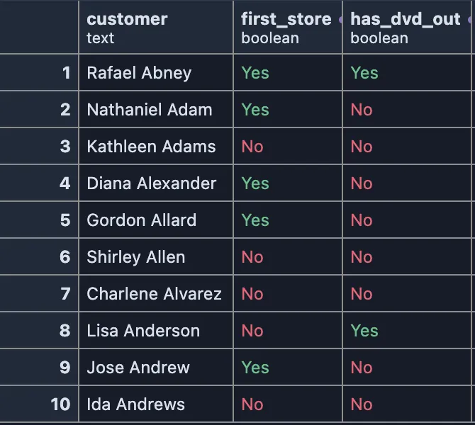
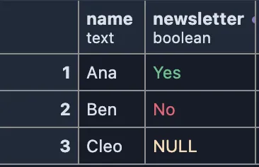

# Booleans

True and false read as a green **Yes** and a red **No**, in every boolean column.



Two questions about each customer of the dvdrental shop, answered by the query as `true` or `false`. PostgreSQL sends them as `t` and `f`; here they read Yes and No, so the customers who still have a DVD at home (Rafael Abney, Lisa Anderson) stand out at once.

## What it is for

- **Flags in your tables**: active, verified, paid, deleted, is_admin. A column of green and red reads faster than a column of `t` and `f`.
- **Yes or no questions you ask in a query**: `exists (...)`, `amount > 100`, `email is null`. Each one becomes a column you can scan.
- **Checking a migration**: a column that should be all Yes shows its red rows at a glance.

## Try it

**Who signed up for the newsletter**, on any connection, with made-up data. Cleo never answered, so her value is NULL:

```sql
-- @extension booleans
select name, newsletter
from (values ('Ana', true), ('Ben', false), ('Cleo', null)) as t(name, newsletter);
```



A NULL is not a No: it stays the grid's own NULL, so "never answered" and "said no" stay apart.

The picture at the top is this query, in the [dvdrental](https://neon.com/postgresql/postgresql-getting-started/postgresql-sample-database) sample database:

```sql
-- @extension booleans
select c.first_name || ' ' || c.last_name as customer,
       c.store_id = 1 as first_store,
       exists (select 1 from rental r
               where r.customer_id = c.customer_id and r.return_date is null) as has_dvd_out
from customer c
order by c.last_name
limit 10;
```

## Settings

None. Every column of type `boolean` reads this way, whatever it is called.

## Good to know

- Copying cells from the grid copies them as they read (`Yes`, `No`); **Save As** writes the server's own `t` and `f` to the file.
- The green and red are the theme's own colours, so a theme extension repaints them.
- To use it, put `-- @extension booleans` above a query (in the file header it covers every query in the file), or pick it from a result's own menu.

## Requirements

PostgreSQL 13 or newer. Runs in the grid alone; nothing is sent to the server.
