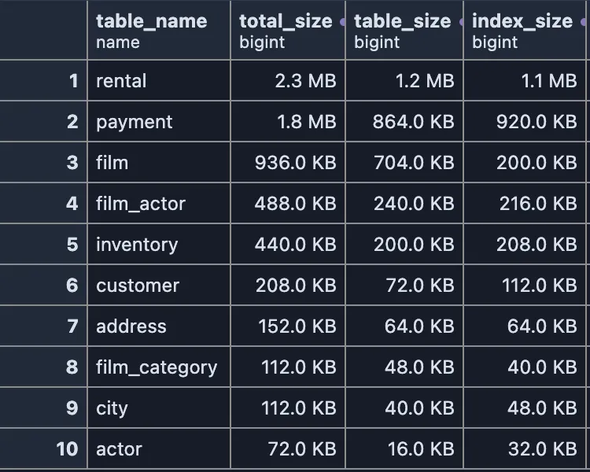
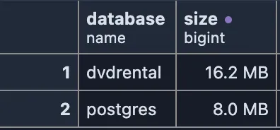

# Byte sizes

Byte counts read as KB, MB and GB, in every number column whose name ends in `size` or `bytes`.



The ten largest tables of the dvdrental database. PostgreSQL's size functions answer in bytes (`2408448`); here they read `2.3 MB`. The rental table is the largest, and nearly half of it is indexes (1.1 MB of 2.3 MB). The payment table carries more index (920 KB) than data (864 KB).

## What it is for

- **Where the disk goes**: which tables, indexes or databases are big, without counting digits.
- **Before and after a cleanup**: a `VACUUM FULL`, a dropped index or an archived year, measured in sizes you can say out loud.
- **File and upload sizes** stored in your own tables (`file_size`, `attachment_bytes`), read the way a file manager shows them.

## Try it

**How big each database on the server is**, on any connection:

```sql
-- @extension byte-sizes
select datname as database,
       pg_database_size(datname) as size
from pg_database
where not datistemplate
order by size desc;
```



The picture at the top is this query, in the [dvdrental](https://neon.com/postgresql/postgresql-getting-started/postgresql-sample-database) sample database:

```sql
-- @extension byte-sizes
select c.relname as table_name,
       pg_total_relation_size(c.oid) as total_size,
       pg_relation_size(c.oid) as table_size,
       pg_indexes_size(c.oid) as index_size
from pg_class c
where c.relkind = 'r'
  and c.relnamespace = 'public'::regnamespace
order by total_size desc
limit 10;
```

`total_size` is the table with its indexes and its TOAST storage (where long values live), `table_size` the rows alone, `index_size` the indexes alone.

## Settings

None. A column is picked by its name: it must end in `size` or `bytes` (any case) and hold a whole or decimal number.

## Good to know

- The steps are of 1024: 1 KB is 1024 bytes, 1 MB is 1024 KB, up to PB. Below 1 KB the value reads in bytes (`512 B`); above, with one decimal (`8.0 KB`).
- The column is picked by name, so name it in the query: `pg_total_relation_size(oid) as total_size`. A number that is not bytes but ends in `size` (a `shoe_size`, a `page_size` in rows) would read as bytes too; name it differently or leave the extension off that query.
- Copying cells from the grid copies them as they read (`2.3 MB`); **Save As** writes the exact byte counts to the file. The cells are right aligned so sizes line up.
- To use it, put `-- @extension byte-sizes` above a query (in the file header it covers every query in the file), or pick it from a result's own menu.
- PostgreSQL's own `pg_size_pretty()` does the same in SQL, as text. Byte sizes keeps the column a number, so it still sorts by size in the grid.

## Requirements

PostgreSQL 13 or newer. Runs in the grid alone; nothing is sent to the server.
