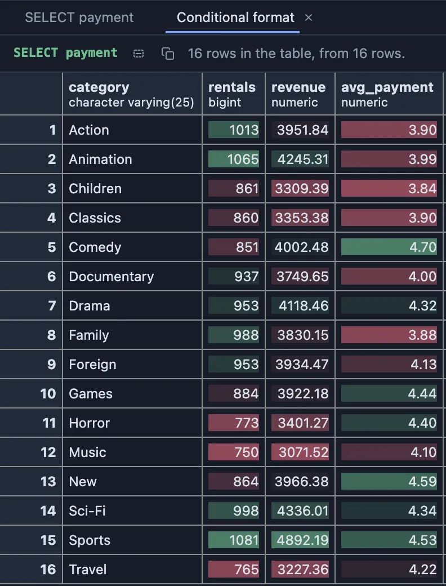
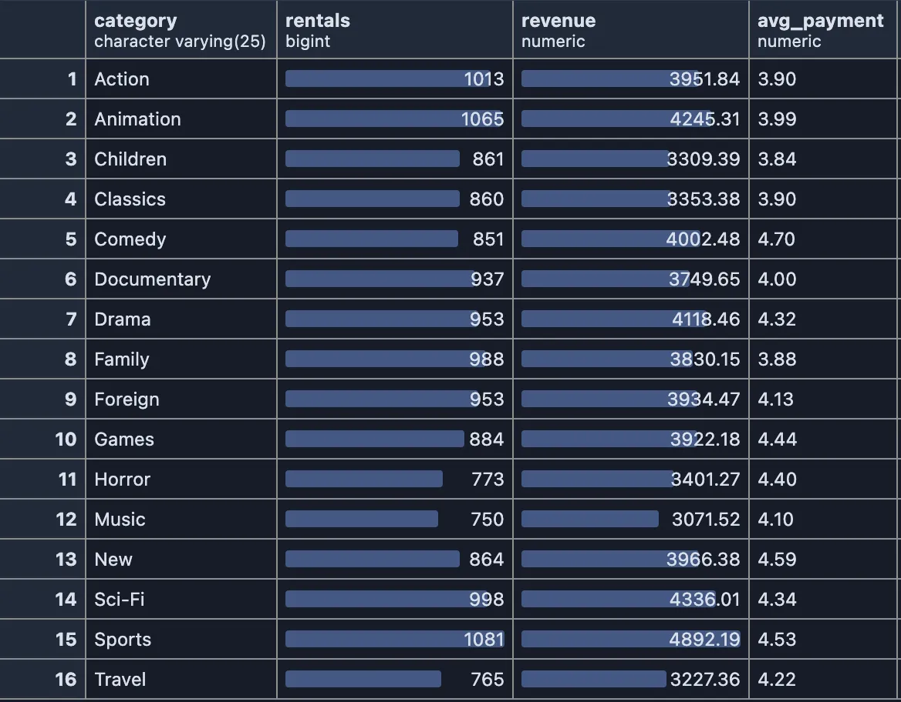
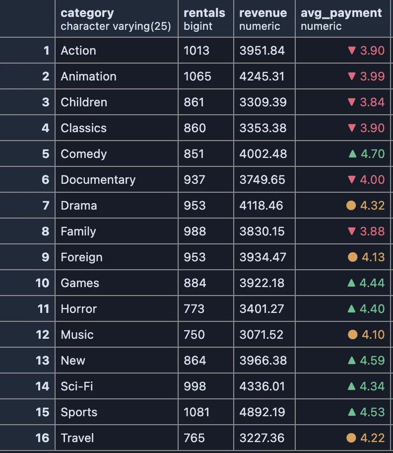
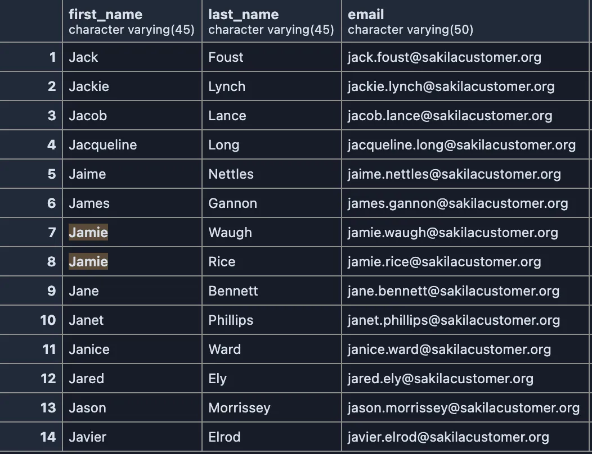

# Conditional format

Colour the cells of a result by their value, like a spreadsheet's Conditional Formatting: colour scales, data bars, arrows, the top or bottom values, values above or below average, and duplicates.



Rentals, revenue and average payment of each film category in the dvdrental shop, each column coloured on its own scale: red for its lowest values, green for its highest, the middle left dark. Sports is green for rentals and revenue; Music and Travel are red in both. Comedy is red in rentals but the greenest in average payment: fewer customers, who pay more each time.

## What it is for

- **Seeing the highs and lows of a table at a glance**: sales by region, response times by endpoint, sizes by table.
- **Comparing several columns of one row**: a category that is red in one column and green in another tells a story (Comedy above).
- **Finding repeated values**: the same e-mail twice, two orders with one number, names that were entered twice.

## Try it

The table opens as a **Conditional format** tab beside the result, a coloured copy of it. All the examples run in the [dvdrental](https://neon.com/postgresql/postgresql-getting-started/postgresql-sample-database) sample database. The picture at the top is a colour scale:

```sql
-- @extension conditional-format open
-- @inputs columns=rentals, revenue, avg_payment, style=color scale
select c.name as category,
       count(*) as rentals,
       sum(p.amount) as revenue,
       round(avg(p.amount), 2) as avg_payment
from payment p
     join rental r using (rental_id)
     join inventory i using (inventory_id)
     join film_category fc using (film_id)
     join category c using (category_id)
group by c.name
order by c.name;
```

**Data bars** on the same query (`-- @inputs columns=rentals, revenue, style=data bars`): a bar behind each number, as long as its share of the column's largest value.



**An icon set** on the average payment (`-- @inputs columns=avg_payment, style=icon set`): a green ▲ for the top third of the values, an amber ● for the middle third, a red ▼ for the bottom third.



**Duplicates** in a text column: which first names appear more than once among the customers whose name starts with J.

```sql
-- @extension conditional-format open
-- @inputs columns=first_name, style=duplicates
select first_name, last_name, email
from customer
where first_name like 'J%'
order by first_name
limit 14;
```



## Settings

| Setting | `@inputs` key | Default | What it does |
|---|---|---|---|
| Columns | `columns` | asked | The columns to colour, as a comma list. Every style but duplicates needs number columns and leaves others alone |
| Style | `style` | color scale | `color scale`, `data bars`, `icon set`, `top 10`, `bottom 10`, `above average`, `below average` or `duplicates` |
| Colours | `scheme` | red-green | For a colour scale: `red-green` (low red, high green), `green-red` (the other way round, for costs and delays), or `accent` (from faint to strong in one colour) |
| N | `n` | 10 | For top 10 and bottom 10: how many values are marked |

The styles in plain words:

- **color scale**: each cell coloured by where its value sits between the column's lowest and highest.
- **data bars**: a bar behind the number, its length the value's share of the largest one; a negative value's bar is red.
- **icon set**: ▲ for the top third, ● for the middle third, ▼ for the bottom third.
- **top 10** and **bottom 10**: the N largest or smallest values marked; values tied at the edge are all marked.
- **above average** and **below average**: the values above or below the column's average marked.
- **duplicates**: every value that appears more than once in its column marked; works on text too.

## Good to know

- Each column is judged on its own: its own lowest, highest, thirds and average, over every row of the result.
- The colours come from the theme, so a theme extension repaints them.
- The tab is a copy: the cells keep their values, so sorting, filtering and copying read the data, not the paint. The result itself stays as it was; to colour the result in place by one condition, use **Highlight**.
- Data bars start at zero, so values close together (750 and 1081) get bars of similar length; widen the column (drag the right edge of its header) for longer bars.
- The tab lists the first 100,000 rows; the thresholds still read every row.
- It can follow another table view: `-- @extension pivot | conditional-format` colours a pivot table like a heat map.

## Requirements

PostgreSQL 13 or newer. Nothing runs on the server: the colours are computed in the result's sandbox from the rows already fetched. Stats core installs with it.
