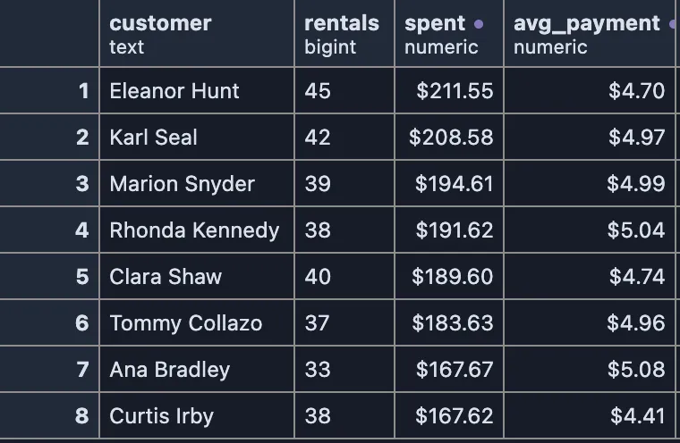
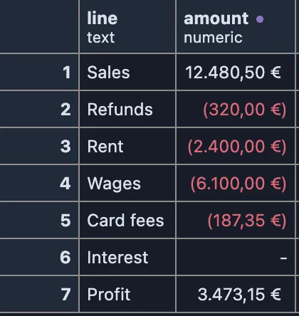

# Currency

Amount columns read as money: the currency, the way of writing it and the columns are yours to pick, negatives in parentheses if you like.



The dvdrental shop's best customers. The query answers `211.55`; with Currency set to US dollars it reads `$211.55`, two decimals always, right aligned so the amounts line up. Eleanor Hunt spent the most, but Ana Bradley pays the most per rental ($5.08).

## What it is for

- **Sales, invoices, salaries and prices**: amounts that read as money, in your currency and your way of writing numbers.
- **A ledger or a profit and loss table**: the accounting style puts negatives in parentheses and writes a zero as a dash, as an accountant expects.
- **Sharing a screen or a screenshot** with someone who reads `1.234,56 €`, not `1234.56`.

## Try it

**A month of a small shop in euros**, the accounting way, on any connection with made-up data:

```sql
-- @extension currency
-- @inputs columns=amount, currency=EUR, locale=European, 1.234,56 €, style=in parentheses (accounting)
select line, amount
from (values ('Sales', 12480.50), ('Refunds', -320.00), ('Rent', -2400.00), ('Wages', -6100.00),
             ('Card fees', -187.35), ('Interest', 0.00), ('Profit', 3473.15)) as t(line, amount);
```



Every cost is in red and in parentheses, the zero interest is a dash, and the digits of every row line up: the positive amounts keep an invisible closing parenthesis for that.

The picture at the top is this query, in the [dvdrental](https://neon.com/postgresql/postgresql-getting-started/postgresql-sample-database) sample database:

```sql
-- @extension currency
-- @inputs columns=spent, avg_payment, currency=USD, locale=English, €1,234.56
select c.first_name || ' ' || c.last_name as customer,
       count(*) as rentals,
       sum(p.amount) as spent,
       round(avg(p.amount), 2) as avg_payment
from payment p
     join customer c using (customer_id)
group by c.customer_id
order by spent desc
limit 8;
```

## Settings

| Setting | `@inputs` key | Default | What it does |
|---|---|---|---|
| Columns | `columns` | the columns named amount, price, cost, total, balance, salary or fee that the result has | Which columns are money, as a comma list |
| Currency | `currency` | EUR | The three letter currency code: EUR, USD, GBP, CHF, JPY and every other ISO code. Empty: a plain number with two decimals |
| Written | `locale` | Your locale | Where the symbol goes and how thousands and decimals are marked: `European, 1.234,56 €`, `English, €1,234.56`, `Swiss, 1’234.56`, `French, 1 234,56 €`, or your computer's own way |
| Negatives | `style` | with a minus | `with a minus` (in red), or `in parentheses (accounting)`, which also writes a zero as a dash |

**Configure Currency…** in the result's menu changes the answers; tick **Save in the script** there to keep them as the `-- @inputs` line above the query.

## Good to know

- Hovering a cell shows the server's own value. Copying cells from the grid copies them as they read (`$211.55`); **Save As** writes the server's own values to the file.
- A `money` column is read in the server's own shape first (`$1,234.50`, `1.234,50 €`, whatever the server's `lc_monetary` says), then written your way.
- The currency's own number of decimals is used: yen have none, euros and dollars two.
- An empty cell and a NULL stay as they are. A value that is not a number is left alone.
- PlumeSQL sizes a column by the server's text, and the symbol makes the formatted text a little wider. If a value is cut, double-click the right edge of the column's header to fit it.
- To use it, put `-- @extension currency` above a query (in the file header it covers every query in the file), or pick it from a result's own menu.

## Requirements

PostgreSQL 13 or newer. Runs in the grid alone; nothing is sent to the server.
