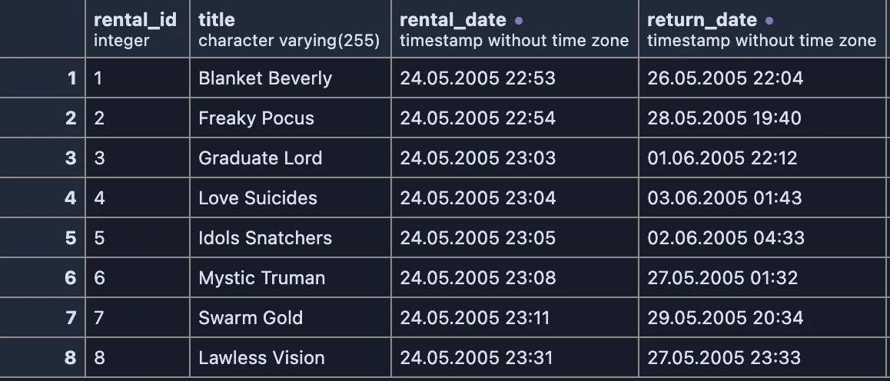
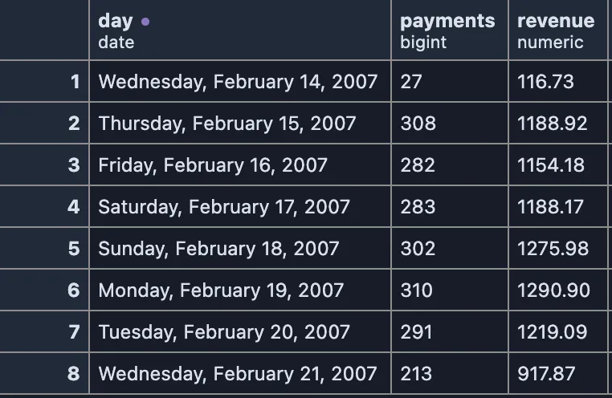

# Date format

Every date and timestamp column reads the way you pick: ISO, European, US, long, short, with the weekday, month and year, date only, time only or your computer's own way.



The first rentals of the dvdrental shop. PostgreSQL sends a timestamp as `2005-05-24 22:53:30`; with the European format it reads `24.05.2005 22:53`, the way a reader in Zagreb, Berlin or Vienna writes it. The return dates show at once how long each DVD stayed out: Love Suicides went out on 24 May and came back on 3 June.

## What it is for

- **Reading dates the way your country writes them**, or the way the person you share the screen with does.
- **Finding the weekday** behind a date: which days of the week the orders, the incidents or the deploys fall on.
- **Cutting the noise**: a month and year for a report by month, the time alone for a log of one day.

## Try it

**The first week of payments, with the weekday**, in the [dvdrental](https://neon.com/postgresql/postgresql-getting-started/postgresql-sample-database) sample database:

```sql
-- @extension date-format
-- @inputs format=Weekday, Wednesday, September 23, 2026
select payment_date::date as day,
       count(*) as payments,
       sum(amount) as revenue
from payment
where payment_date < '2007-02-22'
group by 1
order by 1;
```



The first day was a slow Wednesday (27 payments, it started late in the evening); from Thursday on the shop took close to 300 payments a day, the weekend included.

The picture at the top is this query:

```sql
-- @extension date-format
-- @inputs format=European, 23.09.2026 11:15
select r.rental_id, f.title, r.rental_date, r.return_date
from rental r
     join inventory i using (inventory_id)
     join film f using (film_id)
order by r.rental_id
limit 8;
```

## Settings

| Setting | `@inputs` key | Default | What it does |
|---|---|---|---|
| Format | `format` | `ISO, 2026-09-23 11:15:03` | How every date and timestamp column reads. Write the option whole, as the list shows it |

The formats, and how a timestamp reads in each:

| Format | A timestamp reads | A date reads |
|---|---|---|
| `ISO, 2026-09-23 11:15:03` | 2026-09-23 11:15:03 | 2026-09-23 |
| `European, 23.09.2026 11:15` | 23.09.2026 11:15 | 23.09.2026 |
| `US, 9/23/2026, 11:15 AM` | 9/23/2026, 11:15 AM | 9/23/2026 |
| `Long, September 23, 2026` | September 23, 2026 at 11:15 AM | September 23, 2026 |
| `Short, Sep 23, 2026` | Sep 23, 2026, 11:15 AM | Sep 23, 2026 |
| `Weekday, Wednesday, September 23, 2026` | Wednesday, September 23, 2026 at 11:15 AM | Wednesday, September 23, 2026 |
| `Month and year, Sep 2026` | Sep 2026 | Sep 2026 |
| `Date only, 2026-09-23` | 2026-09-23 | 2026-09-23 |
| `Time only, 11:15:03` | 11:15:03 | 2026-09-23 (a date has no time) |
| `Your locale` | your computer's own way and clock | your computer's own way |

Without an answer it reads ISO. **Configure Date format…** in the result's menu changes it; tick **Save in the script** there to keep it as the `-- @inputs` line above the query.

## Good to know

- One rule covers every `date`, `timestamp` and `timestamptz` column of the result, whatever it is called.
- A `date` stays the day it names, in every time zone. A `timestamp` without a zone is read as it is written; a `timestamptz` is shown in your computer's time zone.
- Hovering a cell shows the server's own text. Copying cells from the grid copies them as they read; **Save As** writes the server's own text to the file.
- Long formats are wider than the server's text, and PlumeSQL sizes a column by the server's text: if a date is cut, double-click the right edge of the column's header to fit it.
- **Time ago** is the other way to read a timestamp: `3 hours ago`, `in 2 days`.
- To use it, put `-- @extension date-format` above a query (in the file header it covers every query in the file), or pick it from a result's own menu.

## Requirements

PostgreSQL 13 or newer. Runs in the grid alone; nothing is sent to the server.
