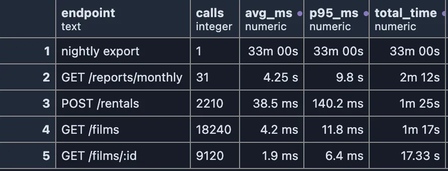
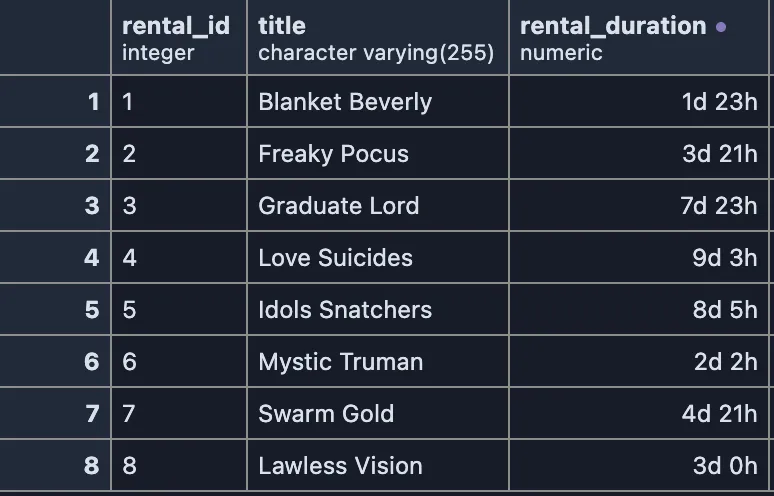

# Duration

Milliseconds read as time you can say: `38.5 ms`, `4.25 s`, `2m 12s`, `33m 00s`, `1d 23h`.



A web app's endpoints and how long they take, in milliseconds as most tools log them. Read raw, `1980000` and `76608` say little; here the nightly export reads `33m 00s`, and the film list, at 4.2 ms a call, still adds up to `1m 17s` of work because it is called 18,240 times.

## What it is for

- **Query and request timings**: `pg_stat_statements`, your app's logs, a benchmark, all in milliseconds.
- **How long things took**: a job's run time, a rental, a support ticket, once turned into milliseconds.
- **Spotting the slow one**: `33m 00s` among `ms` values stands out where `1980000` among `38.5` does not.

## Try it

**How long each DVD stayed out**, in the [dvdrental](https://neon.com/postgresql/postgresql-getting-started/postgresql-sample-database) sample database. The return time minus the rental time is an interval; `extract(epoch from ...)` makes it seconds, and `* 1000` milliseconds:

```sql
-- @extension duration
select r.rental_id, f.title,
       extract(epoch from r.return_date - r.rental_date) * 1000 as rental_duration
from rental r
     join inventory i using (inventory_id)
     join film f using (film_id)
where r.return_date is not null
order by r.rental_id
limit 8;
```



Love Suicides stayed out longest of these eight, 9 days and 3 hours.

The picture at the top is this query, on any connection with made-up data:

```sql
-- @extension duration
select endpoint, calls, avg_ms, p95_ms, calls * avg_ms as total_time
from (values ('GET /films', 18240, 4.2, 11.8),
             ('GET /films/:id', 9120, 1.9, 6.4),
             ('POST /rentals', 2210, 38.5, 140.2),
             ('GET /reports/monthly', 31, 4250, 9800),
             ('nightly export', 1, 1980000, 1980000)) as t(endpoint, calls, avg_ms, p95_ms)
order by total_time desc;
```

## Settings

None. A column is picked by its name: it must end in `_ms`, `_time`, `duration`, `elapsed` or `latency` (any case) and hold a number of **milliseconds**.

## How it reads

| Milliseconds | Reads |
|---|---|
| under a second | `38.5 ms` |
| under a minute | `4.25 s` |
| under an hour | `2m 12s` |
| under a day | `1h 30m` |
| a day or more | `1d 23h` |

A negative duration keeps its minus sign.

## Good to know

- The value must be milliseconds. A column of seconds named `duration` reads a thousand times too short: multiply it in the query (`elapsed_s * 1000 as elapsed`), or name it so it does not match.
- `pg_stat_statements` reports its times in milliseconds (`total_exec_time`, `mean_exec_time`), so its `_time` columns read right as they are.
- Hovering a cell shows the number with `ms`. Copying cells from the grid copies them as they read (`2m 12s`); **Save As** writes the numbers to the file. The cells are right aligned.
- To use it, put `-- @extension duration` above a query (in the file header it covers every query in the file), or pick it from a result's own menu.

## Requirements

PostgreSQL 13 or newer. Runs in the grid alone; nothing is sent to the server.
