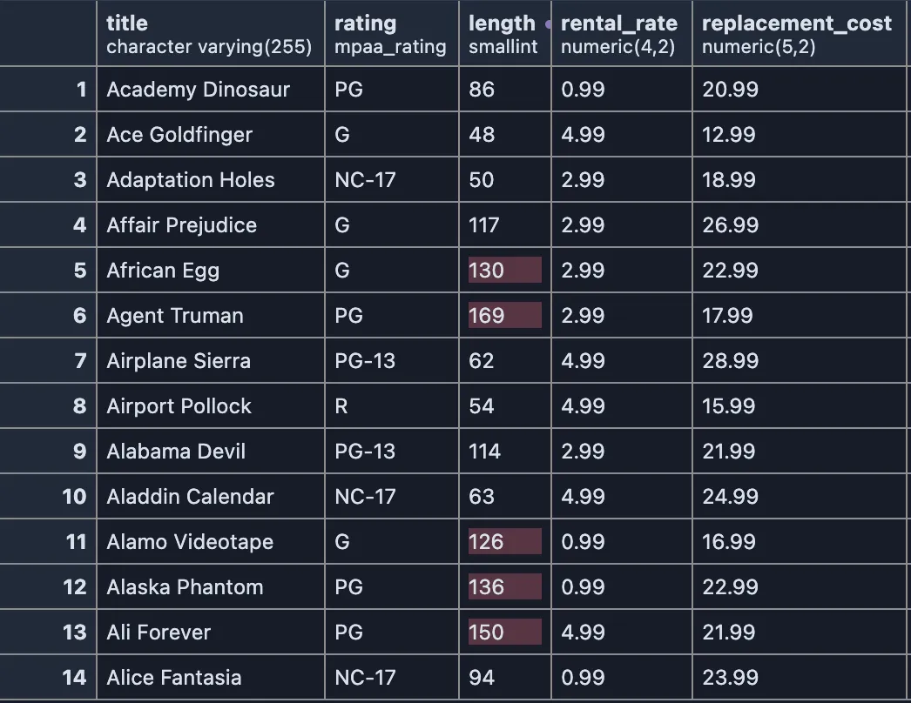
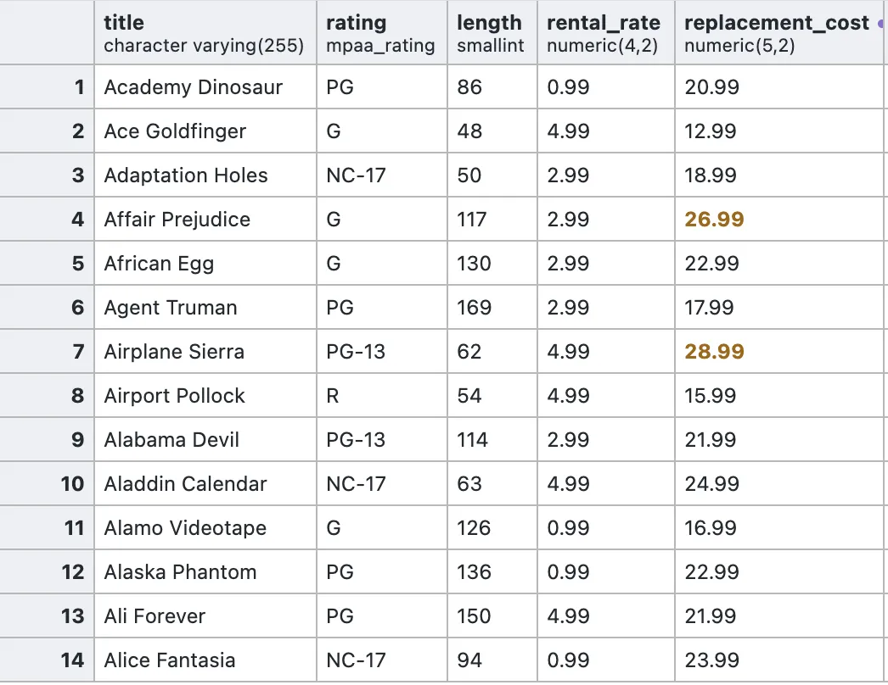

# Highlight

Colour the cells that meet a condition, right in the result: films longer than two hours, a status that contains "cancel", a date between two days.



The first films of the dvdrental catalogue, with every film longer than two hours (120 minutes) filled in red. Five of these fourteen run longer; Agent Truman is the longest at 169 minutes. The other cells are left as they were.

## What it is for

- **Spotting what crosses a line**: orders above a limit, response times above a target, stock below a minimum.
- **Finding text in a column**: every status that contains `cancel`, every e-mail that ends in a domain, every name that starts with a letter.
- **Checking a range**: dates inside a week, prices between two values, readings outside what is normal.

## Try it

**The films that cost the most to replace**, in the [dvdrental](https://neon.com/postgresql/postgresql-getting-started/postgresql-sample-database) sample database: a replacement cost between 25 and 30, in bold amber text.

```sql
-- @extension highlight
-- @inputs columns=replacement_cost, when=between, value=25, and=30, colour=amber, style=bold text
select title, rating, length, rental_rate, replacement_cost
from film
order by title
limit 14;
```



The picture at the top is the same query with:

```sql
-- @extension highlight
-- @inputs columns=length, when=greater than, value=120
```

## Settings

| Setting | `@inputs` key | Default | What it does |
|---|---|---|---|
| Columns | `columns` | asked | The columns whose cells are checked, one or several, as a comma list |
| Highlight when | `when` | greater than | `greater than`, `less than`, `between`, `equal to`, `not equal to`, `contains`, `starts with`, `is empty`, `is not empty` |
| Value | `value` | none | What a cell is compared with: a number, a date written as `2026-09-01`, or text |
| And (for between) | `and` | none | The upper end for `between`; both ends count |
| Colour | `colour` | red | A theme colour (`red`, `amber`, `green`, `accent`, `violet`) or any colour written as `#rrggbb` |
| Style | `style` | fill | `fill` (the cell's background), `text` (the text in the colour) or `bold text` |

Without a `-- @inputs` line PlumeSQL asks for the columns the first time the query runs. **Configure Highlight…** in the result's menu changes the answers; tick **Save in the script** there to keep them as the `-- @inputs` line above the query.

## Good to know

- Numbers compare as numbers. Dates and timestamps compare as they read (`2026-09-01`, `2026-09-01 10:00`), and text compares as text. `contains` and `starts with` ignore upper and lower case.
- A NULL meets only `is empty`.
- A theme colour is the theme's own, so a theme extension repaints it; a `#rrggbb` colour stays as you picked it. Hover a coloured cell to see the condition it met.
- One condition per query. For colour scales, data bars, arrows, top N or duplicates, which compare a cell with the rest of its column, use **Conditional format**.
- A column you pick wears the highlight instead of a formatter that reads columns by their type (a date format, say).
- To use it, put `-- @extension highlight` above a query (in the file header it covers every query in the file), or pick it from a result's own menu.

## Requirements

PostgreSQL 13 or newer and PlumeSQL 0.22.0 or newer. Runs in the grid alone; nothing is sent to the server.
