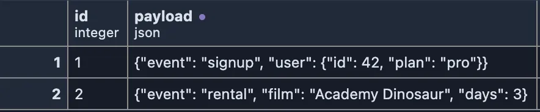
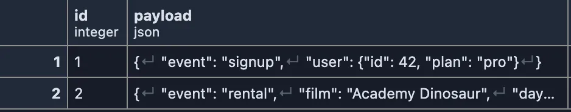

# JSON

A `json` or `jsonb` column reads on one compact line, and hovering a cell shows the document laid out with indentation.



Two events an app stored as `json`. The app wrote them pretty-printed, over several lines, and a `json` column keeps those line breaks: in the grid they show as `↵` marks and push the end of the document out of sight. With JSON each document reads as one line; hover a cell to read it laid out.

Without the extension, the same two cells:



## What it is for

- **Event logs, API payloads and settings** stored as `json`: one document per line, readable down the column.
- **Reading a long document** without opening it: the hover lays it out with indentation, nested objects included.
- **Checking what an app wrote** before you query into it with `->` and `->>`.

## Try it

The picture at the top, on any connection with made-up data:

```sql
-- @extension json
select id, payload
from (values (1, '{
  "event": "signup",
  "user": {"id": 42, "plan": "pro"}
}'::json),
             (2, '{
  "event": "rental",
  "film": "Academy Dinosaur",
  "days": 3
}'::json)) as t(id, payload);
```

**Films as documents**, in the [dvdrental](https://neon.com/postgresql/postgresql-getting-started/postgresql-sample-database) sample database. `jsonb_build_object` builds one document per film; hover a `details` cell to read it with its actors one per line:

```sql
-- @extension json
select f.title,
       jsonb_build_object('rating', f.rating, 'length', f.length, 'features', f.special_features,
                          'actors', (select jsonb_agg(a.first_name || ' ' || a.last_name)
                                     from film_actor fa join actor a using (actor_id)
                                     where fa.film_id = f.film_id)) as details
from film f
order by f.title
limit 10;
```

A `jsonb` value already comes from the server on one line, so for `jsonb` the cell reads as before and the hover is what the extension adds.

## Settings

None. Every column of type `json` or `jsonb` reads this way.

## Good to know

- Only the spaces and line breaks between the parts of the document go; a string's own spaces and every number's digits stay exactly as stored.
- A line wider than the column ends in `…`; the hover holds the whole document.
- Copying cells from the grid copies the whole compact line, still valid JSON; **Save As** writes the server's own text to the file, line breaks included.
- A value that is not valid JSON is shown as it is.
- For one document read whole, the grid's own peek (Space on a cell) shows it in full; to turn a document's keys into columns, **JSON to columns** does that.
- To use it, put `-- @extension json` above a query (in the file header it covers every query in the file), or pick it from a result's own menu.

## Requirements

PostgreSQL 13 or newer. Runs in the grid alone; nothing is sent to the server.
