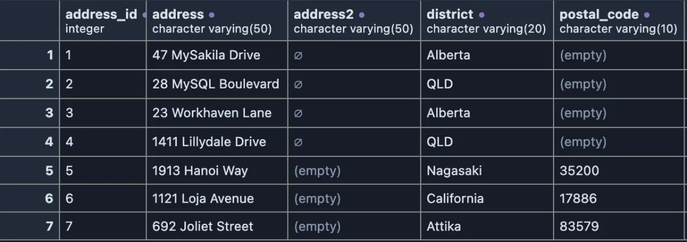
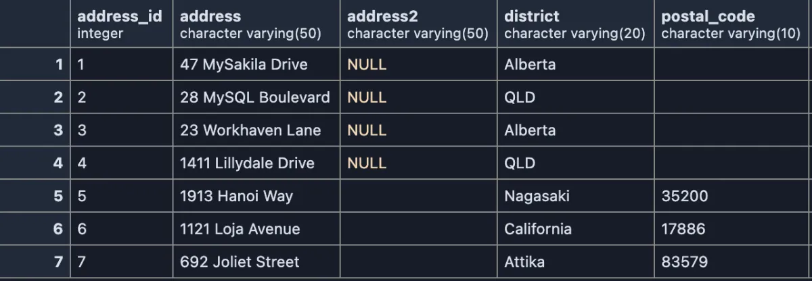

# Nulls

A missing value and an empty one look different: NULL reads as a dimmed `∅`, an empty string as a dimmed `(empty)`, in every column.



The first addresses of the dvdrental database. The second address line of addresses 1 to 4 (the shop's and the staff's) was never filled in: it is NULL. Every customer's address has one too, but as an empty string. And addresses 1 to 4 have an empty postal code. With Nulls each kind of nothing has its own mark.

Without the extension, the same rows: NULL reads `NULL`, and an empty string is a blank cell you cannot tell from a cell of spaces:



## What it is for

- **Data quality checks**: is a field missing (NULL) or filled with nothing (`''`)? The two behave differently in `WHERE x IS NULL` and `WHERE x = ''`, and in `count(x)`.
- **Imports and forms**: a CSV import or a web form often writes `''` where the database designer expected NULL. This makes it visible.
- **Quieter grids**: a result full of NULLs reads calmer when they are dimmed.

## Try it

The pictures above, in the [dvdrental](https://neon.com/postgresql/postgresql-getting-started/postgresql-sample-database) sample database:

```sql
-- @extension nulls
select address_id, address, address2, district, postal_code
from address
order by address_id
limit 7;
```

To count each kind of nothing in a column:

```sql
select count(*) filter (where address2 is null) as missing,
       count(*) filter (where address2 = '') as empty
from address;
```

dvdrental answers 4 missing and 599 empty.

## Settings

None. Every column of the result is covered.

## Good to know

- The marks are only the cells' face: copying a cell still copies a NULL or an empty string, never `∅` or `(empty)`, and **Save As** writes them as they are.
- A column that another formatter dresses (a currency, a date format) wears that formatter instead: a column wears one formatter at a time, and Nulls, which covers every column, gives way to one aimed at a column.
- A string of spaces is not empty: it is shown as it is.
- To use it, put `-- @extension nulls` above a query (in the file header it covers every query in the file), or pick it from a result's own menu.

## Requirements

PostgreSQL 13 or newer. Runs in the grid alone; nothing is sent to the server.
