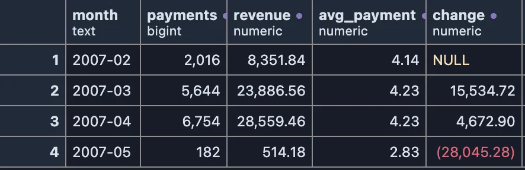
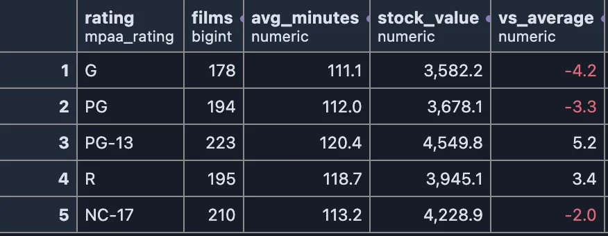

# Numbers

Every number column reads your way: thousands separated, a fixed number of decimals, negatives in red or in parentheses.



The dvdrental shop's payments by month. Read raw, the average payment is `4.1427777777777778` and the change in May is `-28045.28`. Here every amount has two decimals and its thousands separated, the counts stay whole numbers, and the drop of 28,045.28 in May (the data ends in mid May) is in red parentheses, the way a finance report writes a loss.

## What it is for

- **Reports and totals** that someone else reads: `23,886.56` instead of `23886.56`, and no averages with sixteen decimals.
- **Spotting what went down**: a change, a balance or a margin with its negatives in red or in parentheses.
- **Big numbers**: rows, bytes, visits and money with the thousands marked, so a million reads as a million.

## Try it

**Each rating of the dvdrental films against the average length**, one decimal, negatives in red:

```sql
-- @extension numbers
-- @inputs decimals=1, negatives=in red
select rating,
       count(*) as films,
       avg(length) as avg_minutes,
       sum(replacement_cost) as stock_value,
       avg(length) - (select avg(length) from film) as vs_average
from film
group by rating
order by rating;
```



G and PG films run about 4 and 3 minutes shorter than the average film, PG-13 films 5 minutes longer. The film counts stay whole numbers: a fixed number of decimals applies only to columns that can hold decimals.

The picture at the top is this query, in the [dvdrental](https://neon.com/postgresql/postgresql-getting-started/postgresql-sample-database) sample database:

```sql
-- @extension numbers
-- @inputs decimals=2, negatives=in parentheses
select to_char(date_trunc('month', payment_date), 'YYYY-MM') as month,
       count(*) as payments,
       sum(amount) as revenue,
       avg(amount) as avg_payment,
       sum(amount) - lag(sum(amount)) over (order by date_trunc('month', payment_date)) as change
from payment
group by date_trunc('month', payment_date)
order by 1;
```

## Settings

| Setting | `@inputs` key | Default | What it does |
|---|---|---|---|
| Thousands | `grouping` | `separated, 1,234,567` | `separated, 1,234,567` marks the thousands; `as sent, 1234567` leaves them unmarked |
| Decimals | `decimals` | `as sent` | `as sent` keeps the digits the server sent; `0` to `4` rounds every decimal column to that many |
| Negatives | `negatives` | `plain` | `plain` (with a minus), `in red`, or `in parentheses` (and in red) |

**Configure Numbers…** in the result's menu changes the answers; tick **Save in the script** there to keep them as the `-- @inputs` line above the query.

## Good to know

- It covers every number column of the result: `smallint`, `integer`, `bigint`, `numeric`, `real` and `double precision`. Whole-number columns (counts, ids) never get decimals.
- The separators follow your computer's language settings: `1,234.5` in English, `1.234,5` in German or Croatian.
- A rounded cell keeps its exact value on hover. Copying cells from the grid copies them as they read (`23,886.56`); **Save As** writes the server's own values to the file.
- The server's digits are formatted as they are, so a `bigint` beyond what JavaScript holds exactly (2^53) or a long `numeric` keeps every digit.
- A formatter that picks columns by name or by your answer (Currency, Byte sizes, Percent) wins the columns it picks; Numbers reads the rest.
- To use it, put `-- @extension numbers` above a query (in the file header it covers every query in the file), or pick it from a result's own menu.

## Requirements

PostgreSQL 13 or newer. Runs in the grid alone; nothing is sent to the server.
