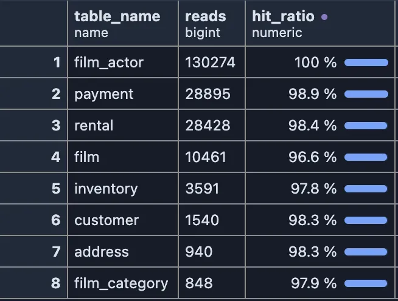
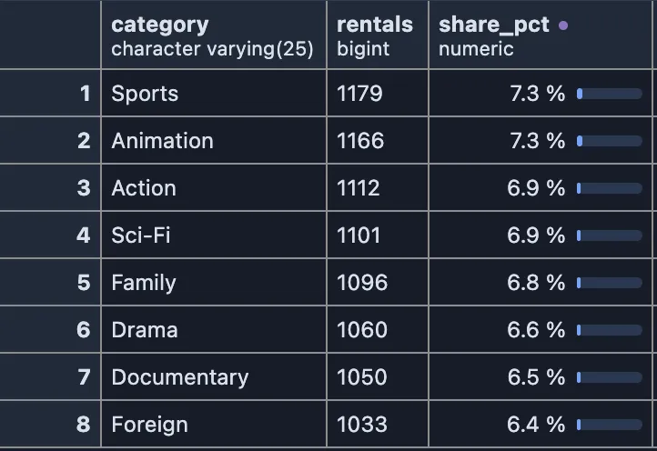

# Percent

Percentages and ratios read as `98.4 %` with a small bar, in every number column whose name ends in `pct`, `percent`, `ratio`, `rate` or `share`.



How often PostgreSQL found each table's data already in memory instead of reading it from disk, for the busiest tables of the dvdrental database. The query computes a fraction (`0.9840`); Percent reads it as `98.4 %` with a bar, so a table that falls behind stands out. Here every table is above 96 %: this small database fits in memory.

## What it is for

- **Shares of a whole**: each category's share of sales, each region's share of users.
- **Rates and ratios** from monitoring: cache hit ratio, error rate, disk usage, conversion rate.
- **Progress**: a migration or a backfill that is 37 % done.

## Try it

**Each film category's share of all rentals**, in the [dvdrental](https://neon.com/postgresql/postgresql-getting-started/postgresql-sample-database) sample database. The query already computes percent (`7.3`), and the column's name says so (`share_pct`):

```sql
-- @extension percent
select c.name as category,
       count(*) as rentals,
       round(100.0 * count(*) / sum(count(*)) over (), 1) as share_pct
from rental r
     join inventory i using (inventory_id)
     join film_category fc using (film_id)
     join category c using (category_id)
group by c.name
order by rentals desc
limit 8;
```



No category dominates: the most rented, Sports, has 7.3 % of all rentals, so the bars are short and close to one another. That is the answer: the shop's customers spread their rentals evenly.

The picture at the top is this query, on any database:

```sql
-- @extension percent
select relname as table_name,
       heap_blks_hit + heap_blks_read as reads,
       round(heap_blks_hit::numeric / nullif(heap_blks_hit + heap_blks_read, 0), 4) as hit_ratio
from pg_statio_user_tables
order by reads desc
limit 8;
```

## Settings

None. A column is picked by its name and holds a number.

## How it reads a value

- A column whose name ends in `pct`, `percent` or `percentage` already holds percent: `7.3` reads `7.3 %`, and `0.4` reads `0.4 %`.
- A column whose name ends in `ratio`, `rate` or `share` holds a fraction when the value is between -1 and 1: `0.984` reads `98.4 %`. A larger value is taken as percent already.
- The bar is the value's part of 100 %.

## Good to know

- The column is picked by its name, so name it in the query (`as hit_ratio`). A column that ends in `rate` but is not a rate at all (dvdrental's `rental_rate` is a price) would read as a percentage too: leave the extension off that query, or rename the column.
- Hovering a cell shows the server's own value. Copying cells from the grid copies them as they read (`98.4 %`); **Save As** writes the server's own values to the file.
- PlumeSQL sizes a column by the server's text, which leaves no room for the bar: drag the right edge of the column's header wider to see the bars. The number always shows first; a narrow column cuts the bar, never the number.
- The bar is drawn in the theme's accent colour, so a theme extension repaints it.
- To use it, put `-- @extension percent` above a query (in the file header it covers every query in the file), or pick it from a result's own menu.

## Requirements

PostgreSQL 13 or newer. Runs in the grid alone; nothing is sent to the server.
