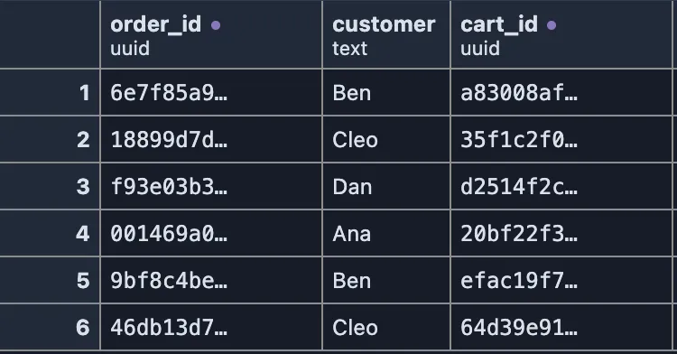

# Short UUID

UUID columns show their first eight characters, `6e7f85a9…`, and the whole id on hover.



Six orders of an app that keys everything by UUID. A full id (`6e7f85a9-d0fe-9b5d-fb50-4c6f2991d744`) is 36 characters and pushes the rest of the row out of sight; eight are enough to tell the rows apart and to recognise an id you have seen before.

## What it is for

- **Tables keyed by UUID**: users, orders, sessions, events. The ids stop crowding out the columns you came to read.
- **Following an id across results**: the first eight characters are usually enough to match a row in one result with a row in another.
- **Screenshots and screen sharing**: shorter ids, fewer characters to blur.

## Try it

The picture at the top, on any connection with made-up data (`md5(...)::uuid` makes the same ids on every run):

```sql
-- @extension short-uuid
select md5('order-' || n)::uuid as order_id,
       (array['Ana', 'Ben', 'Cleo', 'Dan'])[1 + n % 4] as customer,
       md5('cart-' || n)::uuid as cart_id
from generate_series(1, 6) as n;
```

## Settings

None. Every column of type `uuid` is shortened, whatever it is called.

## Good to know

- Only the face is short. Copying a cell copies the whole id, so it still finds the row when you paste it into a `WHERE` clause, and **Save As** writes the whole ids to the file. Hovering a cell shows the whole id.
- The ids are shown in a monospaced font, so they line up.
- A uuid stored as `text` is not shortened: cast it, `id::uuid`, to have it read short.
- PlumeSQL sizes the column by the whole id, so the column starts wide: drag the right edge of its header to make it narrow.
- To use it, put `-- @extension short-uuid` above a query (in the file header it covers every query in the file), or pick it from a result's own menu.

## Requirements

PostgreSQL 13 or newer. Runs in the grid alone; nothing is sent to the server.
