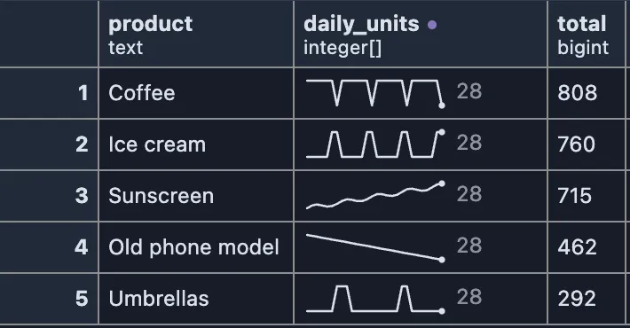

# Sparklines

A list of numbers reads as a small line chart in its cell: a month of daily sales per product, one line per row.



Four weeks of daily sales for five products of a made-up summer shop, each drawn as a small line in its row. The numbers alone would be 28 values per cell; the lines tell the story at once: coffee is steady with a dip every Sunday, ice cream jumps every weekend, sunscreen climbs as summer comes, the old phone model is on its way out, and umbrellas sell only on two rainy spells.

## What it is for

- **A trend per row**: daily sales per product, weekly sign-ups per country, hourly load per server, all in one result.
- **Comparing shapes**: which products grow, which are seasonal, which are fading, without a chart per product.
- **Monitoring at a glance**: the last 24 hours of a metric beside its current value.

## Try it

The lines come from an array column. `array_agg(... order by day)` gathers each row's values in order, one array per row. The picture at the top is this query, on any connection with made-up data:

```sql
-- @extension sparklines
select product,
       array_agg(units order by day) as daily_units,
       sum(units) as total
from (select p.product, d.day,
             greatest(0, round(case p.product
               when 'Sunscreen' then 5 + d.day * 1.5 + 4 * sin(d.day)
               when 'Umbrellas' then case when d.day in (6, 7, 8, 19, 20) then 40 else 4 end
               when 'Coffee' then case when d.day % 7 = 6 then 22 else 30 end
               when 'Ice cream' then 20 + case when extract(isodow from date '2026-06-01' + d.day) >= 6 then 25 else 0 end
               when 'Old phone model' then 30 - d.day
             end))::int as units
      from (values ('Sunscreen'), ('Umbrellas'), ('Coffee'), ('Ice cream'), ('Old phone model')) as p(product)
           cross join generate_series(0, 27) as d(day)) s
group by product
order by total desc;
```

On your own tables the shape is the same: group by what each row is about, and `array_agg` the measure ordered by time.

```sql
-- @extension sparklines
select product_id,
       array_agg(units order by day) as last_30_days
from daily_sales
where day > current_date - 30
group by product_id;
```

## Settings

None. Every column whose type is an array of numbers (`integer[]`, `bigint[]`, `numeric[]`, `real[]`, `double precision[]` and the like) is drawn.

## How to read it

- Each line runs left to right in the array's order, with a dot on the last value. The number beside it is how many values the array holds.
- Each line is scaled to its own lowest and highest value, so two rows compare in SHAPE, not in size: a flat line of big numbers and a flat line of small ones look alike. The `total` column (or the hover) gives the sizes.
- Hover a cell for the count, the lowest, the highest and the last value.

## Good to know

- An array longer than 40 values is averaged into 40 points, so the line keeps its shape in its 80 pixels; the hover still gives the real lowest, highest and last.
- A NULL inside an array is skipped; an empty array reads greyed out.
- The line takes the cell's text colour, so it reads in every theme.
- Copying a cell copies the array itself; **Save As** writes the arrays to the file.
- PlumeSQL sizes the column by the array's text, so it starts wide: drag the right edge of its header to make it narrow.
- **Arrays** reads arrays as lists of items instead. A column wears one formatter at a time, so attach one of the two to a query.
- To use it, put `-- @extension sparklines` above a query (in the file header it covers every query in the file), or pick it from a result's own menu.

## Requirements

PostgreSQL 13 or newer. Runs in the grid alone; nothing is sent to the server.
