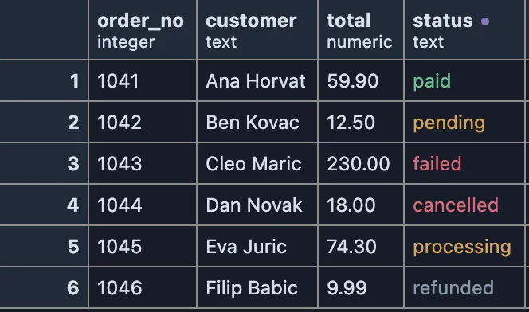

# Status

A column named `status` reads in traffic light colours: green when all is well, amber while something waits, red when it failed.



The last orders of a made-up shop. Paid reads green; pending and processing amber, they still need something; failed and cancelled red; refunded is none of these and stays grey. The two orders that need a look (Cleo's failed payment, Ben's pending one) stand out without reading a word.

## What it is for

- **Orders, payments, jobs and tickets**: which ones are done, which wait, which failed.
- **Background work**: a queue table, a list of import runs, the state of each sync.
- **Your own app's state columns**, as long as they use the usual words (below).

## Try it

The picture at the top, on any connection with made-up data:

```sql
-- @extension status
select order_no, customer, total, status
from (values (1041, 'Ana Horvat', 59.90, 'paid'),
             (1042, 'Ben Kovac', 12.50, 'pending'),
             (1043, 'Cleo Maric', 230.00, 'failed'),
             (1044, 'Dan Novak', 18.00, 'cancelled'),
             (1045, 'Eva Juric', 74.30, 'processing'),
             (1046, 'Filip Babic', 9.99, 'refunded')) as o(order_no, customer, total, status);
```

## Settings

None. The column is picked by its name, which must end in `status` (`status`, `order_status`, `PaymentStatus`), and the colour by its value, in any case:

| Colour | Values |
|---|---|
| green | active, done, success, ok, completed, enabled, paid |
| amber | pending, waiting, processing, review, queued |
| red | error, failed, cancelled, canceled, disabled, rejected |
| grey | anything else |

## Good to know

- Your values have other names? Rename them in the query so they land in a colour: `case state when 'shipped' then 'done' when 'on hold' then 'waiting' else state end as status`.
- The colours are the theme's own, so a theme extension repaints them.
- Only the colour changes: the cell reads, copies and saves the value as it is.
- To use it, put `-- @extension status` above a query (in the file header it covers every query in the file), or pick it from a result's own menu.

## Requirements

PostgreSQL 13 or newer. Runs in the grid alone; nothing is sent to the server.
