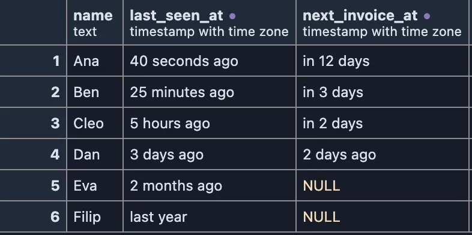
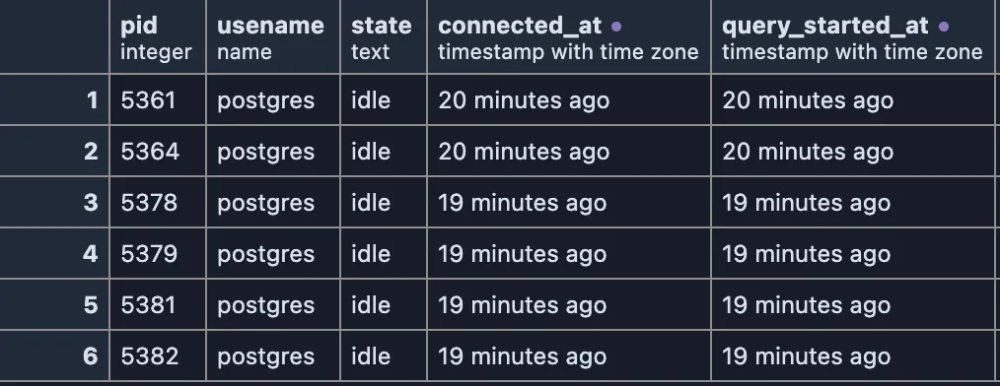

# Time ago

Timestamps read as how long ago they were, or how soon they come: `25 minutes ago`, `3 days ago`, `in 2 days`.



The users of a made-up app. `2026-10-13 09:41:12+02` makes you do the arithmetic; `25 minutes ago` does not. Ana is online now, Filip has not been back for over a year, and Dan's invoice was due two days ago, which a date alone would hide.

## What it is for

- **Activity**: when a user was last seen, when a row was last updated, when a job last ran.
- **What is coming**: the next invoice, a certificate's expiry, a scheduled job, read as `in 3 days`.
- **Database sessions**: how long ago each connection opened and when it last ran a query.

## Try it

**The sessions of your database**, on any connection:

```sql
-- @extension time-ago
select pid, usename, state,
       backend_start as connected_at,
       query_start as query_started_at
from pg_stat_activity
where backend_type = 'client backend'
order by backend_start
limit 6;
```



The picture at the top, on any connection with made-up data:

```sql
-- @extension time-ago
select name, last_seen_at, next_invoice_at
from (values ('Ana', now() - interval '40 seconds', now() + interval '12 days'),
             ('Ben', now() - interval '25 minutes', now() + interval '3 days'),
             ('Cleo', now() - interval '5 hours', now() + interval '2 days'),
             ('Dan', now() - interval '3 days', now() - interval '2 days'),
             ('Eva', now() - interval '7 weeks', null),
             ('Filip', now() - interval '14 months', null)) as u(name, last_seen_at, next_invoice_at);
```

## Settings

None. A column is picked by its name, which must end in `_at` (`created_at`, `last_seen_at`), and its type, `timestamp` or `timestamptz`. Name a column in the query to have it read this way: `backend_start as connected_at`.

## Good to know

- The time is counted from the moment the cell is drawn, in the largest unit that fits, rounded: 49 days read `2 months ago`, 14 months `last year`.
- The words follow your computer's language settings.
- A `timestamp` without a time zone is read as your computer's local time; a `timestamptz` carries its own.
- Hovering a cell shows the exact timestamp. Copying cells from the grid copies them as they read (`3 days ago`); **Save As** writes the timestamps to the file.
- **Date format** is the other way to read a timestamp: the date itself, written your way.
- To use it, put `-- @extension time-ago` above a query (in the file header it covers every query in the file), or pick it from a result's own menu.

## Requirements

PostgreSQL 13 or newer. Runs in the grid alone; nothing is sent to the server.
