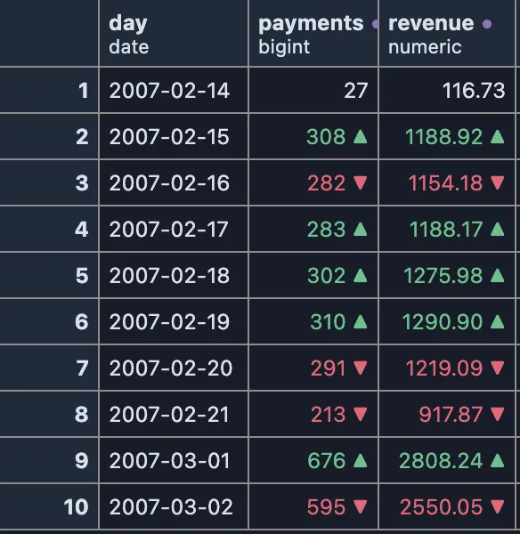

# Trend

Every number gets a green ▲ when it is higher than the row above and a red ▼ when it is lower: a day-by-day story without a chart.



The first ten days of payments at the dvdrental shop, one row a day. Each number is compared with the one above it: the jump from 27 to 308 payments on the second day is green, the fall to 291 and 213 at the end of the first week is red, and so is the drop on 2 March after the busy 1st.

## What it is for

- **Day by day, week by week**: sales, sign-ups, errors or response times in time order, each row compared with the one before.
- **Spotting the turn**: where a rising number starts to fall, without drawing a chart.
- **Version by version**: a benchmark run after run, a table's size release after release.

## Try it

The picture at the top, in the [dvdrental](https://neon.com/postgresql/postgresql-getting-started/postgresql-sample-database) sample database:

```sql
-- @extension trend
select payment_date::date as day,
       count(*) as payments,
       sum(amount) as revenue
from payment
group by 1
order by 1
limit 10;
```

Order the query by time: the arrow compares each row with the row ABOVE it, so the order is the story.

## Settings

None. Every number column of the result gets its arrows.

## Good to know

- The first row has nothing above it and gets no arrow. A value equal to the one above gets none either, and a NULL row breaks the comparison: the row after it gets no arrow.
- Up is green and down is red, whatever the number means. For costs, delays and errors down is the good direction; read the arrows as up and down, not as good and bad.
- Number arrays (Sparklines' kind) are left alone.
- Copying cells from the grid copies them as they read, arrows included; **Save As** writes the plain numbers to the file.
- The arrow makes the cell wider than the server's text, which PlumeSQL sizes the column by: if an arrow is cut, double-click the right edge of the column's header to fit it.
- To use it, put `-- @extension trend` above a query (in the file header it covers every query in the file), or pick it from a result's own menu.

## Requirements

PostgreSQL 13 or newer. Runs in the grid alone; nothing is sent to the server.
