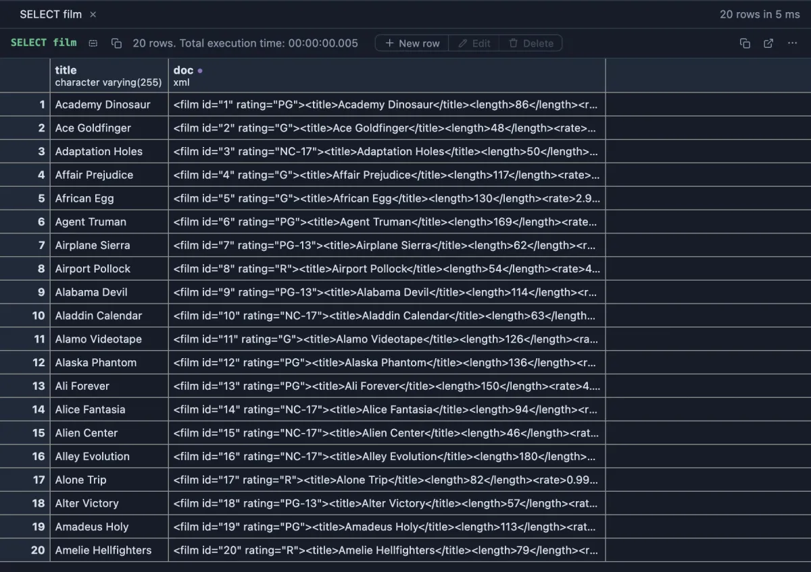

# Xml



An xml column reads compact on one line, the indented document on hover.

## What it shows

A formatting rule that matches every `xml` column by type. Whitespace between tags is collapsed and the line cut at 120 characters; the whole document, indented two spaces a level, is in the tooltip, an element holding only text kept on one line with it. What the server sent stays the value: copying, exporting and the console never see the formatted text.

## Examples

**The xml PostgreSQL makes**: a table's rows as an xml document with `query_to_xml`, and a row per element with `xmlelement`. In the [dvdrental](https://neon.com/postgresql/postgresql-getting-started/postgresql-sample-database) sample database:

```sql
-- @extension xml
select query_to_xml('select category_id, name from category order by 1 limit 5', true, false, '') as categories;
```

```sql
-- @extension xml
select f.title,
       xmlelement(name film, xmlattributes(f.film_id as id, f.rating as rating),
                  xmlelement(name title, f.title),
                  xmlelement(name length, f.length),
                  xmlelement(name rate, f.rental_rate)) as doc
from film f
order by f.title
limit 20;
```

**Any connection**: the server's settings of one category as xml.

```sql
-- @extension xml
select xmlagg(xmlelement(name setting, xmlattributes(name as name), setting)) as settings
from pg_catalog.pg_settings
where category like 'Query Tuning%';
```

## Requirements

PostgreSQL 13 or newer. The rule works on the result in the grid; the server is never asked.

## Notes

The indenting is done without an XML parser (a formatting rule runs where there is no DOM), so it follows the tags as they come and never rejects a document; one that is not well formed is indented as best it can be. Documents past 200,000 characters are indented up to there. A script attaches it with `-- @extension xml` above the query, or once in the header for the whole file; a result's menu can attach it too.
