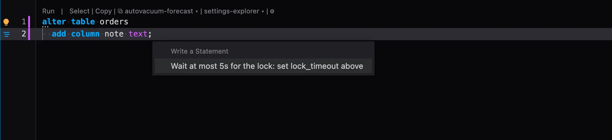

# Migration safety

A schema change that cannot hold your database up. The lightbulb on an `ALTER TABLE`, a `CREATE INDEX`, a `DROP` or a `TRUNCATE` writes a lock wait with an end above it, and on an index build the memory it needs.



## What it is for

- **A change that freezes the table.** `ALTER TABLE` takes a lock on its table. With `lock_timeout` at 0, the default, it waits for that lock as long as it takes: behind one long report, say. Every query that arrives after it, even a plain `select`, then queues behind the change, and the table stops answering until the change gets through. A `lock_timeout` makes the change give up instead, so you can run it again a minute later.
- **An index that builds slowly.** `CREATE INDEX` sorts the table's keys in `maintenance_work_mem`, 64MB by default. With more, it sorts in memory longer and finishes sooner.

## What it offers

**A lock wait with an end.** On `ALTER TABLE`, `ALTER INDEX`, `CREATE INDEX` (not `concurrently`), `DROP TABLE`, `DROP INDEX`, `TRUNCATE`, `REINDEX`, `VACUUM FULL`, `CLUSTER`, `REFRESH MATERIALIZED VIEW` and `LOCK TABLE`, when your session's `lock_timeout` is 0:

```sql
set lock_timeout = '5s';
alter table orders add column note text;
```

If the lock does not come within five seconds, the change fails with `canceling statement due to lock timeout` and nothing waits behind it. Run it again when the long query is done. The wait is an option: **Longest lock wait** under the refactor in the Refactors settings, and on the extension's page.

**More memory for an index build.** On `CREATE INDEX`, `REINDEX`, `VACUUM`, `CLUSTER` and an `ALTER TABLE ... ADD FOREIGN KEY` (which checks every row), when your session's `maintenance_work_mem` is under 256MB:

```sql
set maintenance_work_mem = '256MB';
create index on orders (customer_id);
```

Four times what the session has, up to 2GB. Take the offer if the server has the memory to spare: each session that builds takes that much.

A `set` holds for the rest of your session; inside a transaction, `set local` holds until it ends.

## What it reads

The statement, and your session's own `lock_timeout` and `maintenance_work_mem`, which PlumeSQL already holds: the values a `SET` earlier in the script gave them, else what a new session starts with. Nothing is asked of the server.

## Where it applies

In the SQL editor, everywhere from the install on (change it on its page).

## Requirements

PostgreSQL 13 or newer, and PlumeSQL 0.29.0 or newer, which hands the extension the session's settings.
