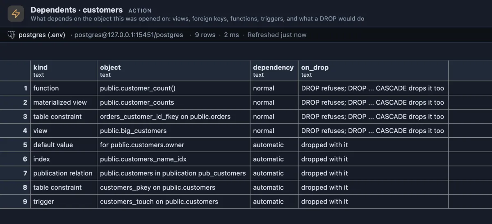

# Dependents

What depends on a table, view or materialized view, and what a `DROP` would do to each: the list of what breaks before you drop, rename or rewrite it.



Opened on a `customers` table. The first four rows are separate objects that use it: a plain `DROP TABLE customers` refuses because of them, and `DROP ... CASCADE` would take them along, the whole view and materialized view included, and the foreign key out of `orders` (not `orders` itself). The rest belong to the table and simply go with it.

## When to use it

- **Before `DROP TABLE` or `DROP VIEW`**: what else goes, or why the drop is refused.
- **Before renaming or changing a column's type**: views and SQL functions built on the table may stop working or block the change.
- **Cleaning up an old table** that "nobody uses": a view or a foreign key someone forgot shows up here.
- **Reading an unfamiliar schema**: which views and functions are built on a table.

## How to read it

One row per dependent object, the ones a `DROP` refuses over first:

| Column | Meaning |
|---|---|
| kind | What the dependent is: `view`, `materialized view`, `table constraint` (a foreign key of another table, or one of this table's own constraints), `function`, `trigger`, `index`, `policy`, `default value`, `sequence`, `publication relation`, `rule`, and so on. |
| object | Its full name as PostgreSQL writes it: `orders_customer_id_fkey on public.orders`. |
| dependency | `normal`: a separate object that uses this one. `automatic`: a part of this one. |
| on_drop | `DROP refuses; DROP ... CASCADE drops it too` for a normal dependency, `dropped with it` for an automatic one. |

Read the normal ones before any `DROP ... CASCADE`: each view or materialized view listed goes entirely, and with it whatever was built on IT, which this list does not show (see Good to know).

## Try it

Open it on a table from the table's row menu in the object tree (**Run Dependents**), from the dots menu of an open table, or from its pin in the title bar while the table's rows or its DDL are the active tab. To see a full list, **on a test database**:

```sql
create table customers (id integer primary key, name text, owner text default current_user);
create index customers_name_idx on customers (name);
create table orders (id integer primary key, customer_id integer references customers (id), total numeric);
create view big_customers as
select c.*, (select sum(total) from orders o where o.customer_id = c.id) as spent from customers c;
create materialized view customer_counts as select count(*) as n from customers;
create function customer_count() returns bigint language sql begin atomic select count(*) from customers; end;
```

Dependents on `customers` lists the function, the materialized view, the foreign key of `orders` and the view as normal, and the default, the index and the primary key as automatic. `drop table customers;` then fails, naming the same four. Clean up with `drop table customers cascade; drop table orders;`.

## Good to know

It reads what PostgreSQL itself records in `pg_depend` and names each object with `pg_identify_object()`, so the list is exactly what a `DROP` would find. Two limits follow from that:

- **One level deep**: a view on a view on this table shows the first view only. Open Dependents on that view for the next level.
- **Function bodies only when recorded**: a SQL function whose body is `BEGIN ATOMIC ... END` or a bare `RETURN` (PostgreSQL 14 and newer) records the tables it uses. A PL/pgSQL function, or a SQL function with its body in quotes, does not, so a function that uses the table that way is not listed, and a `DROP` will not stop for it either: it fails later, when the function runs.

Reads only. An `@for table, view, materialized view` extension: `{schema}` and `{name}` are the object it was opened on, bound as parameters.

## Requirements

PostgreSQL 13 or newer.
