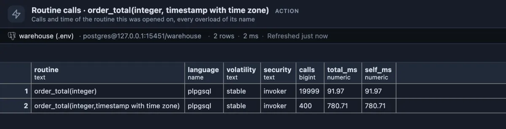

# Routine calls

How often a function or procedure has been called and how much time it took, for every version of its name, beside its language and how the planner may treat it.



A shop's `order_total` comes in two versions (overloads). The one that reads a single order was called almost 20,000 times and took 92 ms in all, under 5 microseconds a call. The one that sums a customer's orders since a date was called only 400 times but took 781 ms, about 2 ms a call: it is the one to look at if the page that uses it feels slow.

## When to use it

- **A page or a report is slow** and it calls functions: which one takes the time, and is it many cheap calls or a few expensive ones?
- **Before changing or dropping a function**: is it still called at all?
- **After a deploy**: did a new version of a function replace the old one in use, or are both still being called?
- **Checking how a routine is declared**: its language, whether it is marked `immutable`, `stable` or `volatile`, and whether it runs with its owner's rights.

## How to read it

One row per routine of that name in that schema (each overload is a row):

| Column | Meaning |
|---|---|
| routine | The signature: the name with its argument types. |
| language | `plpgsql`, `sql`, `c`, and so on. |
| volatility | `immutable`, `stable` or `volatile`: what the function promises about its result, which decides whether the planner may call it once and reuse the answer. |
| security | `definer` (runs with the owner's rights) or `invoker` (with the caller's). |
| calls | How many times it was called since the statistics were reset. Empty when calls are not being counted (see Requirements). |
| total_ms | All the time spent in it, including the functions it called. |
| self_ms | The time spent in its own code, without the functions it called. |

Total divided by calls is the cost of one call. A big gap between total and self means the time goes into another function it calls; open that one next.

## Try it

Open it on a routine from its row menu in the object tree (**Run Routine calls**) or from its pin in the title bar while the routine's DDL is the active tab. Calls are counted only where `track_functions` is on, which is off by default. **On a test database**, as a superuser:

```sql
set track_functions = 'pl';
create function square(n integer) returns integer language plpgsql immutable as $$ begin return n * n; end $$;
select sum(square(g)) from generate_series(1, 10000) g;
```

The `set` counts the calls of this session only. A few seconds later Routine calls on `square` shows 10,000 calls. Clean up with `drop function square(integer);`.

To count every session's calls, set it for the server (`track_functions = pl` in `postgresql.conf`, then reload) or for one database (`alter database shop set track_functions = 'pl';`, for new sessions).

## Good to know

The numbers come from `pg_stat_user_functions`; the description from `pg_proc`. `pl` counts functions written in procedural languages such as PL/pgSQL; `all` adds SQL and C functions (a simple SQL function inlined into the query that calls it is never counted, since it never runs as a call). Counting costs a little time on every call, which is why it is off by default.

Reads only. An `@for routine` extension: `{schema}` and `{name}` are the routine it was opened on, bound as parameters.

## Requirements

PostgreSQL 13 or newer. The counters need `track_functions = pl` (or `all`); without it the calls and times stay empty and the rest still describes the routine. Setting it needs superuser (or a role granted the right to set it).
