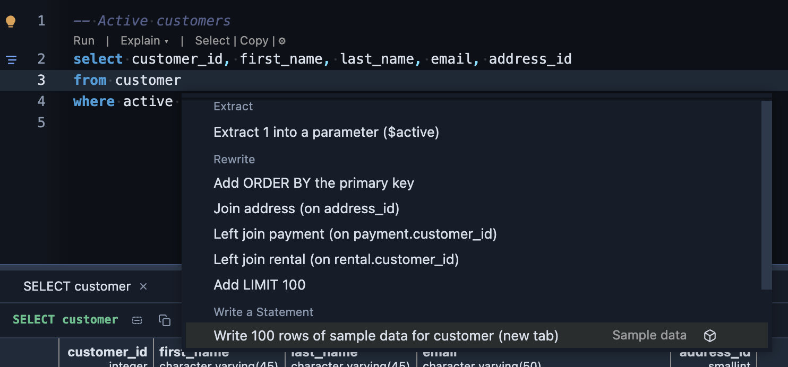
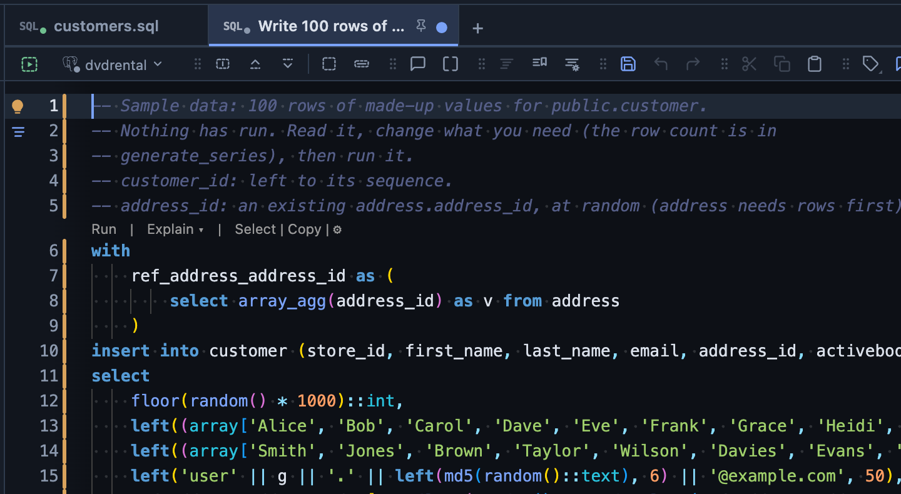

# Sample data

Rows of made-up data for a table, written for you as an INSERT script. Put the caret on a statement that names the table, open the lightbulb, and pick **Write 100 rows of sample data**: the script opens as a new, unsaved script named after it. Nothing runs, and nothing is saved until you save it (Save asks where and under which name).



## What it is for

- **A table to try a query on**: a new table is empty, and a chart, a report or an index needs rows before it shows anything.
- **More rows than you have**: a hundred, or a hundred thousand, to see how a query behaves when the table grows.
- **A starting point you edit**: the script is plain SQL; change a value, a list of names or the row count before you run it.

## What you get



A comment at the top says what the script does with each column it does not fill itself, then one INSERT that makes every row from `generate_series`:

- **Values that look like the column**: an email reads like one (and is unique), a first name is a first name, a city a city, a price a sum of money with the column's decimals, a birth date an adult's, a URL a link, a status one of active, inactive or pending. A column whose name says nothing gets its name and the row number (`note 12`).
- **Every type it knows**: numbers, text up to the column's length, dates and times, booleans, uuid, json and jsonb, arrays, inet, bytea, tsvector, ranges, a pgvector vector of the column's size, a PostGIS point.
- **References that hold**: a foreign key takes an existing row of the table it points to, at random, so the INSERT never breaks a reference. That table needs rows first.
- **What the table fills itself is left to it**: an identity, a serial and a generated column are left out (PlumeSQL 0.26.0 and later say which; an older one only knows the key, and a single number key is then taken for one).
- **No duplicate keys**: a unique column gets a random suffix, a number key the next numbers after the largest. A link table, whose key is made of references, skips a pair that is already there, so a few less may go in; the comment says so.
- **What it cannot make, it says**: a column of a type it has no sample for is left NULL when it may be, and named in the script when it may not (one of the labels at random, if the type is an enum).

## Try it

In the [dvdrental](https://neon.com/postgresql/postgresql-getting-started/postgresql-sample-database) sample database, put the caret on:

```sql
select * from film;
```

and press Ctrl+. (⌘. on a Mac). **Write 100 rows of sample data for film** opens a script that leaves `film_id` to its sequence, picks an existing language for `language_id`, leaves the enum `rating` and the `release_year` domain NULL, and writes a title, a description, rental rates and a `tsvector`. Run it in its tab: `INSERT 0 100`.

An UPDATE, a DELETE and an INSERT name their table too, and a query over several tables offers one script per table (the first three).

## Settings

**Rows**, 100 by default (1 to 100,000), in the Refactors settings or on this extension's page. The number stands in the script's `generate_series`, so one script can still be changed before it runs.

## Good to know

- Check constraints are not read: a value outside one fails the INSERT, and the error names the column. Change that column's line and run again.
- The values are random every run: run the same script twice for twice the rows.
- It reads only what the editor knows about the table. Nothing is asked of the server until you run the script.
