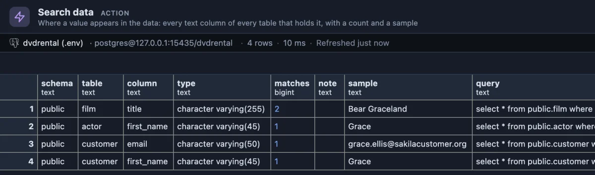
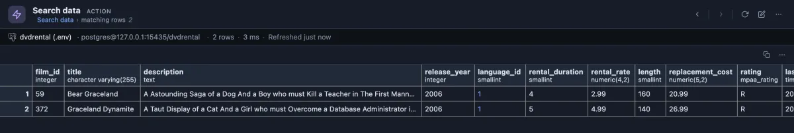

# Search data

Where a value appears in your data: you type a name, an email or an order number, and it finds every table and column that holds it, with a count, a sample and the query that lists the rows.

Searching the [dvdrental](https://neon.com/postgresql/postgresql-getting-started/postgresql-sample-database) sample for `grace`, with no idea where it might be: two film titles (`Bear Graceland` is one), an actor called Grace, and a customer whose first name and email both hold it. The last column, cut off here, is the query that lists those rows, ready to copy into a script.

## When to use it

- **Support hands you an email or a name** and you do not know which table it lives in.
- **Learning a database you did not design**: where does this customer number show up, in which tables and columns?
- **Before changing or removing a value everywhere** (a renamed product, a person who asked to be forgotten): every place that holds it.
- **Checking a migration**: does the old value still appear anywhere?

## How to read it

One row per column that holds the term, the columns with the most hits first:

| Column | Meaning |
|---|---|
| schema, table, column | Where the term was found. |
| type | The column's type. |
| matches | How many rows hold it, counted up to the limit you set. Click it to open those rows (below). |
| note | `counted up to N` when there may be more than the limit. |
| sample | One matching value, cut to 200 characters. |
| query | The `SELECT` that lists the matching rows, to copy into a script. |

Tables larger than the size limit are not searched; each gets one row at the end saying so, with its size. Lower the limit for a quick look, raise it (and wait) for a thorough one.

**matching rows** on a count opens the rows of that table whose column holds the term:

## Try it

Run it from the Extensions side tab (**Run** on its row). The form asks:

| Field | Default | What it does |
|---|---|---|
| Search for | | The term. Case is ignored, and `%` and `_` in it are plain characters. |
| Schema | `*` | One schema, or `*` for every schema you can read. The list shows each schema with its number of tables. |
| Match | contains | `contains` finds the term anywhere in the value, `starts with` at its start, `exact` only the whole value. |
| Count up to | 1000 | Rows counted per column. A lower number makes the search faster on big tables. |
| Skip tables larger than (MB) | 1024 | Tables above this size are listed as not searched rather than read. |

On dvdrental, search for `grace` with the rest left as it is: the picture above. Search for `42` and number columns are searched too, compared as numbers.

## Good to know

What is searched: every column of a text type (`text`, `varchar`, `char`, `citext`, a domain over one of them), every enum, `uuid`, `json` and `jsonb` (as their text), in every table, partitioned table and materialized view the current role may read. When the term is a number, integer, `numeric` and floating point columns are searched too, as numbers, so `42` finds `42` and not `142`.

It reads every searched column of every table up to the count limit, with no index to help (`ILIKE '%term%'` cannot use one), so on a large database pick a schema, keep the size limit, and expect it to take a while. It runs as one read-only statement on your connection: Cancel stops it.

Opening a match selects every column of the table, so a role allowed to read only some columns finds the match here but cannot open it; copy the `query` column and narrow it instead.

What you type never goes into the SQL text as it is: the server quotes it (`format('%L')`) before a statement is built from it, and table and column names are quoted as identifiers.

## Requirements

PostgreSQL 13 or newer. It searches only the columns the current role may select; the rest are left out without an error. Each column is read through `query_to_xml`, which needs a server built with XML support, as every common distribution is.
