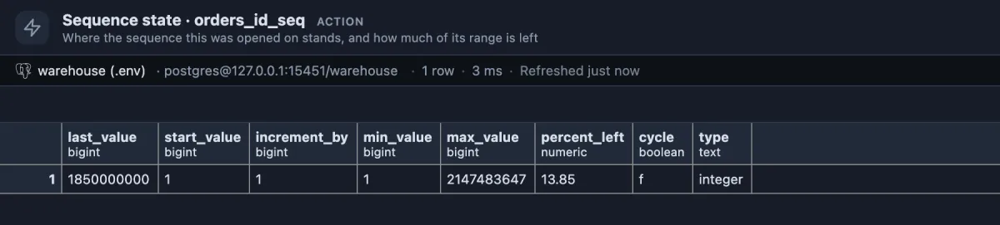

# Sequence state

Where a sequence stands: the last number it handed out, its range and step, and how much of the range is left before it runs out.



The sequence behind a shop's `orders.id`. It has handed out 1.85 billion numbers of an `integer`'s 2.1 billion: 13.85 percent of the range is left. When it reaches the end, the next order fails to insert with `nextval: reached maximum value of sequence`.

## When to use it

- **An `integer` key that has been growing for years**: how long it has left.
- **Inserts fail** with `reached maximum value of sequence` or `duplicate key value`: the first says it ran out, the second often that the sequence fell behind the data (after an import that wrote ids by hand).
- **Checking a sequence's settings** before reusing it: its step, its range, whether it starts over (`cycle`).

## How to read it

One row for the sequence:

| Column | Meaning |
|---|---|
| last_value | The last number handed out; empty when none has been. |
| start_value, increment_by | Where it started and the step between numbers. |
| min_value, max_value | The range. |
| percent_left | How much of the range remains, from the last value to the maximum (to the minimum for one that counts down). |
| cycle | `t` when it starts over from the minimum at the end instead of failing (rarely what a key wants). |
| type | `smallint`, `integer` or `bigint`, which sets the largest possible maximum. |

Under about 20 percent left on an `integer` or `smallint` sequence that feeds a key, plan the move to `bigint`: `ALTER TABLE ... ALTER COLUMN ... TYPE bigint` for the column, and `ALTER SEQUENCE ... AS bigint` for a serial's sequence. Integer overflow risk lists every such key of the database at once, with both statements written out.

## Try it

Open it on a sequence from its row menu in the object tree (**Run Sequence state**) or from its pin in the title bar while the sequence's DDL is the active tab. To see one nearly full, **on a test database**:

```sql
create table overflow_demo (id serial primary key, note text);
select setval('overflow_demo_id_seq', 2000000000);
```

Sequence state on `overflow_demo_id_seq` shows 6.87 percent left. Clean up with `drop table overflow_demo;`.

## Good to know

It reads `pg_sequences`. The percentage counts from the start value, so a sequence that started at 1,000,000 shows the share of what was left after that. A sequence that counts down (a negative step) is measured toward its minimum. Reads only. An `@for sequence` extension: `{schema}` and `{name}` are the sequence it was opened on, bound as parameters.

## Requirements

PostgreSQL 13 or newer. Reading `last_value` needs SELECT or USAGE on the sequence; without it the column stays empty.
