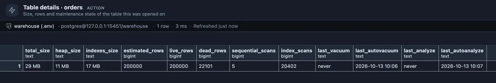

# Table details

One table at a glance: how big it is on disk, how many rows it has live and dead, how it is read, and when it was last vacuumed and analyzed.

A shop's `orders` table: its indexes take more room (17 MB) than its rows (11 MB), which is common for a narrow table with a few indexes. About 22,000 old row versions wait for vacuum, about one in ten. It is read almost only through its indexes (20,402 index scans against 5 full scans), and it has never been vacuumed by hand: autovacuum and autoanalyze look after it. In the columns to the right of the picture, `last_autovacuum` and `last_autoanalyze` both read today.

## When to use it

- **While writing a query against a table**: is it big, is it read by index, is its information for the planner fresh?
- **A query on it got slow**: many dead rows, or an analyze long ago (stale statistics mislead the planner), are the first two suspects.
- **Many sequential scans on a big table** hint at a missing index; Table indexes and Sequential scans go further.
- **Checking that autovacuum reaches the table**: the last autovacuum and autoanalyze times.

## How to read it

One row for the table or materialized view:

| Column | Meaning |
|---|---|
| total_size, heap_size, indexes_size | On disk, all in; the rows alone; the indexes alone. |
| estimated_rows | The planner's row estimate (from the last VACUUM or ANALYZE). |
| live_rows, dead_rows | Rows the statistics see as live, and dead ones (old versions) waiting for vacuum. |
| sequential_scans, index_scans | How often the table was read whole, and through an index, since the statistics were reset. |
| last_vacuum, last_autovacuum | When it was last vacuumed by hand and by autovacuum, or `never`. |
| last_analyze, last_autoanalyze | When its statistics for the planner were last refreshed, by hand and automatically, or `never`. |

Dead rows above about a fifth of the live ones, or an `autovacuum` time long ago on a table that changes, mean vacuum is not keeping up: Vacuum candidates shows why. An `analyze` long ago on a table that changed a lot calls for `ANALYZE table_name;`.

## Try it

Open it on a table from its row menu in the object tree (**Run Table details**), from its pin in the title bar while the table is open, or from the header of any result: it is pinned there and offered for the tables the result's query reads, one click when the query reads one table and a pick among them when it reads several. That makes it the quickest way to the state of a table you are writing a query against. On the [dvdrental](https://neon.com/postgresql/postgresql-getting-started/postgresql-sample-database) sample, run `select * from rental limit 10;` and press **Table details** in the result's header.

## Good to know

It reads `pg_class` and `pg_stat_all_tables`, so system tables answer too. The counters (rows, scans, maintenance times) are statistics PostgreSQL keeps as the table is used; they start from zero after a statistics reset or a restore. Reads only. An `@for table, materialized view` extension: `{schema}` and `{name}` are the object it was opened on, bound as parameters; pinned to every result's header (`@toolbar results`) beside Table indexes.

## Requirements

PostgreSQL 13 or newer.
