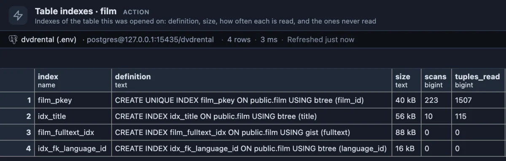

# Table indexes

The indexes of one table: what each one covers, how big it is, how often it is used, and which ones nothing has ever read.

The `film` table of the [dvdrental](https://neon.com/postgresql/postgresql-getting-started/postgresql-sample-database) sample. The primary key does most of the work (223 scans); the index on `title` is used now and then. The full-text index and the index on `language_id` have not been read once since the statistics were reset, so the note column, at the right end of the row, marks them `never read`: on a real database, after a few weeks of normal use, those are the indexes to question.

## When to use it

- **While writing a query against a table**: is there an index on the column you filter or join by?
- **A table is slow to write to**: every index costs time on every insert and update, and one never read is pure cost.
- **Before adding an index**: is there one already that covers the same columns?
- **After a failed `CREATE INDEX CONCURRENTLY`**: it leaves an index marked not valid, which costs writes and helps no query.

## How to read it

One row per index, the primary key first, then unique ones, then by how often each is read:

| Column | Meaning |
|---|---|
| index | Its name. |
| definition | The `CREATE INDEX` statement: the columns it covers, its kind (`btree`, `gist`, `gin` ...), and any condition. |
| size | On disk. |
| scans | How many times a query used it since the statistics were reset. |
| tuples_read, tuples_fetched | Index entries read, and table rows fetched through it. |
| primary, unique, valid | Its flags (`t` or `f`). `valid` is `f` for an index a failed concurrent build left behind. |
| note | `never read` for an index with no scans that is neither unique nor the primary key. |

Before dropping a `never read` index, make sure the statistics have seen a full cycle of the application's work (month-end reports included), and that a replica does not use it: each server counts its own scans. Dropping is `DROP INDEX CONCURRENTLY index_name;`, which does not block the table. A unique index or a primary key is never marked: it guards the data even when no query reads it.

## Try it

Open it on a table from its row menu in the object tree (**Run Table indexes**), from its pin in the title bar while the table is open, or from the header of any result: it is pinned there and offered for the tables the result's query reads. On dvdrental, run `select * from film where title like 'Bear%';` and press **Table indexes** in the result's header.

## Good to know

It reads `pg_index` and `pg_stat_all_indexes`, so system tables answer too. Unused indexes asks the same "never read" question of every table at once, and Duplicate indexes finds two indexes that cover the same columns. Reads only. An `@for table, materialized view` extension: `{schema}` and `{name}` are the object it was opened on, bound as parameters; pinned to every result's header (`@toolbar results`) beside Table details.

## Requirements

PostgreSQL 13 or newer.
