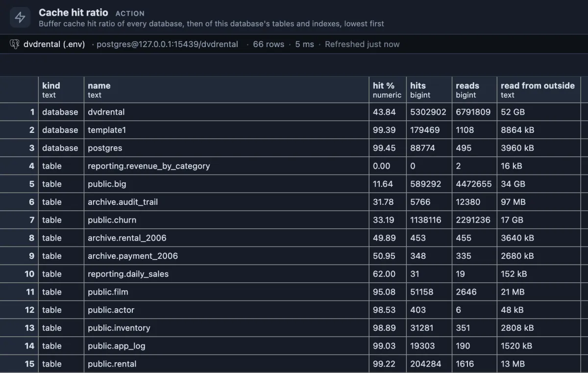

# Cache hit ratio

How often PostgreSQL finds the data it needs in memory, per database, then per table and index of this one, the worst first.

dvdrental finds only 43.84 % of its data in PostgreSQL's memory, and two tables explain almost all of it: `big` (11.64 %, 34 GB read from outside) and `churn` (33.19 %, 17 GB), both scanned whole again and again. The small, busy tables, film, inventory, rental, sit between 95 and 99 %, as they should.

## When to use it

- **Queries are slower than they were**: is the data still in memory, or does every query go to the disk now?
- **Choosing `shared_buffers`**, or a bigger server: is the working set larger than the memory?
- **Finding the table that pushes the others out**: one big table scanned whole can evict everything else.

## How to read it

Databases first, then tables, then indexes, each group lowest ratio first.

| Column | Meaning |
|---|---|
| kind | `database`, `table` or `index`. |
| name | The database, the table (with its schema), or the index with its table. |
| hit % | Of all the blocks it needed, the share found in PostgreSQL's memory (shared buffers). |
| hits, reads | The two counters: blocks found in memory, blocks asked of the operating system. A table's include its TOAST data (long values); its indexes have rows of their own. |
| read from outside | The reads as a size: what had to come from outside PostgreSQL's memory. |

What is good: a busy application database usually sits above 99 %. A low ratio on a big table that reports read whole is expected; a low ratio on a small, hot table or index is not, and points at memory that is too small or at a query that reads far more than it needs (Sequential scans, Top queries). A table read twice in its life at 0 % says nothing: look at the reads column too.

## Try it

Run it from its row in the Extensions side tab (**Run**). It answers on any server; the longer the server has run since the counters were reset, the more the figures mean.

## Good to know

A "read" is a block asked of the operating system, which may still serve it from its own file cache without touching the disk. So a low ratio with fast queries often means the operating system's cache is doing the work; this view cannot see that cache. The counters come from `pg_stat_database`, `pg_statio_user_tables` and `pg_statio_user_indexes`, since the last statistics reset or restart. Objects nobody read since then are left out. Reads only. Opens on its result (`@face result`).

## Requirements

PostgreSQL 13 or newer. Tables and indexes are this database's only: PostgreSQL keeps those statistics per database.
