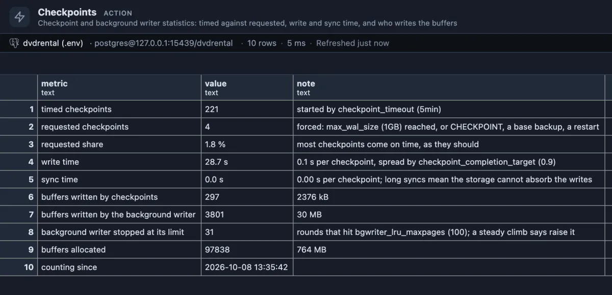

# Checkpoints

Whether the server writes its changes to disk calmly, on schedule, or in forced rushes, with a plain note beside each figure.

A healthy server. 221 checkpoints came on time and only 4 were forced (1.8 %), so the WAL settings fit the load. Each one spent 0.1 seconds writing and almost nothing syncing. The background writer did most of the writing ahead of need (30 MB, against 2.3 MB by the checkpoints); it stopped at its per-round limit 31 times, a figure to watch only if it keeps climbing.

## When to use it

- **The server stalls every few minutes**, then recovers: forced checkpoints are a usual cause.
- **After a bulk load or a migration** wrote a lot: did it force checkpoints?
- **Tuning `max_wal_size` and the background writer**: the figures before and after a change.

## How to read it

A short list of figures, each with a note.

| Metric | Meaning |
|---|---|
| timed checkpoints | Started because `checkpoint_timeout` passed: the calm, planned kind. |
| requested checkpoints | Forced: `max_wal_size` filled up, or a CHECKPOINT command, a base backup, a restart. |
| requested share | The forced share, with a note when it is the majority. |
| write time, sync time | Seconds spent writing and syncing, in total and per checkpoint. A long sync means the storage cannot absorb the writes. |
| buffers written by checkpoints | Changed pages the checkpoints wrote. |
| buffers written by the background writer | Written ahead of need by the background writer. |
| buffers written by backends | Written by the sessions themselves, which wait while they do it (up to PostgreSQL 16; from 17 see I/O statistics). |
| background writer stopped at its limit | Rounds that hit `bgwriter_lru_maxpages`. |
| buffers allocated | Pages loaded into memory in total. |
| counting since | When the counters were last reset. |

What to do: **most checkpoints requested** (not by hand) means the WAL fills up between two planned checkpoints: raise `max_wal_size`. **Backends writing many buffers** themselves means the background writer cannot keep up: raise `bgwriter_lru_maxpages` or lower `bgwriter_delay`. **Long syncs** point at the storage.

## Try it

Run it from its row in the Extensions side tab (**Run**). It answers on any server; on one that restarted recently the figures are small and the shares say little.

## Good to know

PostgreSQL 17 moved the checkpoint counters out of `pg_stat_bgwriter` into a new view, `pg_stat_checkpointer`, and dropped the backend write counter. One query answers on 13 to 18: it reads `pg_stat_checkpointer` where it exists (through `query_to_xml`, since a query cannot name a view the server does not have) and `pg_stat_bgwriter` otherwise. On 17 and newer that needs a server built with XML support, which every common distribution is. Reads only. Opens on its result (`@face result`).

## Requirements

PostgreSQL 13 or newer.
