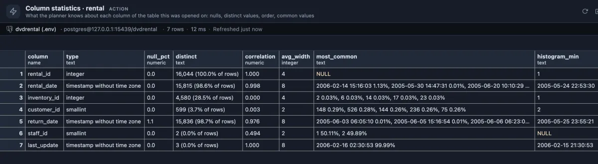

# Column statistics

What PostgreSQL believes about each column of a table: how many empty values, how many different values, which ones are the most common, and whether the rows are stored in order.

The dvdrental `rental` table, as the query planner sees it. `rental_id` is unique (16,044 different values for as many rows) and stored in its own order (correlation 1.000). `return_date` is empty in 1.1 % of the rows: films not returned yet. `staff_id` has two values, half each, so a filter on it keeps half the table and an index on it would not help. `inventory_id` has no order at all on disk (0.000).

## When to use it

- **A query picks a bad plan**: is the planner working from stale or wrong numbers? Compare these with what you know about the data.
- **Deciding whether an index is worth it**: a column with few different values (`staff_id` above) rarely profits from one; a column with many does.
- **Getting to know a table** without scanning it: empty values, typical values and the range, in a second, on a table of any size.

## How to read it

One row per column, in table order.

| Column | Meaning |
|---|---|
| column, type | The column and its type. |
| null_pct | The share of rows where it is empty (NULL). |
| distinct | How many different values, and that as a share of the rows (`599 (3.7% of rows)`); `unknown` when the sample could not tell. |
| correlation | From -1 to 1: how closely the order on disk follows the column's sorted order. Near 1 or -1, reading a range of values through an index is cheap; near 0 it jumps all over the table. |
| avg_width | The average size of a value, in bytes. |
| most_common | Up to five most common values with their share of the rows, each cut to 40 characters. |
| histogram_min, histogram_median, histogram_max | The spread of the other values: lowest, middle and highest. |
| analyzed | When these statistics were last refreshed, by hand or by autovacuum. |
| note | `never analyzed` when the table has no statistics yet, `no statistics for this column` when ANALYZE skipped it. |

What to do: when the numbers look wrong or `analyzed` is old, `analyze rental;` refreshes them in seconds. When a column's values are skewed and the planner still misjudges, `alter table ... alter column ... set statistics 1000;` before the ANALYZE makes it sample more.

## Try it

It opens ON a table. While a table's tab is open (its rows or its DDL), the title bar shows a **Column statistics** pin for it; the table's row menu in the object tree has **Run Column statistics**; and every result's header offers it for the tables its query reads. Open dvdrental's `rental` that way and you get the picture above.

## Good to know

Read from `pg_stats`, the statistics ANALYZE collects from a sample of rows, so it never scans the table and answers at once. The numbers are estimates, as fresh as the last ANALYZE. For a partitioned table the statistics cover the whole tree. An `@for table, materialized view` extension: `{schema}` and `{name}` are the table it was opened on, bound as parameters, never pasted into the query. Pinned to every result's header too (`@toolbar results`). Reads only, and reads no rows of the table.

## Requirements

PostgreSQL 13 or newer. Rows appear only for the columns you may read: `pg_stats` hides the others.
