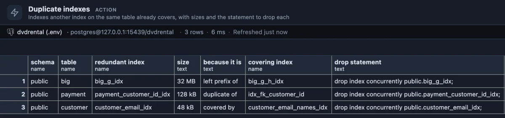

# Duplicate indexes

Indexes you can drop because another index on the same table already does their job, the biggest first, with the statement that drops each.



Three indexes that can go. `big_g_idx` (32 MB) indexes `big (g)`, but `big_g_h_idx` on `(g, h)` starts with the same column and serves every search it serves. `payment_customer_id_idx` is an exact copy of `idx_fk_customer_id`. `customer_email_idx` is covered by `customer_email_names_idx`, the same key with two more columns carried along. Beside each, the statement that drops it; further right, both definitions to compare.

## When to use it

- **Writes are slower than they should be**: every index is updated on every insert and on most updates, the useless ones too.
- **The disk fills up**: indexes often take more room than the tables, and duplicates are free space.
- **After years of "let me add an index"** by several people, or after an ORM created its own next to yours.

## How to read it

One row per index that can go.

| Column | Meaning |
|---|---|
| schema, table | The table both indexes belong to. |
| redundant index, size | The index that can go, and the room it takes. |
| because it is | `duplicate of`: the same columns in the same way; `left prefix of`: its columns are the first columns of a longer index; `covered by`: the same columns, where the other carries extra columns along (INCLUDE). |
| covering index | The index that stays. |
| drop statement | `DROP INDEX CONCURRENTLY` for a plain index, `ALTER TABLE ... DROP CONSTRAINT` for one behind a constraint. Text only: nothing is run. |
| redundant definition, covering definition | Both CREATE INDEX statements, to compare. |

What to do: copy a drop statement into a script tab and run it there, one index at a time, then run this again: when three indexes overlap, the index that "stays" in one row can be listed against a third. Before dropping a left prefix on a busy table, look at Unused indexes: the shorter index is smaller and can be the faster one for its searches.

## Try it

Run it from its row in the Extensions side tab (**Run**). To make it find something, on a TEST database (dvdrental here) add an index the sample already covers, run Duplicate indexes, then drop it again:

```sql
create index rental_rental_date_idx on rental (rental_date);
-- Duplicate indexes: a left prefix of idx_unq_rental_rental_date_inventory_id_customer_id
drop index rental_rental_date_idx;
```

## Good to know

Two indexes are compared only on the same table, with the same index method and the same WHERE clause (a partial index is compared only with indexes of the same predicate). Their columns are compared in order, each with its expression, operator class, collation and sort direction, so `(a)` and `(a DESC)`, or `(c)` and `(c COLLATE "C")`, are not duplicates. Invalid indexes (a failed CONCURRENTLY build) are left out. Of two exact duplicates, the one that stays is the one backing a constraint, then a unique one, then the older one. A left prefix is reported only for btree, and never when the shorter index is unique, backs a constraint or carries INCLUDE columns of its own: those do something the longer one cannot. `DROP INDEX CONCURRENTLY` cannot run inside a transaction block. Reads only. Opens on its result (`@face result`).

## Requirements

PostgreSQL 13 or newer. User schemas only; the system catalogs are left out.
