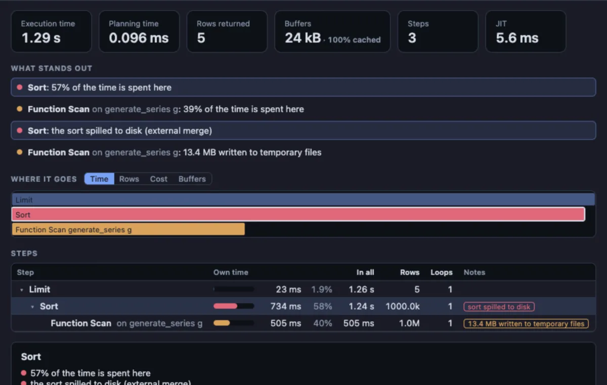

# Explain plan

See why a query is slow: the plan PostgreSQL ran, drawn as a picture of where the time went, with the steps worth a look listed first. It opens by itself on every EXPLAIN result.


A search for Saturday rentals by one staff member. The plan has one step, reading the whole `rental` table, and the three facts under it say what is wrong with it: almost all the time is spent there, PostgreSQL expected 40 rows and got 1,154, and it read 16,044 rentals to keep 7% of them. On a small table that costs 3 ms; on a table a thousand times bigger, this is where an index belongs.

## What it is for

- **Why is this query slow?** The step that takes most of the time is named first, with its share, so you know where to look before reading a line of the plan.
- **Did PostgreSQL guess wrong?** It picks a plan from estimates of how many rows each step returns. When an estimate is off ten times or more (an outdated table, a condition it cannot predict), the plan it picked may be the wrong one, and the view says where.
- **Is it running out of memory?** A sort or a hash that spilled to disk, temporary files, a step run thousands of times in a loop: each one listed with its numbers, ready to paste into a ticket.

## How to read it

The **Plan** tab beside the grid has four parts, top to bottom:

- **The summary**: how long the query ran (or, for a plain EXPLAIN that did not run it, its estimated cost), how many rows it returned, how much data it read and how much of that came from memory (cached), how many steps the plan has, and JIT compile time when there was any.
- **What stands out**: the facts worth a look first, each a link to its step. A step that takes a fifth of the time or more, row estimates off by ten times or more, a filter that threw away nearly everything it read, a sort or hash that spilled to disk, temporary files, an inner step run thousands of times in a nested loop, heap fetches in an index only scan and a bitmap gone lossy. Only what the plan's own numbers say; nothing is guessed.
- **Where it goes**: the whole plan as boxes, each step under the step that uses its rows and as wide as its share with everything under it. The colour is the step's OWN share: dark blue costs almost nothing by itself, amber and red is where the time really goes. Switch what it measures between **Time**, **Rows**, **Cost** and **Buffers** (data read).
- **Steps**: the plan as a table, one row per step: its own time as a bar, its time with everything under it, its rows (with `×29↑` beside them when the estimate was that far off, ↑ for more rows than expected, ↓ for fewer), its loops and its notes. Select a step to read everything the plan says about it on the side: its conditions, sort keys, memory, buffers and every other property.

A step's own time is its time in all minus the steps under it, and its time in all counts every loop, except under a Gather, where the loops are workers running side by side. Under a Limit a step stops early on purpose, so fewer rows than planned there is the Limit working, not a wrong guess, and it is not flagged.

## Try it

Run any EXPLAIN in a script; the Plan tab opens with the result. The examples use the [dvdrental](https://neon.com/postgresql/postgresql-getting-started/postgresql-sample-database) sample database; the third runs on any connection.

**A filter PostgreSQL cannot predict**, the picture above: it has no statistics for "the day of the week of a date", so it guesses, and reads the whole table.

```sql
explain analyze
select * from rental
where extract(dow from rental_date) = 6 and staff_id = 1;
```

**The best customers since July**: a join of three tables, grouped and sorted. Everything came from memory (2.2 MB, 100% cached), and the time is spread over the joins and the grouping; no single step stands out as a problem.

```sql
explain (analyze, buffers)
select c.first_name || ' ' || c.last_name as customer, sum(p.amount) as spent
from customer c
     join payment p using (customer_id)
     join rental r using (rental_id)
where r.rental_date >= '2005-07-01'
group by c.customer_id
order by spent desc
limit 10;
```


Read the boxes from the top: the Limit and the Sort span the whole width because everything runs under them, but they are dark, so they cost almost nothing themselves. The colour warms down the stack, in the grouping (HashAggregate) and the joins; the amber Hash Join, a quarter of the time, is the most expensive single step, and still only 2.8 ms.

**A sort that does not fit in memory** (any connection): a million rows sorted by a text value, to skip almost all of them.

```sql
explain (analyze, buffers)
select g, md5(g::text) as h
from generate_series(1, 1000000) g
order by h
limit 5 offset 999990;
```



1.29 seconds to return five rows. The Sort is red twice: more than half the time, and it spilled to disk because the rows did not fit in `work_mem` (an external merge). The Function Scan wrote 13.4 MB of temporary files holding the million generated rows. Raising `work_mem` for this session, or a query that does not sort a million rows to keep five, are the two ways out.

## Using it

Run EXPLAIN, the editor's **Explain ▾** lens or the run glyph's right click on any statement. The lens speaks PostgreSQL's default text form (its last variant asks for JSON), and EXPLAIN ANALYZE of a statement that writes runs inside a rollback, so nothing is changed. Any EXPLAIN typed by hand works too, in JSON or in text, with or without ANALYZE and BUFFERS; the more the plan carries, the more the view shows. Without ANALYZE the query does not run: you see the plan and its estimates, but no times.

**Copy plan** in the header copies the plan as it came from the server, **Copy summary** a short text of the totals and what stands out, ready for a ticket.

### Keyboard

In the Steps table, Up and Down walk the steps, Left folds a step or goes to its parent, Right unfolds it or goes to its first child, Home and End go to the first and the last. Enter on a fact goes to its step.

## Good to know

EXPLAIN ANALYZE runs the query to time it. A query that takes ten minutes takes ten minutes to explain; a plain EXPLAIN answers at once, with estimates only.

The first example's estimate is fixable: PostgreSQL 14 and newer can keep statistics on an expression (`create statistics rental_dow on (extract(dow from rental_date)) from rental;` then `analyze rental;`), after which it expects 1,158 rows instead of 40. An index on the expression gives it both the statistics and a faster way in.

## Requirements

PostgreSQL 13 or newer. Nothing runs on the server: it reads the plan already fetched. It installs with **stats-core**, the shared helper library of the Analysis extensions, and applies everywhere from the install on (a global scope you can change on its page).
