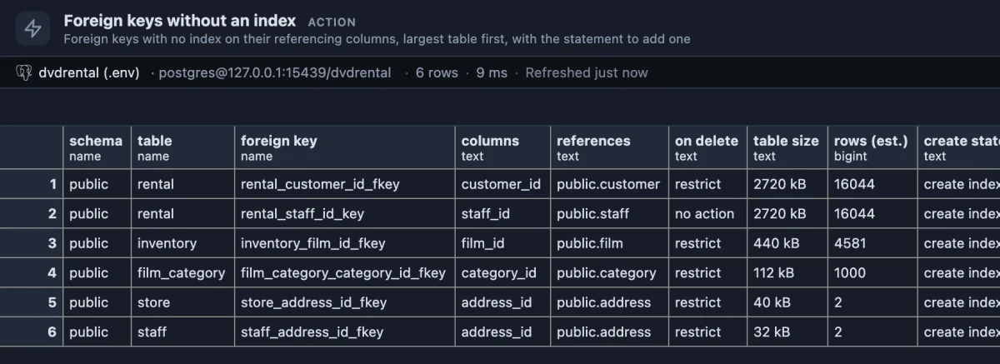

# Foreign keys without an index

Foreign keys with no index on their own side, the biggest table first, with the statement that adds one.

The dvdrental sample has six. The first matters most: `rental.customer_id` points at `customer`, but the only index on rental that has `customer_id` starts with `rental_date`, so it does not help. Every time a customer is deleted, or its id changes, PostgreSQL reads all 16,044 rentals to make sure none still points at it. The statement that fixes each one starts in the last column, cut off here; in the grid the first one reads `create index concurrently on public.rental (customer_id);`.

## When to use it

- **Deleting a row in a parent table is slow**, or locks up the child table while it runs.
- **Joins from a parent to its children** (an order to its lines, a customer to its rentals) read the whole child table.
- **Reviewing a schema** before it goes to production: a missing index on a foreign key is the most common oversight.

## How to read it

One row per foreign key whose columns no index starts with.

| Column | Meaning |
|---|---|
| schema, table | The table that holds the foreign key (the child). |
| foreign key | The constraint's name. |
| columns | Its columns, in the constraint's order. |
| references | The table it points at (the parent). |
| on delete | What deleting a parent does here; `cascade` and `set null` make a missing index cost even more, since every child row must be found and changed. |
| table size, rows (est.) | The child table's size and estimated rows: what each parent delete has to read. |
| create statement | The CREATE INDEX that fixes it, `CONCURRENTLY` (no lock on writes) except on a partitioned table, which cannot build one that way. Text only: nothing is run. |

What to do: copy the create statement into a script tab and run it. Start at the top: a small child table, or a parent nobody deletes from, may not need the index (the store and staff rows above, with 2 rows each, do not).

## Try it

Run it from its row in the Extensions side tab (**Run**). On dvdrental it lists the six above; after `create index concurrently on public.rental (customer_id);` the first row is gone.

## Good to know

PostgreSQL indexes the parent side of a foreign key by force (it must be unique) but never the child side. A foreign key counts as covered when a valid index on the child table, without a WHERE clause, starts with exactly the foreign key's columns, in any order; an index that has them further along, or a partial index, does not count. On a partitioned table the foreign key is reported once, on the partitioned table itself. `CREATE INDEX CONCURRENTLY` cannot run inside a transaction block. Reads only. Opens on its result (`@face result`).

## Requirements

PostgreSQL 13 or newer. User schemas only.
