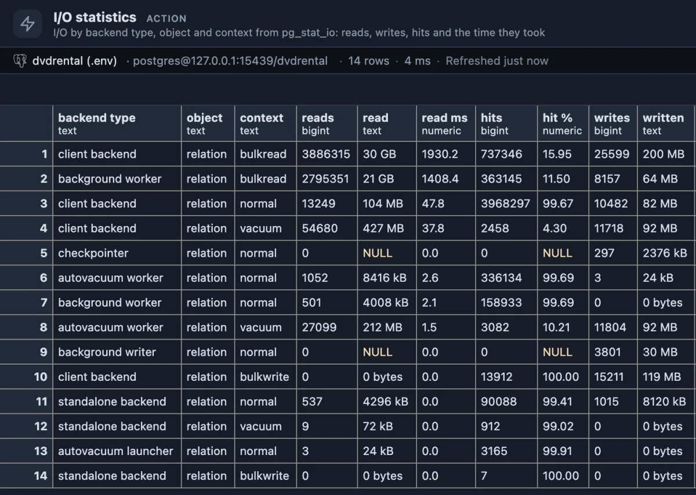

# I/O statistics

Who reads and writes on this server, how much, and how long they waited for the disk: client sessions, parallel workers, autovacuum, the checkpointer, the background writer.

Client sessions read 30 GB in bulk reads, the kind a whole-table scan does, finding only 16 % of it in memory and waiting 1.9 seconds for the rest; parallel query helpers (`background worker`) read another 21 GB the same way. Their ordinary reads, by contrast, hit memory 99.67 % of the time. But in ordinary work the sessions also wrote 82 MB themselves, more than the background writer's 30 MB: each of those writes made a session wait, a sign the background writer could run at a faster pace (see Checkpoints).

## When to use it

- **The disk is busy and you want to know who keeps it busy**: queries, vacuum, or the server's own writers.
- **Sessions are slow on writes**: do they write their own data (they wait while they do), or do the background processes keep up?
- **Before and after a change** (more memory, a new index, a vacuum setting): reset the counters, wait, compare.

## How to read it

One row per kind of process, kind of object and kind of work that did any I/O, the most time first.

| Column | Meaning |
|---|---|
| backend type | `client backend` (sessions), `background worker` (parallel query helpers and extensions), `autovacuum worker`, `checkpointer`, `background writer`, ... |
| object | `relation` (tables and indexes), `temp relation`, and from PostgreSQL 18 `wal`. |
| context | `normal`, `bulkread` (a big scan through a small ring of buffers, so it does not flush everything else from memory), `bulkwrite`, `vacuum`, and from 18 `init` for WAL. |
| reads, read, read ms | Read operations, their size, and the time spent waiting for them. |
| hits, hit % | Blocks found in memory, and their share of everything asked for. |
| writes, written, write ms | Write operations, their size, and their time. Client sessions writing much of their own data wait for it; the background writer and the checkpointer should do that. |
| extends | Operations that grew a table or index file. |
| evictions, reuses | Buffers pushed out of memory to make room, and ring buffers reused (bulk and vacuum work). |
| writebacks, fsyncs, fsync ms | Requests to the operating system to write back, fsync calls, and their time. |
| since | When these counters were last reset. |

What to look for: a high **read ms** on client sessions (queries wait for the disk: Top queries and Sequential scans say which), high **writes** by client sessions (raise the background writer's pace, see Checkpoints), long **fsync ms** (the storage is slow to make writes durable).

## Try it

Run it from its row in the Extensions side tab (**Run**). The times stay zero unless `track_io_timing` is on; on a TEST server turn it on with `alter system set track_io_timing = on;` and `select pg_reload_conf();`. To measure from now, reset the counters: `select pg_stat_reset_shared('io');`.

## Good to know

Reads `pg_stat_io`. PostgreSQL 18 replaced the per-operation `op_bytes` with `read_bytes` and `write_bytes`; the row is read as JSON, so one query gives the sizes on 16, 17 and 18 alike. WAL rows (18 and newer) need `track_wal_io_timing` for their times. Reads only. Opens on its result (`@face result`).

## Requirements

PostgreSQL 16 or newer: `pg_stat_io` does not exist before.
