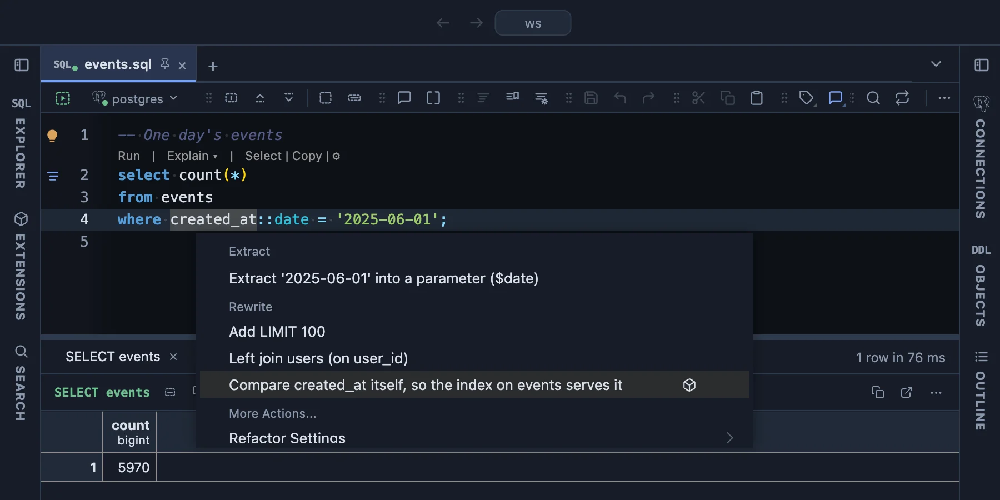

# Performance refactors

Four rewrites that make slow queries fast, offered in the editor's lightbulb (Ctrl+. or ⌘.) where they help. Each fixes a common reason PostgreSQL works much harder than it has to, and returns the same rows as before.



The lightbulb on `created_at::date = '2025-06-01'`. The cast hides `created_at` from its index, so PostgreSQL reads every row; the offer compares the column itself. The cube at the end of its row says it comes from this extension.

## What it is for

- **A query that reads the whole table** although the column it filters has an index.
- **Paging that gets slower page by page**, the deeper you go with OFFSET.
- **Your own function in a WHERE** that is called for every row.
- **A foreign key or a CHECK to add** to a big table that takes writes.

## Before and after

Measured on PostgreSQL 17 on a table of 3 million rows (30 million for the constraint), three runs each.

### Compare the indexed column itself

```sql
-- before: 57 ms, every row read
select count(*) from events where created_at::date = '2025-06-01';

-- after: 0.27 ms, through the index on created_at
select count(*) from events where created_at >= '2025-06-01' and created_at < '2025-06-02';
```

The same for `date(col)`, `cast(col as date)` with any comparison or BETWEEN, `date_trunc('month', col) = '2025-06-01'` on the unit's boundary, `extract(year from col) = 2025`, `coalesce(user_id, 0) = 123` (24 to 27 ms before, 0.05 ms after) and `user_id + 1 = 124` (0.03 ms after).

### Page by the last key instead of OFFSET

```sql
-- before: 77 to 88 ms for page 40,001; every row before it is read and dropped
select * from events order by id limit 50 offset 2000000;

-- after: 0.04 ms, whichever page
select * from events where id > $last_id order by id limit 50;
```

Your code passes the previous page's last `id` instead of a page number. The parameter is written the way your Refactors settings write them (`$last_id` or `:last_id`).

### Declare the function STABLE

```sql
-- before: 356 to 403 ms; the function runs for every row and the index on user_id is not used
create function user_of(x int) returns int language plpgsql as $$ begin return x; end $$;
select count(*) from events where user_id = user_of(123);

-- after: 0.033 to 0.036 ms
create function user_of(x int) returns int language plpgsql stable as $$ begin return x; end $$;
```

A PL/pgSQL function that does not say otherwise is VOLATILE. The offer comes only when PostgreSQL's own parser finds that the body writes nothing, runs no dynamic SQL, locks no rows and calls only IMMUTABLE or STABLE functions.

### Add the constraint NOT VALID, then VALIDATE it

```sql
-- before: every write to orders waits the whole 1.6 s
alter table orders add foreign key (customer_id) references customers (id);

-- after: the ADD takes 1 ms; during the 1.6 s VALIDATE an INSERT takes 1.1 ms
alter table orders add constraint orders_customer_id_fkey foreign key (customer_id) references customers (id) not valid;
alter table orders validate constraint orders_customer_id_fkey;
```

An unnamed constraint gets the name PostgreSQL would give it, so VALIDATE can name it.

## When it is offered

| Refactor | Offered when |
|---|---|
| Compare the indexed column itself | A btree index of the table starts with the column, and the rewrite returns the same rows (a `date_trunc` day off its unit's boundary, or `coalesce(col, 0) = 0`, is left alone). |
| Page by the last key | The query reads one table, orders it by a unique NOT NULL key that an index reads in that order, and its OFFSET is a parameter or at least the option below. |
| Declare the function STABLE | A PL/pgSQL function declares no volatility, returns something (not void, not a trigger) and its body only reads. |
| NOT VALID, then VALIDATE | The table has at least the option below's rows (the statistics' estimate, read when the lightbulb's list opens). |

## Try it

Make a table of 3 million rows and a function, then put each query in a script and open the lightbulb on it:

```sql
create table events as
  select g as id, timestamptz '2025-01-01' + random() * interval '500 days' as created_at,
         (random() * 50000)::int as user_id
  from generate_series(1, 3000000) g;
alter table events add primary key (id);
create index on events (created_at);
create index on events (user_id);
analyze events;

select count(*) from events where created_at::date = '2025-06-01';
select * from events order by id limit 50 offset $offset;
create function user_of(x int) returns int language plpgsql as $$ begin return x; end $$;
```

Run each before and after the rewrite with EXPLAIN ANALYZE to see the difference on your own server.

## Settings

In the Refactors settings, under Performance refactors:

| Setting | Default | What it does |
|---|---|---|
| Smallest OFFSET to page by key | 10000 | A written OFFSET below this is left alone; the rows it skips cost under a millisecond. A parameter is always offered. |
| Smallest table | 1000000 | The rows a table needs before NOT VALID is offered: checking a constraint holds writes about 60 ms per million rows. |

## Good to know

- Nothing runs on its own: each refactor edits the statement in the editor, and you run it.
- Keyset paging changes how your code asks for the next page: it passes the last key it saw. Pages are then stable while rows are added.
- STABLE is a promise that the function changes nothing and returns the same for the same arguments within one statement. Keep it in the function's CREATE in your migrations: a later CREATE OR REPLACE without it makes the function VOLATILE again.
- VALIDATE CONSTRAINT still reads every row; it just lets writes go on meanwhile. Run it when you choose.
- The [Functions that could be STABLE](../stable-functions/) extension lists every such function in a database.

## Requirements

PostgreSQL 13 or newer. PlumeSQL 0.25.0 or newer for the first two; Declare the function STABLE and NOT VALID need PlumeSQL 0.26.0 or newer, which hands a refactor what they read.
