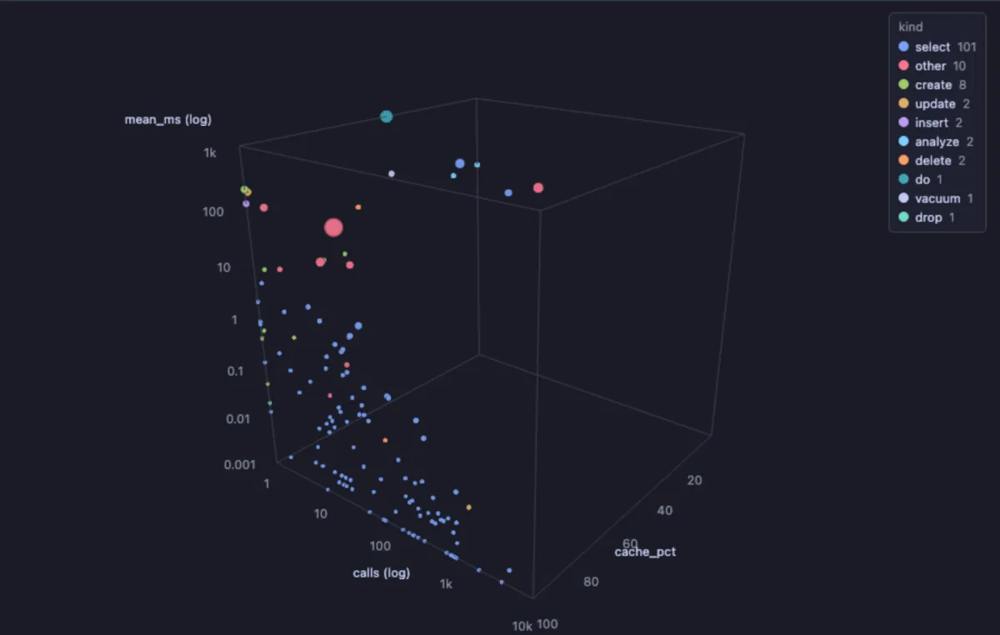
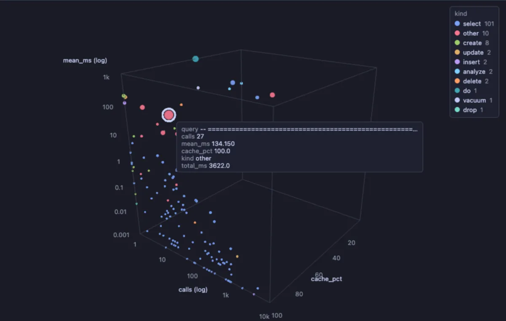

# Query landscape

See every statement your database runs as a point in 3D, from `pg_stat_statements`: how often it runs, how long it takes on average and how much of what it reads comes from memory, each point as big as the time it costs in total. The statements worth tuning stand out at a glance: big, high and far to the right.

The statements of a busy database. Most are small blue `select`s, fast and run thousands of times (low and to the right). The few big points higher up are the slow ones that add up to the most time in total: the first to look at. Colour says what kind of statement each is.

## What it is for

- **What to tune first**: a big point high up is slow and costly in total; making it faster saves the most time.
- **The constant small cost**: a point far to the right runs all the time, so even a small saving per call adds up.
- **What reads from disk**: a point at the low end of the depth (a low cache share) reads its data from disk rather than memory; a bigger `shared_buffers`, an index or a narrower query helps it.

## How to read it

| Axis | Column | Scale |
|---|---|---|
| Width | `calls`, how often it ran | log |
| Height | `mean_ms`, its mean execution time | log |
| Depth | `cache_pct`, the share of blocks found in memory (shared buffers) | linear |
| Size | `total_ms`, the time it took in total | |
| Colour | `kind`, the statement's first word (`select`, `update`, `insert` ...), read past any comment in front of it | |

On a log axis each step is ten times the one before (1, 10, 100, 1k), so statements that differ a thousandfold still fit in one picture. Hover a point for its numbers and its text; click it to select its row in the grid, where `rows_per_call` and the full statement are too. The legend hides and shows a kind with a click.

Steering: drag to turn, right drag (or Shift and drag) to slide, wheel to zoom; **Spin** turns the landscape slowly.

## Try it

Open the **Extensions** side tab and press **Run** on Query landscape, on a connection whose server has `pg_stat_statements` (see Requirements): the statements of the current database open in a grid, the costliest first, with the **Landscape** tab drawn beside it. Run it again after a busy hour to see what changed, or after `select pg_stat_statements_reset();` to start counting from now.

## Good to know

The statements are those of the current database, up to 5000, the costliest first. A statement that touched no blocks (a `SET`, a `BEGIN`) has no cache share and is left out of the picture, not out of the grid. The statistics count from the last `pg_stat_statements_reset()`. The query is the extension's own file, a read of `pg_stat_statements` and nothing else. The view's inputs are set in the file (`-- @inputs`): the sliders button in the view's header changes them for this result, and Fork to Scripts makes a copy of your own to change them for good. The landscape is drawn by Scatter 3D, which installs with it.

## Requirements

PostgreSQL 13 or newer with the `pg_stat_statements` extension: `shared_preload_libraries = 'pg_stat_statements'` in the server's configuration (a restart), then `create extension pg_stat_statements;` in the database. three.js comes from `cdn.jsdelivr.net`, which has to be an allowed remote script host (the Log offers Allow host when it is not).
