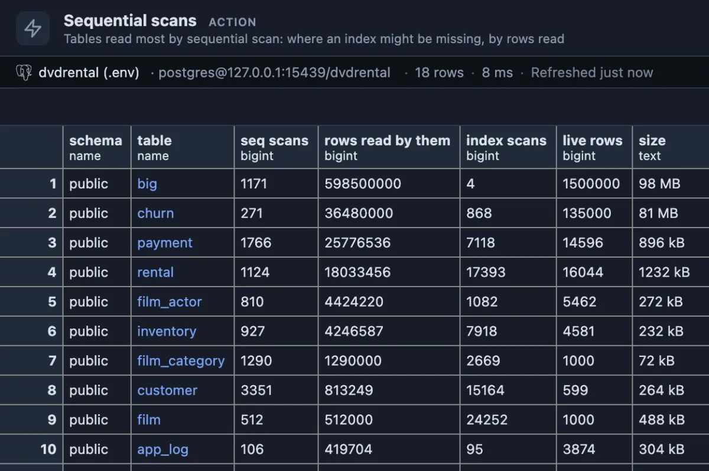
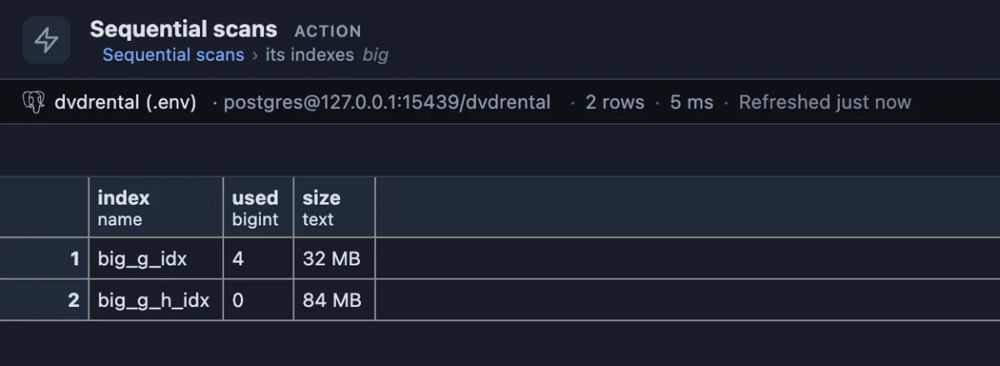

# Sequential scans

The tables PostgreSQL reads from start to end most, by rows read: the first place to look for a missing index.

`big`, 1.5 million rows, has been read whole 1,171 times: 598 million rows, against only 4 index scans. Some query keeps looking for something in it that no index helps with (Top queries shows which one). `churn`, `payment` and `rental` come next with 36, 26 and 18 million rows read.

## When to use it

- **A query is slow** and you suspect a missing index: is its table near the top here?
- **Top queries points at a query** with a low cache %: this tells which table it reads whole.
- **After adding an index**: reset the counters and check that the table moved down.

## How to read it

One row per table that was read whole at least once since the counters were reset, the most rows read first, up to a hundred.

| Column | Meaning |
|---|---|
| schema, table | The table. Click it to see its indexes. |
| seq scans | How many times it was read from start to end. |
| rows read by them | How many rows those reads went through in total: the cost that matters. |
| index scans | How many times an index was used on it instead. |
| live rows | About how many rows it holds. |
| size | Its size on disk, indexes aside. |

What is normal: small tables (a few hundred rows, a few pages) are read whole on purpose, because an index would not pay; dvdrental's `store` and `staff`, two rows each, are read whole all the time, and that is fine. A BIG table with many reads and few index scans is not: find the query (Top queries), EXPLAIN it, and give it an index on the columns it filters by.

## One click deeper

**Its indexes**, on a table, lists the indexes the planner has to work with there, with how often each was used and its size:

`big` has two indexes, both on `g`, and the slow query searches `h`: neither can help it.

## Try it

Run it from its row in the Extensions side tab (**Run**). Any database that has been used for a while answers; the counters run since the last reset (`select pg_stat_reset();` resets this database's) or the last restart.

## Good to know

The counters come from `pg_stat_user_tables` and `pg_stat_user_indexes`, kept per database. Reads only: it changes nothing on the server. Opens on its result (`@face result`).

## Requirements

PostgreSQL 13 or newer.
