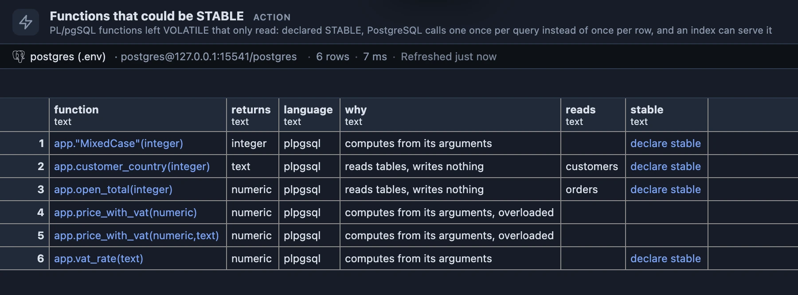
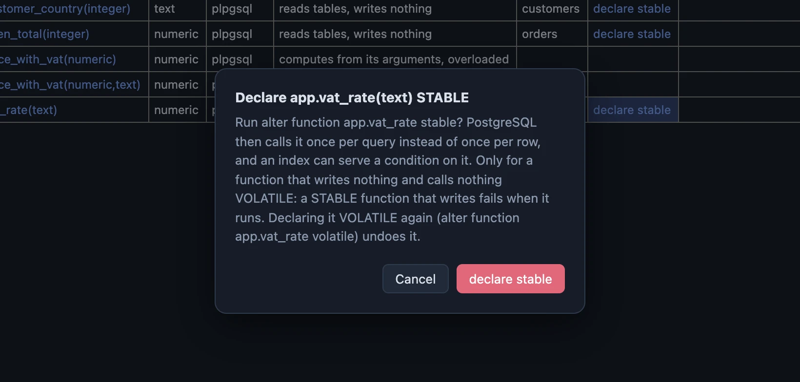

# Functions that could be STABLE

PL/pgSQL functions that only read but were never told so: declared STABLE, PostgreSQL calls one once per query instead of once per row, and an index can serve a condition on it.



Six functions of a sample schema. Each was created without a volatility, so PostgreSQL took the default, VOLATILE, and treats every call as if it could change something. Four have a **declare stable** button; `price_with_vat` has two versions under one name, so it is declared where it is created (see Buttons).

## Why it matters

A VOLATILE function in a WHERE clause runs again for every row, and the index on the column it is compared with cannot be used:

```sql
create function user_of(x int) returns int language plpgsql as $$ begin return x; end $$;

select count(*) from events where user_id = user_of(123);   -- 356 to 403 ms
```

Declared STABLE, it runs once for the whole query and the index on `user_id` answers:

```sql
alter function user_of stable;

select count(*) from events where user_id = user_of(123);   -- 0.033 to 0.036 ms
```

Measured on PostgreSQL 17 with 3,000,000 rows in `events` and an index on `user_id`, three runs each: about ten thousand times faster, from one word. A one-line `LANGUAGE sql` function shows no difference, because PostgreSQL copies its body into the query; that is why the list holds PL/pgSQL functions only.

## When to use it

- **A query calls one of your functions in its WHERE** and reads the whole table although the column has an index.
- **Reviewing a schema**: functions written without a volatility are VOLATILE by default, and most of them only look something up.

## How to read it

One row per PL/pgSQL function that is VOLATILE and looks read-only.

| Column | Meaning |
|---|---|
| function | The function and its arguments. Click it for its definition. |
| returns | What it returns. |
| why | Whether it reads tables or computes from its arguments; "overloaded" when several functions share its name. |
| reads | The tables its source names. |
| stable | The **declare stable** button. Empty for an overloaded function: `alter function` by name alone cannot tell the versions apart. |

The list is careful on purpose. A function stays out when its source names anything that writes (INSERT, UPDATE, DELETE, a CREATE ...), runs dynamic SQL (EXECUTE), locks, reads a sequence or the clock (`nextval`, `random`, `clock_timestamp`), or calls any function that is VOLATILE itself, even when the word is only in a comment or a string. So a function that calls another one from this list shows up once that one is STABLE: declare from the bottom up.

Left out on purpose: functions that return `void` or `trigger`, SQL functions, and functions an extension installed.

## Buttons

- **declare stable** runs `alter function <schema>.<name> stable`, after a question that names the statement:

  

  `alter function <schema>.<name> volatile` undoes it.
- **function** opens the function's definition, one step deeper.

For a function whose name is shared (overloads), and for the full check, open its CREATE FUNCTION in PlumeSQL's editor with the [Performance refactors](../performance-refactors/) extension installed: its lightbulb offers **Declare the function STABLE** there (PlumeSQL 0.26.0 and newer), after reading the body with PostgreSQL's own parser.

## Try it

Run it from its row in the Extensions side tab (**Run**). A database with PL/pgSQL functions of its own answers; a fresh one lists nothing.

## Good to know

STABLE promises PostgreSQL that the function writes nothing and returns the same result for the same arguments within one statement. A STABLE function that tries to write fails when it runs ("UPDATE is not allowed in a non-volatile function"), which is why the list leaves out anything that might. Reading tables is fine for STABLE; IMMUTABLE, the next step, is not offered here. The query reads `pg_proc` only: nothing changes until you press **declare stable** and answer yes. Opens on its result (`@face result`).

A function whose CREATE says VOLATILE outright is listed too: the catalog keeps no difference between VOLATILE written out and the default. If it is VOLATILE on purpose, leave it.

Keep the change in your migrations as well: write STABLE into the function's CREATE. A later CREATE OR REPLACE without it makes the function VOLATILE again.

## Requirements

PostgreSQL 13 or newer. PlumeSQL 0.25.0 or newer. Declaring a function STABLE takes its owner (or a superuser).
