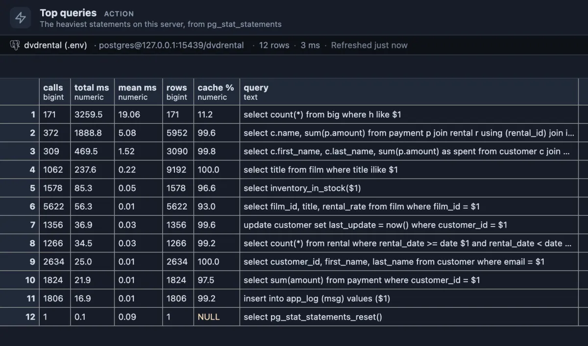

# Top queries

The statements that cost this database the most time, from the server's own statistics.

An application's queries after a busy minute. One short query, `select count(*) from big where h like $1`, ran 171 times and took 3.3 seconds in all, more than the next ten together: 19 ms a call, with only 11 % of what it read found in memory. The film lookup by id ran 5,622 times, yet cost 56 ms in total. The first row is the one worth fixing; here an index made for `LIKE 'ab%'` searches (`create index on big (h text_pattern_ops);`) takes that query from 24 ms to under 1 ms.

## When to use it

- **"The database is slow"**: the shortest road from that sentence to the query that is why.
- **Before optimizing anything**: fix what costs the most in total, not the query that annoyed someone once.
- **After a release**: a new query at the top, or an old one that suddenly runs twice as often.

## How to read it

One row per distinct statement (the same query with other values counts as one), the fifty with the most total time first.

| Column | Meaning |
|---|---|
| calls | How many times it ran. |
| total ms | All its runs together, in milliseconds: what it cost the server. |
| mean ms | One run, on average: what each user waits. |
| rows | Rows returned or changed in all. |
| cache % | The share of the data it read that was already in PostgreSQL's memory; low means it goes to the disk. |
| query | The statement, with its values replaced by `$1`, `$2`, ... |

What to look for: a high **total** with a low **mean** is a cheap query run very often (cache it in the application, or batch it); a high **mean** is a slow query (EXPLAIN it, look for a missing index); a low **cache %** reads more than fits in memory (often a whole-table scan, see Sequential scans).

## Try it

Run it from its row in the Extensions side tab (**Run**). The server must have the `pg_stat_statements` extension (see Requirements); without it the run reports PostgreSQL's own error. The numbers count from the last reset: to measure a test, run `select pg_stat_statements_reset();`, use the application for a while, then run Top queries.

## Good to know

The statistics live in the `pg_stat_statements` view, here limited to the current database. The view is deliberately not schema qualified, the one place PlumeSQL leaves a name to the search path: it lives in whatever schema the extension was installed into, and only the server knows which. Not pinned to the title bar on purpose: a pin that errors on servers without the extension would be a dead button in prime space; where it runs, one `@toolbar` line in your copy pins it back. Reads only. Opens on its result (`@face result`).

## Requirements

PostgreSQL 13 or newer with the `pg_stat_statements` extension, which is not on by default: add `pg_stat_statements` to `shared_preload_libraries` in postgresql.conf, restart the server, then run `create extension pg_stat_statements;` in the database. Managed services (RDS, Cloud SQL, Azure, Supabase, Neon) usually have it ready to create. Seeing other users' statement texts needs the `pg_read_all_stats` role or superuser.
