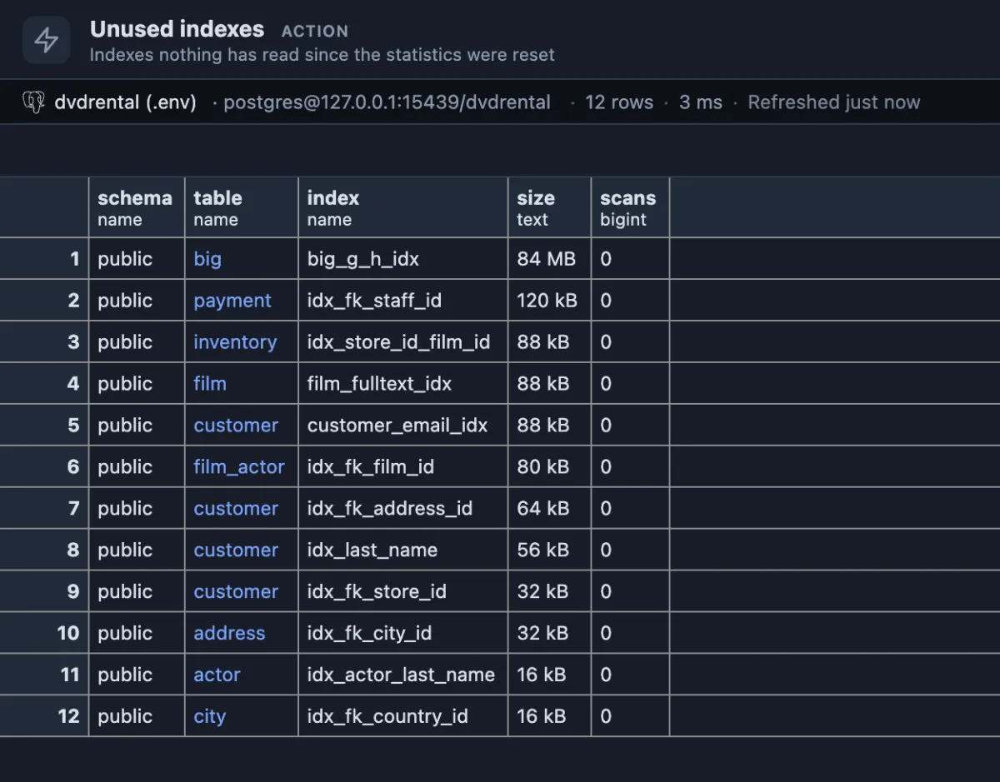
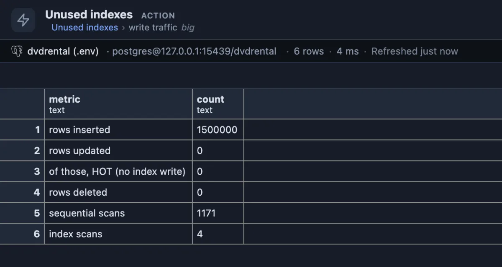

# Unused indexes

Indexes nothing has read since the statistics were reset, the biggest first: disk and write time you may be able to take back.

Twelve indexes nobody read. The one that matters is `big_g_h_idx`, 84 MB. The rest are the sample database's own small indexes (foreign keys, a last name, a full-text search) that this test's queries never needed: small, but each one is updated on every write to its table.

## When to use it

- **Writes are slow**, or the database grows faster than its data: every index is paid for on every insert.
- **Tidying a schema** before a migration or an upgrade: fewer indexes, faster restores.
- **After a feature was removed**: the indexes made for it often stay behind.

## How to read it

One row per index with zero reads. Indexes that cannot be dropped anyway are left out: primary keys, unique indexes, indexes behind a constraint and the replica identity index.

| Column | Meaning |
|---|---|
| schema, table, index | The index and its table. Click the table for its write traffic. |
| size | The room it takes on disk. |
| scans | Zero, by definition. |

What to do: an index unused HERE may be read on a replica, or once a month by a report. Check how long the counters have been running (a restart or `pg_stat_reset()` set them to zero), check the replicas, then drop with `DROP INDEX CONCURRENTLY`, one at a time, keeping its CREATE INDEX statement in case it was needed after all.

## One click deeper

**Write traffic**, on a table, shows what that table pays for its indexes: rows inserted, updated (and how many of those were HOT updates, which touch no index), deleted, and its scan counts:

`big` was loaded once and never changed: its unused index costs disk, not write time. On a table with millions of updates, the same index would cost on every one of them.

## Try it

Run it from its row in the Extensions side tab (**Run**). Any database answers; the longer the counters have run, the more an empty scans column means.

## Good to know

The counters come from `pg_stat_user_indexes` and `pg_stat_user_tables`, kept per database since the last statistics reset or restart. Reads only: nothing is dropped here. Opens on its result (`@face result`).

## Requirements

PostgreSQL 13 or newer.
