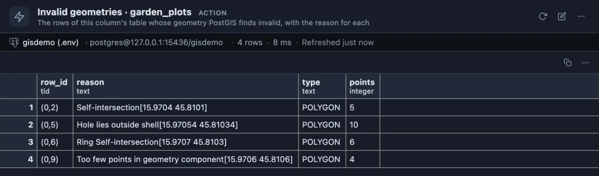
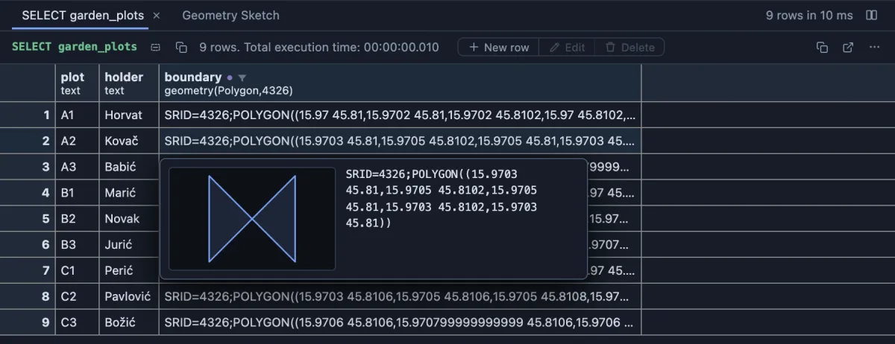

# Invalid geometries

Find every row of a table whose shape PostGIS considers broken, and why.



Nine plots of a community garden, drawn by hand in a mapping tool. Four of them are broken: one boundary crosses itself, one has a hole that lies outside the plot, one touches itself at a point, and one has too few points to enclose anything. Each row gives where the problem is (the point in brackets, in the column's own coordinates) and the row's physical address, `(0,2)`, to find it again.

## When to use it

- **After an import**: shapefiles, GeoJSON and KML from other tools often carry shapes PostGIS rejects as invalid.
- **Before an analysis**: area, union, intersection and overlay functions (`ST_Area`, `ST_Union`, `ST_Intersection`) give wrong answers or stop with an error on invalid shapes. Check first, then compute.
- **When people draw**: hand-drawn polygons easily cross themselves (a bow-tie, below). A check after each batch of edits finds them before anyone else does.

## How to read it

| Column | Meaning |
|---|---|
| row_id | The row's physical address in the table (`ctid`), such as `(0,2)`. Use it at once: `select * from garden_plots where ctid = '(0,2)'`. An update or a `VACUUM FULL` can move a row, so do not keep it. |
| reason | Why PostGIS refuses the shape, and the point where it saw the problem. |
| type | The geometry type, such as `POLYGON` or `MULTIPOLYGON`. |
| points | How many points the shape has. |

The reasons you will meet most:

- **Self-intersection**: the boundary crosses itself, like a figure eight or a bow-tie. Usually two points were drawn in the wrong order.
- **Ring Self-intersection**: the boundary touches itself at a point without crossing.
- **Hole lies outside shell**: a hole (an inner ring) is not inside the shape it is meant to cut.
- **Too few points in geometry component**: a ring needs at least four points (three corners and the first one again to close it).

An empty answer means every shape in the column is valid. NULLs are left out.

The usual repair is PostGIS's own `ST_MakeValid`, which keeps every part of a shape but makes it valid. Look at what it would make before you save anything:

```sql
select plot, geometrytype(st_makevalid(boundary)) as becomes, st_astext(st_makevalid(boundary)) as repaired
from garden_plots
where not st_isvalid(boundary);
```

In the garden, the bow-tie becomes two triangles (a `MULTIPOLYGON`), and the plot with too few points becomes a `LINESTRING`, a line rather than an area: that one needs drawing again. A column declared `geometry(Polygon, 4326)` refuses a `MULTIPOLYGON`, so either repair into a column that takes it (plain `geometry`, or `geometry(MultiPolygon, 4326)`) or fix the shapes by hand. On a plain `geometry` column, which takes any type, the repair is one statement: `update ... set geom = st_makevalid(geom) where not st_isvalid(geom)`.

## Try it

Right-click the header of a `geometry` or `geography` column in any result that comes from a table and choose **Run Invalid geometries**. The answer opens in a tab of its own, titled with the table. It checks the WHOLE table, not only the rows the result shows.

To see it find something, make the garden on a test database with PostGIS:

```sql
create table garden_plots (
  plot text primary key,
  holder text,
  boundary geometry(Polygon, 4326)
);
insert into garden_plots (plot, holder, boundary)
select plot, holder,
       st_setsrid(st_translate(st_scale(st_geomfromtext(shape), 0.0002, 0.0002), 15.9700 + col * 0.0003, 45.8100 + rw * 0.0003), 4326)
from (values
  ('A1', 'Horvat',   0, 0, 'POLYGON((0 0, 1 0, 1 1, 0 1, 0 0))'),
  ('A2', 'Kovač',    1, 0, 'POLYGON((0 0, 1 1, 1 0, 0 1, 0 0))'),
  ('A3', 'Babić',    2, 0, 'POLYGON((0 0, 1 0, 1 1, 0 1, 0 0))'),
  ('B1', 'Marić',    0, 1, 'POLYGON((0 0, 1 0, 1 1, 0 1, 0 0))'),
  ('B2', 'Novak',    1, 1, 'POLYGON((0 0, 1 0, 1 1, 0 1, 0 0), (1.2 0.2, 1.6 0.2, 1.6 0.6, 1.2 0.6, 1.2 0.2))'),
  ('B3', 'Jurić',    2, 1, 'POLYGON((0 0, 1 0, 1 1, 0.5 0, 0 1, 0 0))'),
  ('C1', 'Perić',    0, 2, 'POLYGON((0 0, 1 0, 1 1, 0 1, 0 0))'),
  ('C2', 'Pavlović', 1, 2, 'POLYGON((0 0, 1 0, 1 1, 0 1, 0 0), (0.2 0.2, 0.4 0.2, 0.4 0.4, 0.2 0.4, 0.2 0.2))'),
  ('C3', 'Božić',    2, 2, 'POLYGON((0 0, 1 0, 0 0, 0 0))')
) as p(plot, holder, col, rw, shape);

select plot, holder, boundary from garden_plots order by plot;
```

Then right-click the `boundary` header of the last query's result. With the **PostGIS** extension (`postgis`) installed too, hover a cell and its sketch shows the problem: plot A2 is the bow-tie.



To check one shape rather than a whole table, use **Validate geometry** (`validate-geometry`) from a cell's menu.

## Good to know

One statement, read only, on the tab's connection. The table and the column cannot be passed to the server as values, so their names are written into the statement, quoted by the server as identifiers. A `geography` column is checked as geometry. The PostGIS functions are called without a schema and found through the connection's `search_path`, because the schema PostGIS was installed into cannot be known in advance. On a big table the check takes as long as reading the whole table.

## Requirements

PostgreSQL 13 or newer with the `postgis` extension; without it the run answers with the server's own error.
