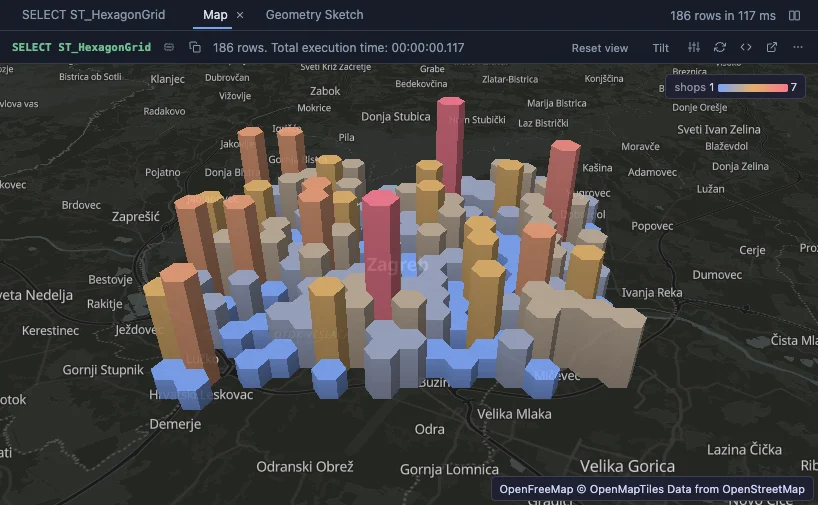

# Map



Geometry on a real map: the points, lines and polygons of a result over an OpenStreetMap basemap, coloured by one column, sized by another, raised by a third. Pan with the mouse, zoom with the wheel, rotate and tilt with the right button; tilt it to read the heights (MapLibre).

## What it shows

A **Map** tab beside the grid. Every row's geometry is placed on the map, which fits itself to them:

- **Points** as dots, sized by **Size by**; **lines** as strokes; **polygons** filled and outlined.
- **Colour by** a number runs along the theme's ramp (the legend says from what to what); a category gives each of the twelve most frequent values a colour.
- **Height** raises the polygons by a number, and turns the points into columns: the map tilts to show them, and **Tilt** in the header turns it flat and back. The tallest stands a quarter of the data's span high.

Hover a shape for its values, click it to select its row. **Reset view** fits the map to the data again.

### The basemap

The map under the rows is yours to choose, for every map in PlumeSQL: the **Map basemap style** setting (Extensions), OpenStreetMap served by [OpenFreeMap](https://openfreemap.org) with no key and no account by default, its Positron style. Its Liberty and Bright styles are a setting away, and so is a tile server of your own. The view's **Basemap** input turns it dark under a dark theme (`theme`, the default), keeps its own colours (`original`) or leaves it out (`none`).

The view itself has no network and names no host. PlumeSQL fetches the basemap's files for it, and only from a host you allowed: the first time, the Log says `tiles.openfreemap.org` is not an allowed map tile host and offers **Allow**; until then, and whenever there is no network, the rows are drawn on a plain background. The files are kept on this machine (Map tiles, on the System page), so an area seen once draws again offline. The host learns which area you look at, never your data.

## Inputs

| Input | `@inputs` key | Default | Meaning |
|---|---|---|---|
| Geometry | `geometry` | asked | A geometry or geography column in WGS 84 (SRID 4326), or GeoJSON or WKT text |
| Colour by | `color` | none | A number (a ramp) or a category (a colour each) |
| Height | `height` | none | A number that raises polygons, and points as columns |
| Size by | `size` | none | A number a point grows with |
| Label | `label` | none | What the tooltip names a shape by |
| Basemap | `basemap` | theme | `theme` (dark under a dark theme), `original` or `none` |
| Top rows | `top` | 20000 | How many rows the view reads from the result, from the first one |

## Example

### Try it on any database with PostGIS

Four hundred shops around Zagreb, then their density as hexagons raised by how many shops each holds:

```sql
create extension if not exists postgis;
create table map_demo_shops as
select g as id, 'Shop ' || g as name, (random() * 900 + 100)::int as sales,
       ST_SetSRID(ST_MakePoint(15.98 + (random() - 0.5) * 0.22, 45.81 + (random() - 0.5) * 0.12), 4326) as geom
from generate_series(1, 400) g;

-- @extension postgis-map open
-- @inputs geometry=geom, color=sales, size=sales, label=name
select name, sales, geom from map_demo_shops;

-- @extension postgis-map open
-- @inputs geometry=geom, height=shops, color=shops
select ST_Transform(h.geom, 4326) as geom, count(*) as shops
from ST_HexagonGrid(900, (select ST_Transform(ST_SetSRID(ST_Extent(geom), 4326), 3857) from map_demo_shops)) h
join map_demo_shops s on ST_Intersects(ST_Transform(s.geom, 3857), h.geom)
group by h.geom;
```

A geometry in another SRID is transformed in the query: `select ST_Transform(geom, 4326) as geom ...`. The view says so when it meets one, with the line to copy, and with PostGIS refactors installed the lightbulb on the statement makes the change in one click (Transform to WGS 84).

## Requirements

PostgreSQL 13 or newer with PostGIS (`ST_HexagonGrid` in the example needs PostGIS 3.1). The PostGIS extension installs with this one: the map reads geometry with its parser. MapLibre comes from `cdn.jsdelivr.net`, which has to be an allowed remote script host; the basemap from the host of your Map basemap style, `tiles.openfreemap.org` by default, which has to be an allowed map tile host (the Log offers Allow for each). A GPU-capable browser: the desktop app, or a normal browser tab.

## Notes

The basemap's attribution (OpenFreeMap, OpenMapTiles, OpenStreetMap) stands in the corner as text: the view cannot open links. Rows whose geometry does not read are left out, and the Log says how many. Attach it from a script with `-- @extension postgis-map` above a query (add `open`, `only` or `beside` to open on the view), or from a geometry column's own menu; `-- @inputs` answers the inputs in the file so the map draws with no dialog.
