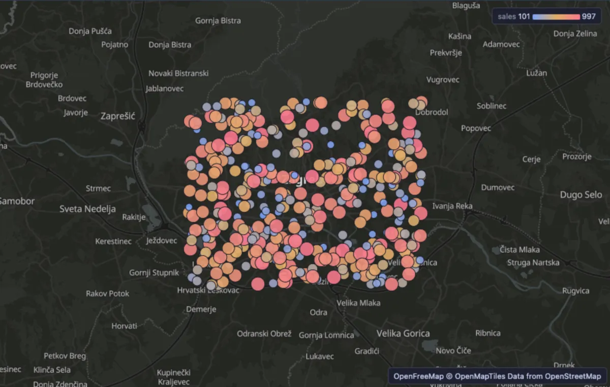
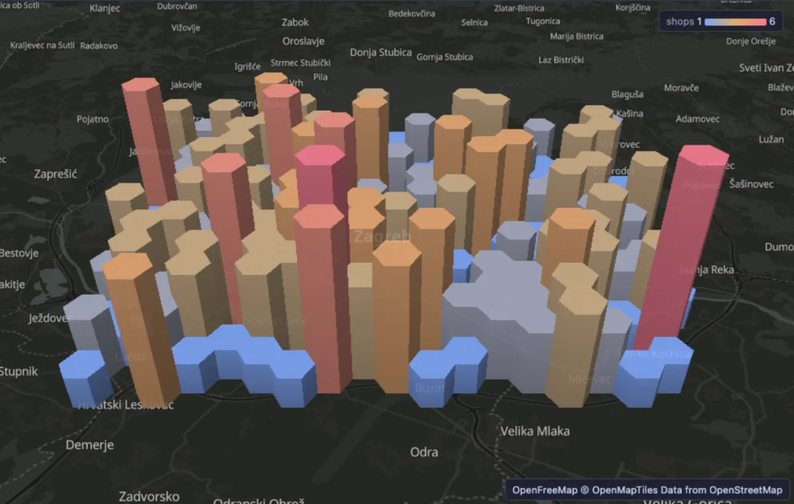
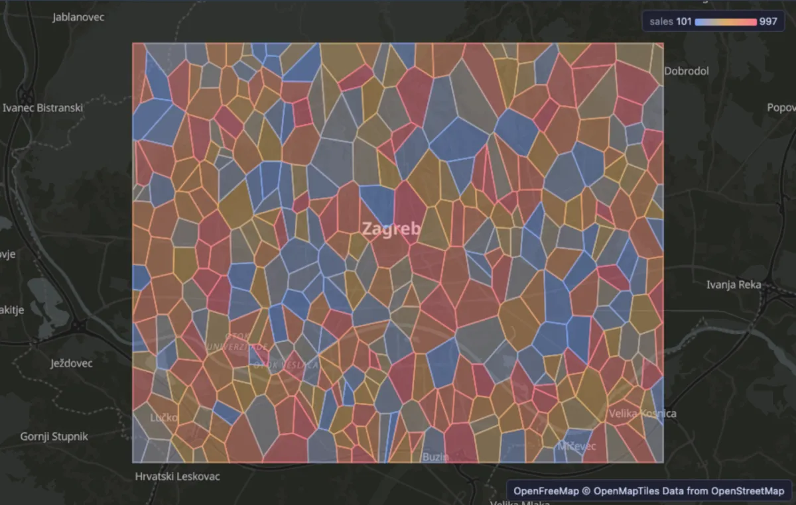

# Map

Put the rows of a query on a real map: points, lines and areas over an OpenStreetMap basemap, coloured, sized and raised by your columns.



Four hundred shops around Zagreb, each a dot coloured and sized by its sales (the legend in the corner runs from 101 to 997). The big red dots are the best sellers, the small blue ones the weakest, and they are mixed all over town: there is no district where every shop sells well or badly, so location alone does not explain the difference.

## What it is for

- **Where are my customers, shops or incidents?** Orders by delivery address, shops by turnover, faults reported by location: the map shows at a glance what a list of coordinates cannot.
- **Where do things crowd together?** Count rows in a grid of hexagons and raise each by its count: the tall towers are the busy places (shops per square kilometre, sign-ups per area, accidents per junction).
- **Who covers which area?** Draw areas (districts, delivery zones, the part of town closest to each shop) and colour them by a number to compare whole regions.

## How to read it

Every row with a geometry is drawn on the map, and the map zooms to fit them all.

- **Points** are dots, bigger by **Size by**. **Lines** are strokes, **areas** are filled and outlined.
- **Colour by** a number runs from blue (low) to red (high) along the theme's ramp, and the legend in the corner says from what to what. A category (a text column) gives each of the twelve most common values its own colour.
- **Height** raises areas by a number and turns points into columns. The map tilts to show them; **Tilt** in the header lays it flat and back. The tallest stands a quarter of the data's width high.

Pan by dragging, zoom with the wheel, rotate and tilt with the right button. Hover a shape for its values, click it to select its row in the grid. **Reset view** fits the map to the data again.

## Try it

The examples need PostGIS and a small table of made-up shops. Run this once on any database where you may create a table:

```sql
create extension if not exists postgis;
create table map_demo_shops as
select g as id, 'Shop ' || g as name, (random() * 900 + 100)::int as sales,
       ST_SetSRID(ST_MakePoint(15.98 + (random() - 0.5) * 0.22, 45.81 + (random() - 0.5) * 0.12), 4326) as geom
from generate_series(1, 400) g;
```

**Shops by sales**, the picture above:

```sql
-- @extension postgis-map open
-- @inputs geometry=geom, color=sales, size=sales, label=name
select name, sales, geom from map_demo_shops;
```

**Where shops crowd together**: the town cut into hexagons about a kilometre across (`ST_HexagonGrid`, in a metric projection), each counted and raised by how many shops it holds.

```sql
-- @extension postgis-map open
-- @inputs geometry=geom, height=shops, color=shops
select ST_Transform(h.geom, 4326) as geom, count(*) as shops
from ST_HexagonGrid(900, (select ST_Transform(ST_SetSRID(ST_Extent(geom), 4326), 3857) from map_demo_shops)) h
join map_demo_shops s on ST_Intersects(ST_Transform(s.geom, 3857), h.geom)
group by h.geom;
```



193 hexagons hold the 400 shops. Most hold one to three (the low blue and sand coloured ones); the red towers hold five or six, the busiest corners of town.

**Who is closest to which shop**: every shop's catchment area, the part of town nearer to it than to any other shop (`ST_VoronoiPolygons`), coloured by the shop's sales. A delivery service would draw its zones this way.

```sql
-- @extension postgis-map open
-- @inputs geometry=area, color=sales, label=name
select s.name, s.sales,
       ST_Intersection(v.cell, (select ST_Envelope(ST_Collect(geom)) from map_demo_shops)) as area
from (select (ST_Dump(ST_VoronoiPolygons(ST_Collect(geom)))).geom as cell from map_demo_shops) v
join map_demo_shops s on ST_Contains(v.cell, s.geom);
```



A big cell is a shop with a lot of town to itself (the largest covers about 190 hectares, the smallest 2); a cluster of small cells is a crowded street. A big blue cell is the one to ask about: a shop with no competition nearby that still sells little.

## Settings

| Setting | `@inputs` key | Default | What it does |
|---|---|---|---|
| Geometry | `geometry` | asked | The column with the shapes: a geometry or geography column in WGS 84 (SRID 4326), or GeoJSON or WKT text |
| Colour by | `color` | none | A number (blue to red) or a category (a colour each) |
| Height | `height` | none | A number that raises areas, and turns points into columns |
| Size by | `size` | none | A number a point grows with |
| Label | `label` | none | What the tooltip names a shape by (a name, an id) |
| Basemap | `basemap` | theme | `theme` (a dark map under a dark theme), `original` (the map's own colours) or `none` (no map, only your rows) |
| Top rows | `top` | 20000 | How many rows the map reads from the result, from the first one |

## The basemap

The street map under the rows is yours to choose, for every map in PlumeSQL: the **Map basemap style** setting (Extensions). By default it is OpenStreetMap served by [OpenFreeMap](https://openfreemap.org), with no key and no account, in its Positron style. Its Liberty and Bright styles are a setting away, and so is a tile server of your own.

The view itself has no network and names no host. PlumeSQL fetches the map for it, and only from a host you allowed: the first time, the Log says `tiles.openfreemap.org` is not an allowed map tile host and offers **Allow**. Until then, and whenever there is no network, your rows are drawn on a plain background. The map files are kept on this machine (Map tiles, on the System page), so an area seen once draws again offline. The map server learns which area you look at, never your data.

## Good to know

The map wants coordinates in WGS 84 (longitude and latitude, SRID 4326). A geometry in another SRID is transformed in the query: `select ST_Transform(geom, 4326) as geom ...`. The view says so when it meets one, with the line to copy, and with PostGIS refactors installed the lightbulb on the statement makes the change in one click (Transform to WGS 84).

Rows whose geometry does not read are left out, and the Log says how many. The basemap's attribution (OpenFreeMap, OpenMapTiles, OpenStreetMap) stands in the corner as text: the view cannot open links. The map is drawn with MapLibre.

Attach it from a script with `-- @extension postgis-map` above a query (add `open`, `only` or `beside` to open on the view), or from a geometry column's own menu; `-- @inputs` answers the settings in the file so the map draws with no dialog.

## Requirements

PostgreSQL 13 or newer with PostGIS (`ST_HexagonGrid` in the example needs PostGIS 3.1). The PostGIS extension installs with this one: the map reads geometry with its parser. MapLibre comes from `cdn.jsdelivr.net`, which has to be an allowed remote script host; the basemap comes from the host of your Map basemap style, `tiles.openfreemap.org` by default, which has to be an allowed map tile host (the Log offers Allow for each). A GPU-capable browser: the desktop app, or a normal browser tab.
