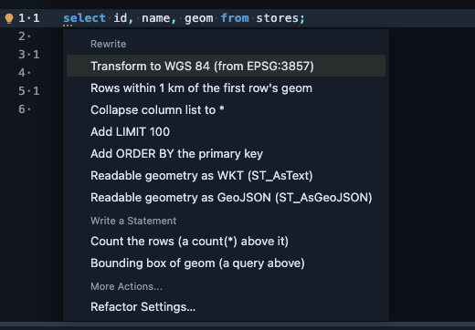
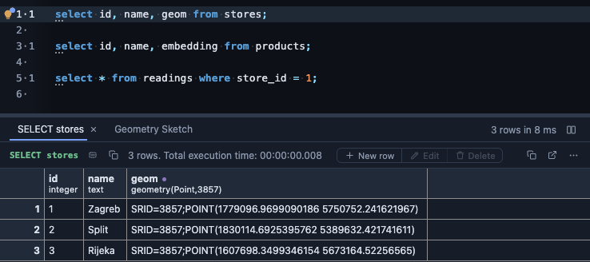
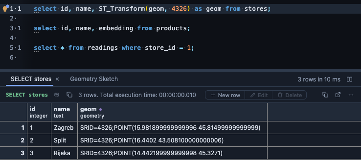
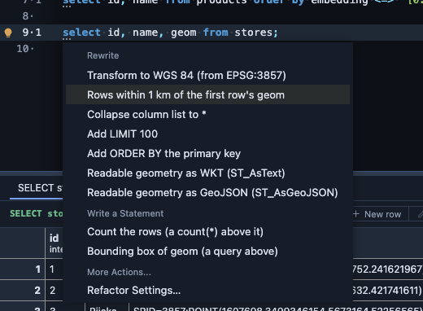

# PostGIS refactors

PostGIS sends a geometry as EWKB hex: exact, and unreadable. On a `SELECT` that lists a geometry or geography column, or a `*` that brings one, the editor's lightbulb (Ctrl+. or ⌘.) turns the column into text a person can read, under its own name:

```sql
select id, name, ST_AsText(geom) as geom from places;
```

Once the query has run, it also notices geometry stored in another reference system and offers to move it to WGS 84.

## What it offers

**Readable geometry**, as WKT (`ST_AsText`) or as GeoJSON (`ST_AsGeoJSON`), one offer each. A named column is wrapped where it stands; a `*` or a `t.*` is expanded into the table's columns with the geometry ones wrapped, so the rest of the query stays as it was. This one needs no run: it reads the statement.

**Transform to WGS 84**, once the query has run. Maps, GeoJSON and most tools expect longitude and latitude (WGS 84, EPSG:4326), but a table often stores its geometry in another reference system: Web Mercator (EPSG:3857), or a national grid. The lightbulb reads the reference system from the values the query returned, and when it is not WGS 84 it offers to transform the column:



```sql
-- before
select id, name, geom from stores;

-- after
select id, name, ST_Transform(geom, 4326) as geom from stores;
```

Run it again and the same points come back in longitude and latitude. Below, the geometry is shown as text by the **PostGIS** extension:

Before, in Web Mercator:



After, in WGS 84:



Not run yet, or already in WGS 84: the offer does not appear.

**Rows within 1 km of the first row's** geometry, once the query has run. The first row's geometry becomes the centre, and the query keeps the rows within a kilometre of it (or the distance you set), nearest first, measured in metres on geography whatever reference system the table stores (a geometry outside WGS 84 is transformed first):



```sql
select id, name, geom from stores
where ST_DWithin(ST_Transform(geom, 4326)::geography, ST_Transform('0101…'::geometry, 4326)::geography, 1000)
order by ST_Distance(ST_Transform(geom, 4326)::geography, ST_Transform('0101…'::geometry, 4326)::geography);
```

The distance is an option: set **Distance in metres** in the extension's **Options** (on its page, or under the extension in **Settings → Refactors**) and the offer says it, for example **Rows within 500 m of the first row's geom**. Offered on a query without a `WHERE`, an `ORDER BY` or a `LIMIT` of its own.

**Bounding box** of a geometry or geography column the query returns: `select ST_Extent(geom) from (...) q;`, a query above yours, the box around every row it returns. This one needs no run.

## What it reads

The statement and its tables' columns, from PlumeSQL's dictionary of the connection. For **Transform to WGS 84** and **Rows within 1 km**, also the first rows of the query's last run in this tab, which PlumeSQL already has. Nothing is asked of the server until you run the query.

## Where it applies

In the SQL editor, wherever the extension is attached (everywhere from the install on; change it on its page). Reading geometry values in a result, with a sketch of the shape, is the **PostGIS** extension's: install that one too, and attach each where you want it (the refactors everywhere, the sketches only where a script asks for them, for example).

## Requirements

PostgreSQL 13 or newer with PostGIS (`create extension postgis`), and PlumeSQL 0.24.0 or newer.
