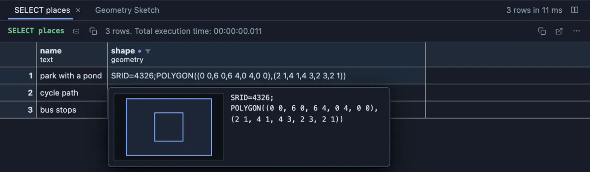
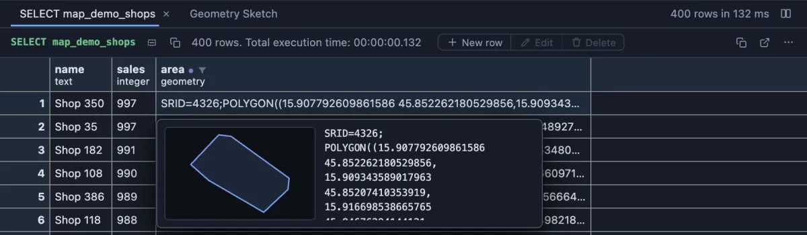
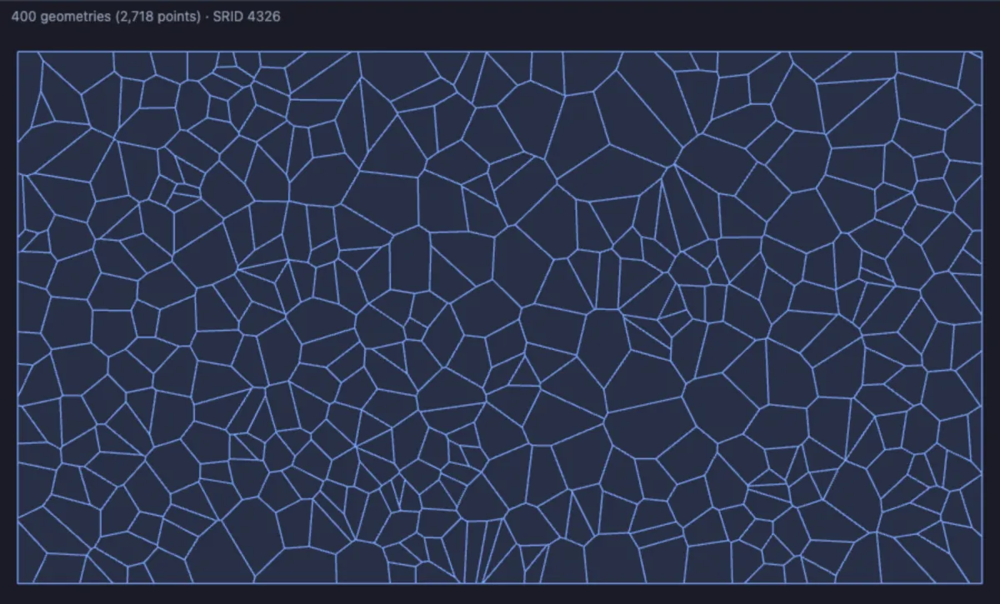

# PostGIS

Read PostGIS shapes in the grid: every `geometry` and `geography` value as text you can understand, with a small drawing of the shape wherever you meet it, and a whole column drawn at once.



Without this extension the cell would hold `0103000020E6100000020000000500...`, the hex PostGIS sends. Here it reads as a polygon in SRID 4326 with two rings, and the hover card draws it: a park (the outer rectangle) with a pond in the middle (the inner square, a hole in the park's area).

## What it is for

- **Is this the shape I think it is?** A delivery zone, a field boundary, a route: see it the moment you hover the cell, with no GIS tool and no map.
- **Spotting bad data**: drawn together, a column shows the polygon that strays a hundred kilometres away, the point at `0 0`, the line that doubles back. The text shows the SRID too, so a shape stored in the wrong one stands out.
- **Writing and copying shapes**: copy a cell and it pastes straight back into a query; type a polygon in the row editor and see it drawn before you save.

## How to read it

- **The cell** shows the value as EWKT, the text `ST_AsEWKT` prints: `SRID=4326;POINT(15.9819 45.815)`, the coordinate system first, then the kind of shape and its coordinates.
- **Hover** a cell: a card with the same text and a sketch of the shape.
- **Peek** a cell (Space): the text and the sketch in a strip above the value as stored.
- **Open Value in Tab**: the facts (the kind of shape, with Z and M when present, the SRID, how many points, the bounding box), the sketch, and the text in the editor. **Decode geometry** in the header flips the editor back to the hex as stored; **Copy** copies whichever is shown.
- **Edit a row** (F2): the geometry field draws the stored value, and the drawing follows as you type EWKT or WKT (`SRID=4326;POLYGON((0 0,4 0,4 4,0 0))`, `POINT Z (1 2 3)`, `MULTIPOINT((1 1),(2 2))`). A half typed shape draws nothing; the server stays the judge of what you typed.
- **Sketch Geometry Column**, in the menu of a geometry or geography column's header: a **Geometry Sketch** tab beside the grid draws every shape of that column together, points as dots, lines as lines, areas with their holes, all to one scale. The line above it counts the shapes and their points and names the SRID and the NULLs.

A sketch is a shape, not a map: the coordinates are drawn as they are, one scale for both axes, latitude up, with no streets under them and no projection. For a real map under the shapes, use the Map extension (postgis-map).

## Try it

**Three hand-written places** (any database with PostGIS), the picture above. Hover each shape cell: a park with a pond, a cycle path, four bus stops.

```sql
select name, shape::geometry as shape
from (values
  ('park with a pond', 'SRID=4326;POLYGON((0 0,6 0,6 4,0 4,0 0),(2 1,4 1,4 3,2 3,2 1))'),
  ('cycle path', 'SRID=4326;LINESTRING(0 0,2 3,5 2,7 5)'),
  ('bus stops', 'SRID=4326;MULTIPOINT((0 0),(1 2),(3 1),(4 4))')
) as places(name, shape);
```

**Every shop's catchment area**: four hundred made-up shops around Zagreb and the part of town nearest to each (`ST_VoronoiPolygons`). Make the shops once:

```sql
create extension if not exists postgis;
create table map_demo_shops as
select g as id, 'Shop ' || g as name, (random() * 900 + 100)::int as sales,
       ST_SetSRID(ST_MakePoint(15.98 + (random() - 0.5) * 0.22, 45.81 + (random() - 0.5) * 0.12), 4326) as geom
from generate_series(1, 400) g;
```

then list the areas, best sellers first, and hover one:

```sql
select s.name, s.sales,
       ST_Intersection(v.cell, (select ST_Envelope(ST_Collect(geom)) from map_demo_shops)) as area
from (select (ST_Dump(ST_VoronoiPolygons(ST_Collect(geom)))).geom as cell from map_demo_shops) v
join map_demo_shops s on ST_Contains(v.cell, s.geom)
order by s.sales desc;
```



Each area reads as a polygon in longitude and latitude, and the card draws the best seller's area: one cell of the mosaic, its edges where the neighbouring shops' areas begin.

**The whole column at once**: the same areas in the Geometry Sketch tab (or right-click the `area` column's header and pick **Sketch Geometry Column**).

```sql
-- @extension postgis open
-- @inputs column=area
select s.name, s.sales,
       ST_Intersection(v.cell, (select ST_Envelope(ST_Collect(geom)) from map_demo_shops)) as area
from (select (ST_Dump(ST_VoronoiPolygons(ST_Collect(geom)))).geom as cell from map_demo_shops) v
join map_demo_shops s on ST_Contains(v.cell, s.geom);
```



400 shapes, 2,718 points, all in SRID 4326. The cells fill the rectangle with no gap and no overlap, which is what a set of zones should do; a gap or a stray shape would show here at once.

## Settings

The column sketch has one setting; everything else works with nothing to set.

| Setting | `@inputs` key | Default | What it does |
|---|---|---|---|
| Geometry column | `column` | the first one | The geometry or geography column the Geometry Sketch tab draws (the column menu's entry sets it) |

## Where it applies

Every column whose declared type is `geometry` or `geography` (with a type modifier such as `geometry(Point,4326)`, and schema qualified when PostGIS lives off the `search_path`), in every result, from the install on (a global scope you can change on its page). A text column holding hex is text and stays that way. The Geometry Sketch tab shows only on a result that has such a column.

## Good to know

Every geometry kind reads: points, lines, polygons with their holes, the multis and geometry collections, 2D, Z, M and ZM, with or without an SRID, in PostGIS's EWKB and in ISO WKB of either byte order. Empty geometries read as `EMPTY`. Nothing is asked of the server: the hex the grid already holds is decoded on this machine.

Only the cell's face changes: the column is still a geometry, so the hover card, the peek, the value tab and the sketches read it as before. Copy takes the cell as the grid shows it, the whole EWKT, which PostGIS reads back as a geometry (`'SRID=4326;POINT(15.9819 45.815)'::geometry`).

The column sketch reads the column page by page and stops at 20,000 shapes or 300,000 points, saying how far it read (`first 20,000 of 25,000 rows`). It resizes with the pane. A very large geometry is drawn coarser in the small sketches of the card and the peek.

## Requirements

PostgreSQL 13 or newer with the PostGIS extension. Nothing runs on the server: the values are decoded from what the grid already holds.
