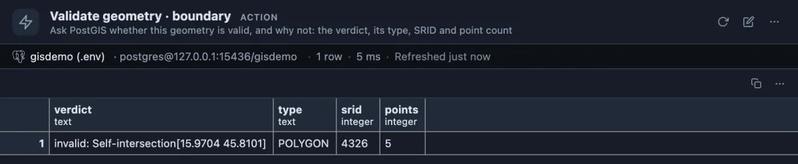
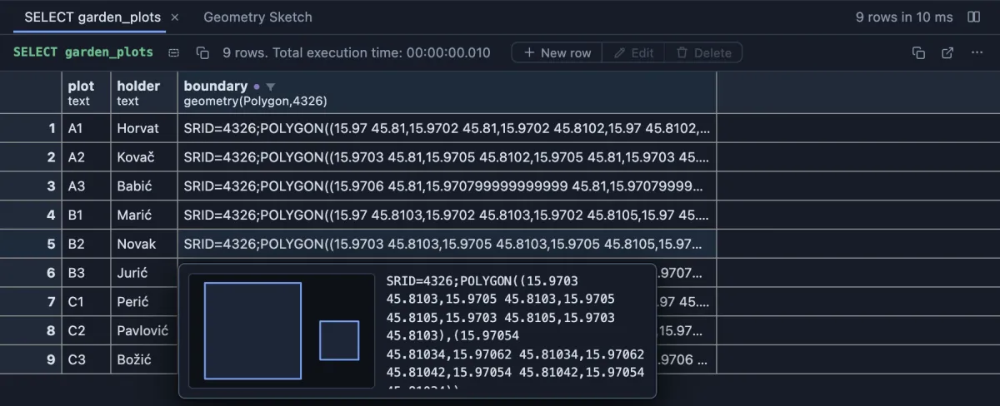

# Validate geometry

Ask PostGIS whether one shape in the grid is valid, and if not, why.



Plot A2 of a community garden, checked from its cell. The boundary looks like a square in the list of coordinates, but PostGIS says it is invalid: it crosses itself at the point in brackets. It is a polygon in SRID 4326 (longitude and latitude) with five points.

## When to use it

- **A function refused a shape**: `ST_Area`, `ST_Union` or `ST_Intersection` stopped with an error or gave a strange number, and you want to know whether that one geometry is to blame.
- **Before you save a drawing**: a polygon you typed or pasted looks right, but PostGIS judges validity by its own rules, so ask PostGIS.
- **Comparing two versions**: each value you check opens its own answer, so the original and a repaired shape can be compared side by side.

To check every row of a table at once, use **Invalid geometries** (`invalid-geometries`) from the column's header instead.

## How to read it

One row:

| Column | Meaning |
|---|---|
| verdict | `valid`, or `invalid:` followed by PostGIS's reason and the point where it saw the problem, such as `Self-intersection[15.9704 45.8101]`. |
| type | The geometry type (`POLYGON`, `MULTIPOLYGON`, `POINT` ...). |
| srid | Its coordinate system: 4326 is longitude and latitude, 3857 the web map projection, 0 none set. |
| points | How many points it has. |

The reasons in plain words: **Self-intersection**, the boundary crosses itself (a bow-tie); **Ring Self-intersection**, it touches itself at a point; **Hole lies outside shell**, a hole is not inside the shape; **Too few points in geometry component**, a ring needs at least four points to close.

With the **PostGIS** extension (`postgis`) installed, hovering the cell sketches the shape, which often shows the problem at once. Here plot B2's hole sits beside the plot instead of inside it, and the verdict for it reads `invalid: Hole lies outside shell`:



## Try it

Right-click a cell of a `geometry` or `geography` column and choose **Run Validate geometry**, or choose it from the **More actions** menu of the cell's value tab. The answer opens in a tab of its own, titled with the column. A NULL cell has nothing to check and does not offer it.

Any connection with PostGIS can check a shape typed on the spot; this bow-tie is invalid:

```sql
select 'bow-tie' as name, st_geomfromtext('POLYGON((0 0, 1 1, 1 0, 0 1, 0 0))') as shape
union all
select 'square', st_geomfromtext('POLYGON((0 0, 1 0, 1 1, 0 1, 0 0))');
```

Right-click each `shape` and run it: the bow-tie answers `invalid: Self-intersection[0.5 0.5]`, the square `valid`. The garden table of the pictures is built in the README of **Invalid geometries**.

## Good to know

One statement, read only, on the tab's connection. The value is sent to the server as a parameter, never pasted into the SQL, and read by PostGIS's own input, so every form the server prints (EWKB hex, EWKT) works. A `geography` is checked as geometry. The PostGIS functions are called without a schema and found through the connection's `search_path`, because the schema PostGIS was installed into cannot be known in advance.

## Requirements

PostgreSQL 13 or newer with the `postgis` extension; without it the run answers with the server's own error.
