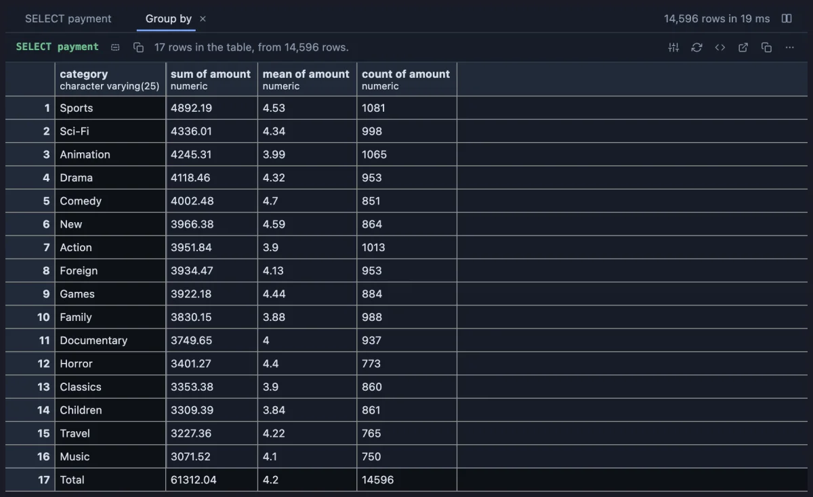
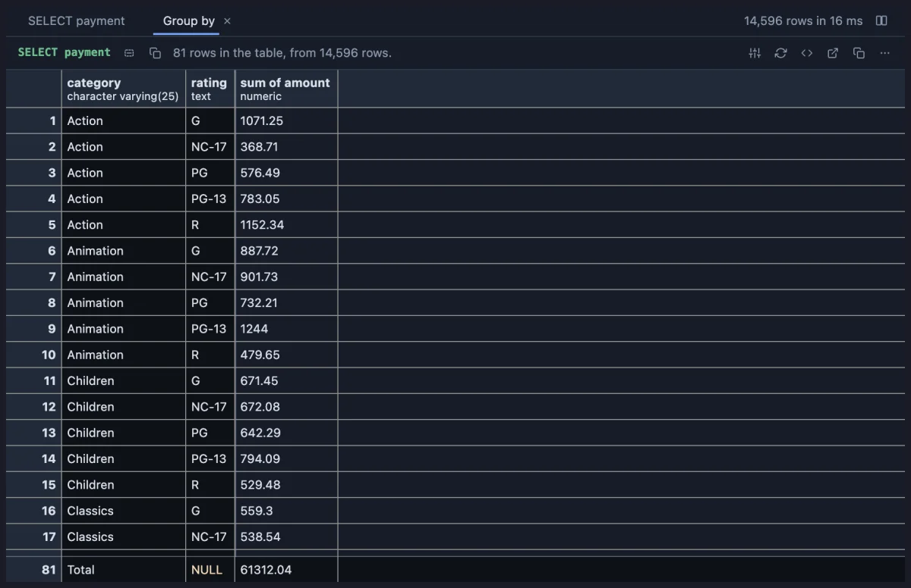

# Group by

Gather the rows that share a value into one row each, and add up, average or count what is in them: a spreadsheet's Subtotal or a PivotTable with one field, for a result you already have.



Every payment in dvdrental, gathered by the category of the film it paid for: one row per category with its total revenue, its average payment and how many payments it had, the biggest first, and a Total row over everything.

## What it is for

- **Totals per kind of thing**: revenue per category, hours per project, errors per server, without rewriting the query.
- **Several measures at once**: the sum, the average and the count side by side, up to three.
- **Two levels**: group by category and rating together, one row per pair.

## How to read it

A **Group by** tab opens beside the grid, a table of its own: one row per distinct value of the **Group by** columns, then one column per measure, named after what it computes (`sum of amount`, `mean of amount`, `count of amount`, or `rows` for a plain count). The Total row at the bottom folds the whole input the same way, so the total of an average is the average of every row, not an average of averages. An empty key is a group of its own.

## Try it

**Revenue by film category**, in the [dvdrental](https://neon.com/postgresql/postgresql-getting-started/postgresql-sample-database) sample database, the picture above:

```sql
-- @extension group-by open
-- @inputs by=category, m1=amount, f1=sum, m2=amount, f2=mean, m3=amount, f3=count
select c.name as category, f.rating::text as rating, p.amount
from payment p
     join rental r using (rental_id)
     join inventory i using (inventory_id)
     join film f using (film_id)
     join film_category fc using (film_id)
     join category c using (category_id);
```

**Two levels, sorted by the keys**: the same payments by category and rating.

```sql
-- @extension group-by open
-- @inputs by=category, rating, m1=amount, f1=sum, order=by group
select c.name as category, f.rating::text as rating, p.amount
from payment p
     join rental r using (rental_id)
     join inventory i using (inventory_id)
     join film f using (film_id)
     join film_category fc using (film_id)
     join category c using (category_id);
```



## Settings

| Setting | `@inputs` key | Default | What it does |
|---|---|---|---|
| Group by | `by` | none | The columns whose values form the groups, as a comma list |
| Measure 1 | `m1` | none | The column folded per group; without one, the rows are counted |
| Fold 1 | `f1` | sum | How it folds: `count`, `sum`, `mean`, `median`, `min`, `max`, `stdev` (how spread out), `p90` (the value 90 % of rows stay under) or `distinct` (how many different values) |
| Measure 2, Fold 2 | `m2`, `f2` | none, mean | A second measure; blank leaves it out |
| Measure 3, Fold 3 | `m3`, `f3` | none, max | A third measure; blank leaves it out |
| Order | `order` | by first measure | `by first measure`: largest first; `by group`: sorted by the keys; `as seen`: the order of the result |

## Good to know

`count` over a column counts its values and skips the empty ones, like SQL's `count(col)`; `distinct` counts different values, an empty one included as one. `stdev` is the sample standard deviation, `p90` the 90th percentile interpolated like `percentile_cont`. The Total row and the group columns stay in view while the rest scrolls. Up to 100,000 groups; rows past that are left out of the groups (the Total still counts them) and the Log says how many.

From a script: `-- @extension group-by` above the query, with `-- @inputs by=region, m1=amount, f1=sum` to answer the settings in the file. A pipeline charts the groups: `-- @extension group-by | echarts` (the Total row is not handed on, so the chart shows the groups alone). In SQL the same is a `GROUP BY` query; this is for a result you already have.

## Requirements

PostgreSQL 13 or newer. Nothing runs on the server: the groups are computed in the result's sandbox from the rows already fetched. Stats core installs with it.
