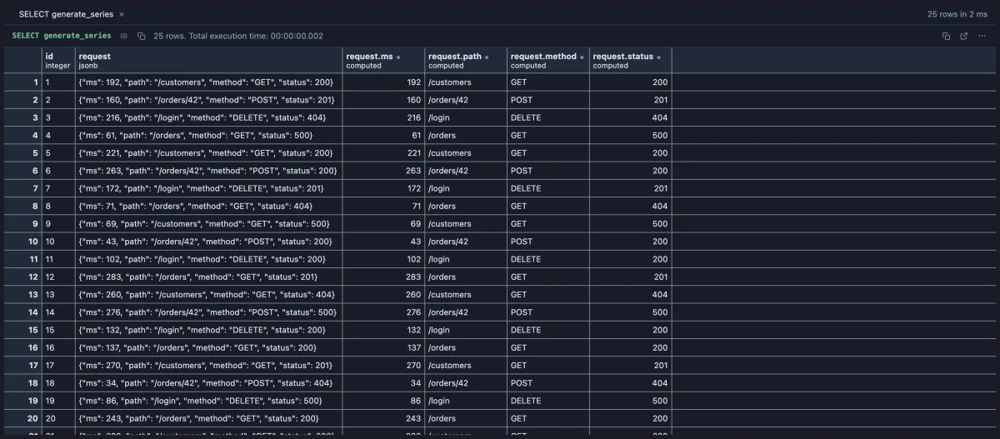
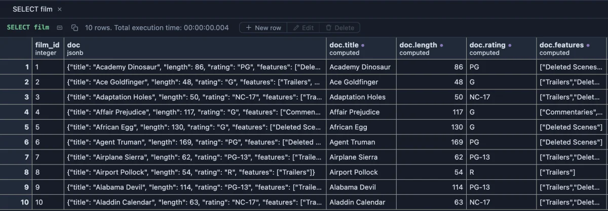

# JSON to columns

Opens a JSON column into ordinary columns right beside it: `{"method": "GET", "status": 200}` reads as a `method` column and a `status` column, so you can sort and filter by them like any other.



An API log whose details sit in one JSON column. Opened into columns, each field reads on its own: the method, the path, the status and the time in milliseconds, numbers aligned right, ready to sort by the slowest or filter to the errors.

## What it is for

- **Reading JSON without writing `->>'key'`**: event logs, API payloads, settings, form answers stored as JSON.
- **Sorting and filtering by a field inside**: the slowest requests, every order from one country, all events of one kind.
- **Seeing which keys a document has**: the columns are the keys found in the rows, in the order they first appear.

## How to read it

Every json and jsonb column of the result gets its keys as new columns right after it, headed `<column>.<key>` (`request.status`). Numbers stay numbers and line up on the right; a nested object or array reads as compact JSON. A key a row does not have is the grid's empty NULL, and a key that holds JSON `null` reads as a dimmed `null`, so a filter can tell the two apart. The original JSON column stays.

## Try it

**An API log** (any connection, made up on the spot), the picture above:

```sql
-- @extension json-to-columns
select g as id,
       jsonb_build_object('method', (array['GET', 'GET', 'POST', 'DELETE'])[1 + g % 4],
                          'path', (array['/orders', '/customers', '/orders/42', '/login'])[1 + g % 4],
                          'status', (array[200, 200, 201, 404, 500])[1 + g % 5],
                          'ms', round((20 + random() * 300)::numeric)) as request
from generate_series(1, 25) g;
```

**Films the way an API sends them**, in the [dvdrental](https://neon.com/postgresql/postgresql-getting-started/postgresql-sample-database) sample database: each film as a JSON document, opened back into columns, its list of special features shown as compact JSON in its own column.

```sql
-- @extension json-to-columns
select film_id,
       jsonb_build_object('title', title, 'length', length, 'rating', rating, 'features', special_features) as doc
from film
order by film_id
limit 10;
```



## Where it applies

Every json and jsonb column of every result the extension is attached to. There are no settings.

## Good to know

The keys are the ones found in the first 500 rows, up to 50 per column; a key that first shows up later gets no column, and the Log says when keys were left out. They are computed columns: they sort, filter, copy and save with the rest, and the result stays editable.

To follow a path into the document, or to turn an array into one row per element, use JSON to rows: it builds a table of its own. To attach this one from a script, put `-- @extension json-to-columns` above the query; on a result you can also turn it on from the result's own menu.

## Requirements

PostgreSQL 13 or newer. Nothing runs on the server: the keys are read from the rows already fetched.
