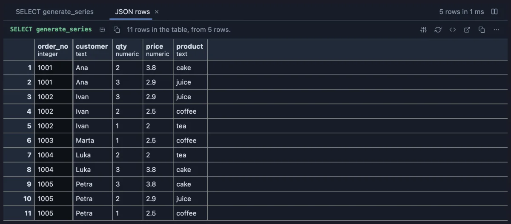
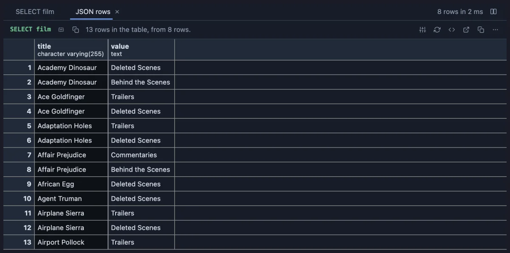

# JSON to rows

Opens a JSON column into a table of its own, and a list inside it into one row per item: an order's line items, a post's tags, a session's events, each on its own row.



Five orders, each with its items as a JSON list. Opened at the path `items`, every item is a row of its own with its product, quantity and price in columns, and the order's own columns (the order number and the customer) repeated in front, so the items can be sorted, filtered and added up.

## What it is for

- **Lists stored as JSON**: order lines, tags, addresses, attachments, read as rows instead of one long cell.
- **Going into a document**: a path like `address` or `meta.tags` opens just that part.
- **Then summing it**: the rows feed the other views, so the items can be grouped and totalled.

## How to read it

A **JSON rows** tab opens beside the grid, a table of its own. Without a **Path**, each row's JSON object becomes one row with a column per key. With a path, the view opens that part instead (`items` opens `doc->'items'`, `meta.tags` goes two levels down), and when the part is a list, each item becomes a row of its own. The result's other columns come first, unless **Other columns** is `drop`.

Numbers and true or false keep their type, so they align and sort as numbers. A key a row does not have is empty, and a JSON `null` reads as a dimmed `null`. A plain value (a number, a string) lands in a `value` column.

## Try it

**Orders and their items** (any connection, made up on the spot), the picture above:

```sql
-- @extension json-to-rows open
-- @inputs column=doc, path=items
select 1000 + g as order_no,
       (array['Ana', 'Ivan', 'Marta', 'Luka', 'Petra'])[g] as customer,
       jsonb_build_object(
         'items', (select jsonb_agg(jsonb_build_object(
                          'product', (array['coffee', 'tea', 'cake', 'juice'])[1 + (g + k) % 4],
                          'qty', 1 + (g * k) % 3,
                          'price', (array[2.5, 2.0, 3.8, 2.9])[1 + (g + k) % 4]))
                   from generate_series(1, 1 + g % 3) k)) as doc
from generate_series(1, 5) g;
```

**Every special feature of a film on its own row**, in the [dvdrental](https://neon.com/postgresql/postgresql-getting-started/postgresql-sample-database) sample database (the features are an array; as JSON, each opens into a row):

```sql
-- @extension json-to-rows open
-- @inputs column=info, path=features
select title, jsonb_build_object('rating', rating, 'features', to_jsonb(special_features)) as info
from film
order by title
limit 8;
```



## Settings

| Setting | `@inputs` key | Default | What it does |
|---|---|---|---|
| JSON column | `column` | asked | The json or jsonb column to open |
| Path | `path` | none | A dot path to open instead of the top level, like `items`, `address` or `meta.tags` |
| Other columns | `keep` | keep | `keep` shows the result's other columns first; `drop` shows the JSON alone |
| Arrays | `explode` | one row per element | A list at the path gives a row per item, or stays one cell of JSON text with `as text` |

## Good to know

The keys come in the order they are first seen across the rows, up to 100 of them; the Log says when keys were left out. A key with the same name as one of the kept columns shows as `name (2)`, so both stay visible. A key with a dot in its name cannot be reached by the path, which splits on every dot. The first kept column stays frozen while the rest scroll. The view reads the whole result.

For a quick look at the keys without a new table, JSON to columns adds them as columns right in the result. From a script: `-- @extension json-to-rows` above the query (add `open`, `only` or `beside` to choose how the tab opens), and `-- @inputs` to answer the settings in the file. A pipeline adds the items up: `-- @extension json-to-rows | group-by`.

## Requirements

PostgreSQL 13 or newer. Nothing runs on the server: the table is built from the rows already fetched.
