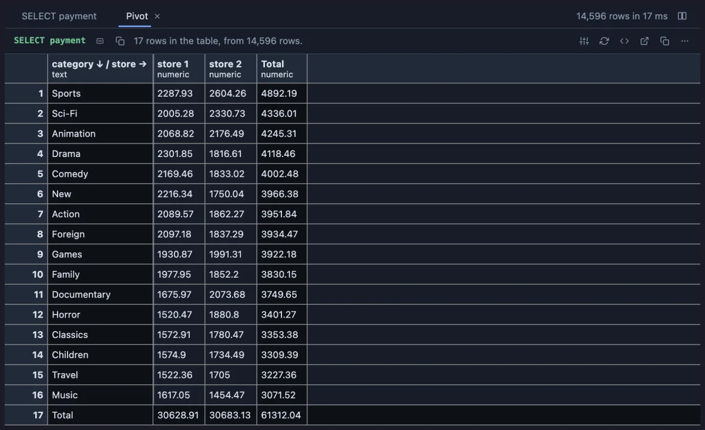
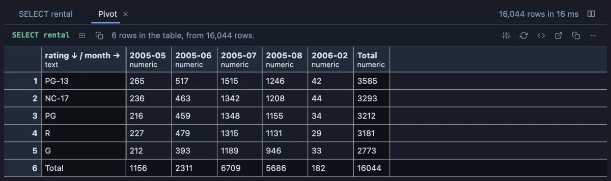

# Pivot

Turn a long list into a table: the values of one column down the side, of another across the top, and the numbers added up where they meet, like Excel's PivotTable.



dvdrental revenue, categories down the side and stores across the top. Each cell is one category's revenue in one store; the Total column and row add them up. Read across a row to compare the stores, down a column to compare the categories.

## What it is for

- **Two questions in one table**: sales by product and month, tickets by team and priority, errors by server and hour.
- **Spotting the odd cell**: one category that sells in one store and not the other stands out in a grid of numbers.
- **Counting combinations**: with no value, each cell counts the rows, so a pivot of rating against month shows what was rented when.

## How to read it

A **Pivot** tab opens beside the grid, a table of its own: one row per value of the **Row field**, one column per value of the **Column field**, each cell the **Value field** folded (summed by default) over the rows that have both. The Total column and the Total row add up across and down; they stay in view while the rest scrolls. An empty cell is 0 for a count or a sum and blank for a mean, a min or a max.

## Try it

**Revenue by category and store**, in the [dvdrental](https://neon.com/postgresql/postgresql-getting-started/postgresql-sample-database) sample database, the picture above:

```sql
-- @extension pivot open
-- @inputs rows=category, cols=store, value=amount, agg=sum
select c.name as category, 'store ' || i.store_id as store, p.amount
from payment p
     join rental r using (rental_id)
     join inventory i using (inventory_id)
     join film_category fc using (film_id)
     join category c using (category_id);
```

**What was rented when**: rentals counted by rating and month, no value needed.

```sql
-- @extension pivot open
-- @inputs rows=rating, cols=month, agg=count
select f.rating::text as rating, to_char(r.rental_date, 'YYYY-MM') as month
from rental r join inventory i using (inventory_id) join film f using (film_id);
```



## Settings

| Setting | `@inputs` key | Default | What it does |
|---|---|---|---|
| Row field | `rows` | asked | The column whose values go down the side |
| Column field | `cols` | none | The column whose values go across the top; without one, a single total column |
| Value field | `value` | none | The number added up in each cell; without one, the rows are counted |
| Fold | `agg` | sum | How a cell combines its values: `sum`, `count`, `mean`, `min` or `max` |
| Row order | `order` | by total | `by total`: the biggest row first; `as seen`: the order of the result |

## Good to know

It folds the whole result (a million rows in a pass) into a table of at most 500 rows by 60 columns; filter in SQL to choose which. The columns come in order, numerically when they are numbers. To pivot by two columns down the side, join them in the query: `select a || ' · ' || b as row_field`. The table selects, copies, filters and exports like any result.

From a script: `-- @extension pivot` (plus `open`, `only` or `beside` for how the view opens) above the query, and `-- @inputs` to answer the settings in the file so the dialog never shows. A pipeline charts it: `-- @extension pivot | echarts`. Unpivot does the opposite, a wide table back into a long list.

## Requirements

PostgreSQL 13 or newer. Nothing runs on the server: the table is built in the result's sandbox from the rows already fetched.
