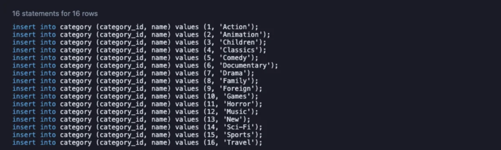
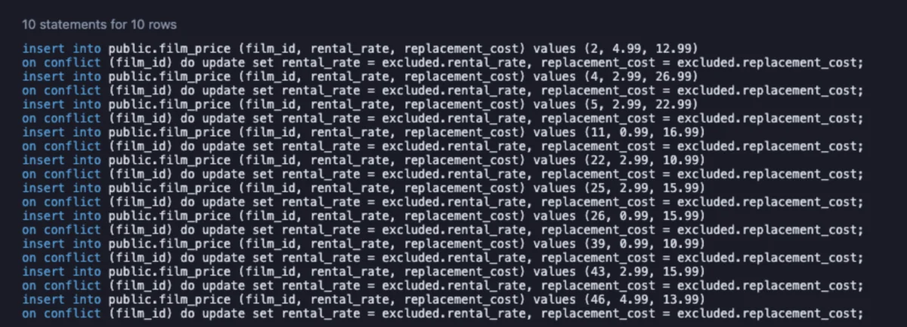

# Rows as SQL

Turn the rows you are looking at into SQL statements you can run somewhere else: INSERTs to copy them into another database, UPDATEs to change them, or upserts that do either.



dvdrental's sixteen film categories as INSERT statements, one per row, values quoted the way PostgreSQL reads them back. Copy them, paste them into a script on another server, and the categories are there.

## What it is for

- **Copying a few rows between databases**: from production to a test database, from one customer's schema to another.
- **A seed file**: the rows a fresh database needs (categories, countries, settings) as a script to keep in git.
- **Turning a look into a change**: you found the rows that need fixing; the UPDATE statements are written for you to edit and run.

## How to read it

A **SQL** tab opens beside the grid with the statements, and a line above them saying how many were written for how many rows. **Copy** copies every statement; **Copy first 100 rows** only those for the first hundred. Nothing is run: the statements are text until you paste and run them yourself.

| Statements | What you get |
|---|---|
| insert | `insert into t (a, b) values (...);` for every row |
| multi-row insert | one `insert ... values (...), (...), ...;` per batch of rows, faster to run |
| update | `update t set b = ... where a = ...;` for every row, the key columns in the WHERE |
| upsert | `insert ... on conflict (a) do update set b = excluded.b;`: insert, or update when the key is already there |

## Try it

**Copy the categories somewhere else**, in the [dvdrental](https://neon.com/postgresql/postgresql-getting-started/postgresql-sample-database) sample database, the picture above:

```sql
-- @extension rows-as-sql open
-- @inputs table=category, kind=insert
select category_id, name
from category
order by category_id;
```

**Bring the prices of a few films up to date on another server**: upserts by the film's id, which insert a film that is missing and update one that is there.

```sql
-- @extension rows-as-sql open
-- @inputs table=public.film_price, kind=upsert, keys=film_id
select film_id, rental_rate, replacement_cost
from film
where rating = 'G'
order by film_id
limit 10;
```



## Settings

| Setting | `@inputs` key | Default | What it does |
|---|---|---|---|
| Target table | `table` | my_table | The table the statements write to, with its schema if you like (`public.film`) |
| Statements | `kind` | insert | `insert`, `multi-row insert`, `update` or `upsert` |
| Key columns | `keys` | none | The columns that identify a row: the WHERE of an UPDATE, the ON CONFLICT of an upsert |
| Rows per INSERT | `batch` | 100 | For a multi-row insert, how many rows one statement carries |
| Top rows | `top` | 10000 | How many rows the view reads from the result, from the first one |

## In Copy As and Save As

The extension also adds four formats to every result grid: **SQL INSERT**, **SQL multi-row INSERT** (100 rows a statement), **SQL UPDATE** and **SQL upsert**. Pick one under Copy As or Save As in the result's dots menu (or the menu of a cell, a row or a column) to copy or save the selection, or everything when nothing is selected, without opening the tab. Pick one under Copy Format and the copy shortcut uses it from then on.

These formats need no settings. They write to the table the result was read from when PlumeSQL knows it (a query on one table) and use that table's primary key for an UPDATE or an upsert. For anything else (a join, an expression) the statements write to `my_table`, and an UPDATE or an upsert stops with a line in the Log asking for the SQL tab, where you pick the table and the key yourself.

## Good to know

The values are written as PostgreSQL reads them back: text with its quotes doubled, NULL as `NULL`, numbers bare, booleans as `true` and `false`. A json or jsonb value, an array, a uuid, a date, a time, a timestamp, an interval and a network address carry an explicit cast (`'{"a":1}'::jsonb`, `'{x,y}'::text[]`), so the statement says what it holds even pasted outside an INSERT. Column and table names are quoted only where they must be; in the SQL tab the target table is used exactly as typed. A NULL key reads `is null` in an UPDATE's WHERE. An upsert needs a unique index or constraint on its key columns in the target table, and an upsert whose every column is a key writes `do nothing`.

A column that appears twice in the result is written once. A generated or identity column is written like any other, so leave it out of the query if the target fills it in itself. The panel shows the first 400,000 characters of a long script; Copy still copies all of it.

From a script: `-- @extension rows-as-sql` above the query (add `open`, `only` or `beside` to choose how the tab opens), and `-- @inputs` to answer the settings in the file.

## Requirements

PostgreSQL 13 or newer. Nothing runs on the server: the SQL is written in the result's sandbox from the rows already fetched.
