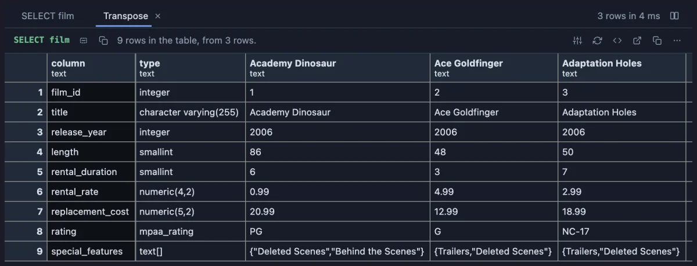
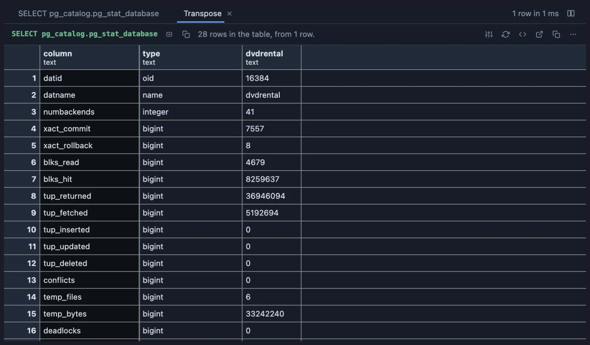

# Transpose

Turn the table on its side: columns become rows and rows become columns, so a few wide rows read side by side, like comparing products on a shop's comparison page.



Three dvdrental films, one column each, every field of the film table down the rows: their lengths, prices and ratings line up for comparing, instead of hiding at the far right of a wide row.

## What it is for

- **Comparing a few things field by field**: two customers, three products, last month's and this month's settings.
- **Reading one wide row**: a table with forty columns reads top to bottom instead of scrolling sideways (psql's `\x`).
- **Spotting the difference**: two rows that should be the same, side by side, show where they are not.

## How to read it

A **Transpose** tab opens beside the grid, a table of its own: one row per column of the result, with the column's name and type first, then one column per row of the result. The columns are numbered 1, 2, 3, or named after a column you pick in **Column names from** (a title, a code). The first column stays in view while the rest scroll sideways.

## Try it

**Three films side by side**, in the [dvdrental](https://neon.com/postgresql/postgresql-getting-started/postgresql-sample-database) sample database, the picture above:

```sql
-- @extension transpose open
-- @inputs names=title
select film_id, title, release_year, length, rental_duration, rental_rate, replacement_cost, rating, special_features
from film
where film_id in (1, 2, 3);
```

**One wide row read top to bottom** (any connection): this database's statistics, one line per counter.

```sql
-- @extension transpose open
-- @inputs names=datname
select * from pg_catalog.pg_stat_database where datname = current_database();
```



## Settings

| Setting | `@inputs` key | Default | What it does |
|---|---|---|---|
| Column names from | `names` | numbered | A column whose values name the new columns (a title, a code); repeated names are numbered |
| Rows to turn | `top` | 60 | How many rows of the result become columns, from the first one (at most 500) |

## Good to know

Made for a few wide rows, not a long result: past a few dozen columns the table scrolls sideways a lot, so narrow the query first. Every value reads as text in the turned table. The table selects, copies, filters and exports like any result.

From a script: `-- @extension transpose open` above the query lands on the table after Run (`only` hides the grid, `beside` splits the two), or attach it from the result's menu; `-- @inputs names=airport_code` answers the setting in the file so nothing asks.

## Requirements

PostgreSQL 13 or newer. Nothing runs on the server: the table is turned in the result's sandbox from the rows already fetched.
